# yutinghaofinance_jP2PllUUXrI — 關鍵畫面索引

- 來源逐字稿：[yutinghaofinance_jP2PllUUXrI_GT.srt](yutinghaofinance_jP2PllUUXrI_GT.srt)
- 影片：https://www.youtube.com/watch?v=jP2PllUUXrI
- 截圖數：37

## 00:00:24

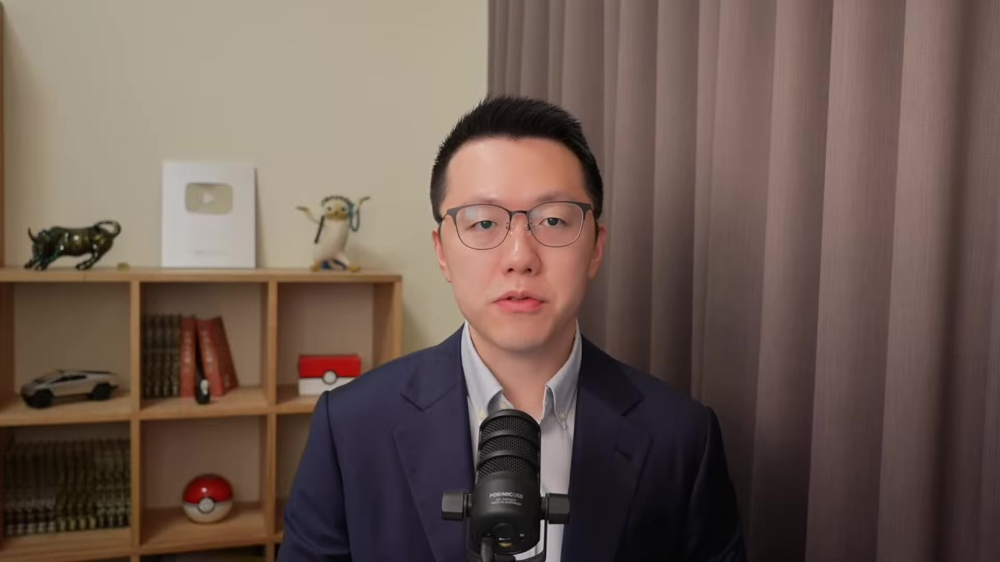

**逐字稿片段：** 現在是臺北時間2026年10月29號禮拜四 早上8:31 大家早安 我是游庭皓 每天早上開盤前半小時 我們在這邊陪伴著各位 一起解讀國際財經新聞 時事變化 昨天美國股市雖然 三大指數是全面收高 已經連續第三個交易日下跌了 不過盤後股價還是有點鬆動 這一次我們看到 不管是微軟財報 還是Google財報 或者甲骨文的前瞻預期 開始透露出市場針對 未來AI發展趨勢的分歧 畢竟其實昨天微軟 公佈的財報整體的雲端 銷售表現非常之不錯 微軟股價也是直接噴出

**話題推測：** 介紹日期時間，可能搭配標題頁面。

---

## 00:01:01

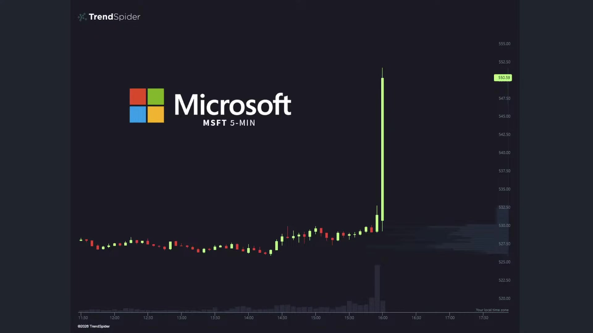

**逐字稿片段：** 可是Google的股價 阿發貝卻因為財報整體表現不如預期 誒結果股價反而重挫10% 這兩個也太極端了 本來 微軟是過去一年當中 在七巨頭其實表現算比較疲憊的哦 但過去半年是急起直追哦 結果Google本來是遠遠領先的現在 好像有所鬆 微軟不軟了 Google不硬了 要如何理解這種情況呢

**話題推測：** 轉向Google（阿發貝）股價重挫與財報表現，可能顯示Google股價走勢圖或財報摘要。

---

## 00:01:27

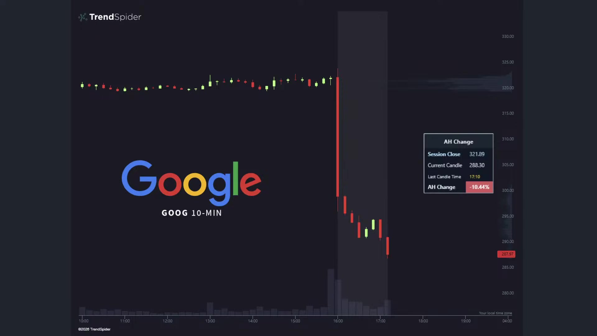

**逐字稿片段：** 與此同時 我們知道FOMC利率決策會議 這一次開完會議之後 整體的升息預期只步 過是延到12月左右 那這樣的效果會導致未來 的貨幣政策是否會限制住 這些大企業融資的成本呢 今天來跟投資朋友多做些觀察 我們先從聯總會 這一次的FOMC會議來聊起

**話題推測：** 切換至FOMC利率決策會議新話題，預計顯示聯準會相關圖表或新聞畫面。

---

## 00:01:48

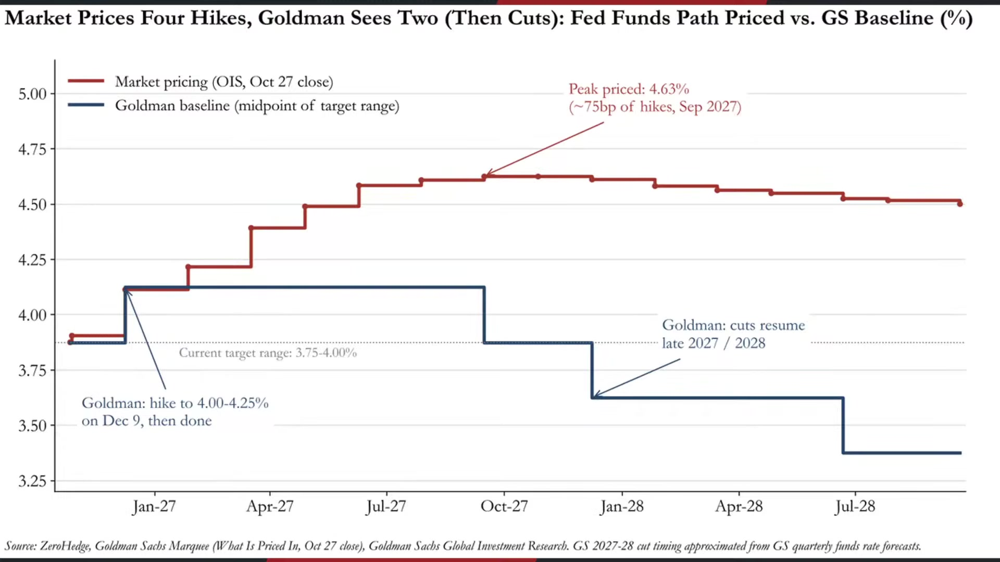

**逐字稿片段：** 這一次把聯邦資金 利率目標區間還是定在3.75-4 % 算是符合市場預期 沒有升息 不過呢 12月份的升息預期並沒有消失 而且這一次 決策也不是全體官員一致同意 最終是10票贊成 兩票反對通過 反對者一個就是川普的死對頭Lisa Cook 另外一個呢 是克裡夫蘭的銀行總裁哈馬克 兩個人都主張再升息一碼 把利率提升到4%到4.25%區間 連總會在會後的聲明其實強調說 因為未來幾周會有更多的經濟數據 有助於判斷到底當前 通膨有沒有機會回到2% 那連總會目前其實也沒有很明確暗示 說這次會議紀要12月份一定要升息嘛 一方面是 那華許根本就不願意做太多的表態 他認為越少表態越好 我們就停看停 另外一方面呢 的確因為時間線就拉很長了 現在有11月有12月 所以呢後續再來多做一些留意 再到時候根據數據來做判斷 這是聯總會目前的立場 但是華許至少在物價穩定層面呢 它的側重性還是很大的 他並不是說不在乎就業 而是說相對於就業市場而言 物價穩定是目前排在就業之前的

**話題推測：** 提及聯邦資金利率目標區間具體數字，可能顯示利率目標區間圖表。

---

## 00:03:03

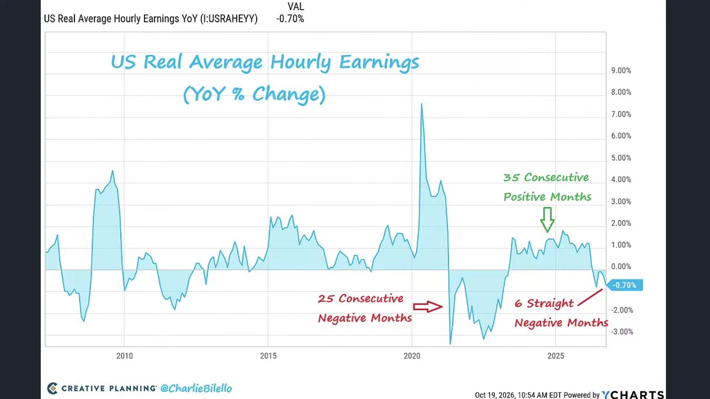

**逐字稿片段：** 他認為美國勞動力 市場目前仍然非常健康 失業率甚至比一年前還要來得更低 這算是十幾年來的最低水準 所以真正現在美國的就業問題 是屬於實質購買力衰退的問題 我們看當時在2024年到2025年 美國實質薪資曾經連續 快要接近3年左右翻正哦 這代表著美國其實在過去兩 到三年有一段時間真的是 薪資漲幅是跑贏通膨漲幅的 可是呢這個數據就在今年3月 份以後就快速的下彎 開始進入到實質薪資的負衰退 那是什麼原因 很明顯是美伊戰事嘛 所以華許說不是不在乎就業 而是現在在就業市場當中 大家更為在乎的是 實質購買力的問題 那麼我們目前應該要把物價給往下壓 才能夠確保目前的薪資漲贏物價 那協力廠商面呢 當然就是美依戰事的部分了 那華許當然 他是川普提名的 也不會做過多的批評 主要還是來分析汽油 柴油相關產品的價格上漲 所以導致外溢到其他商品和服務類別 華許其實也承認說 過去 如果只是單純能源上漲 通脹預期感不會這麼強烈 那現在這種拉伸呢 很明顯就是有外溢的效果

**話題推測：** 談論美國勞動力市場和失業率，可能顯示失業率或就業數據圖表。

---

## 00:04:18

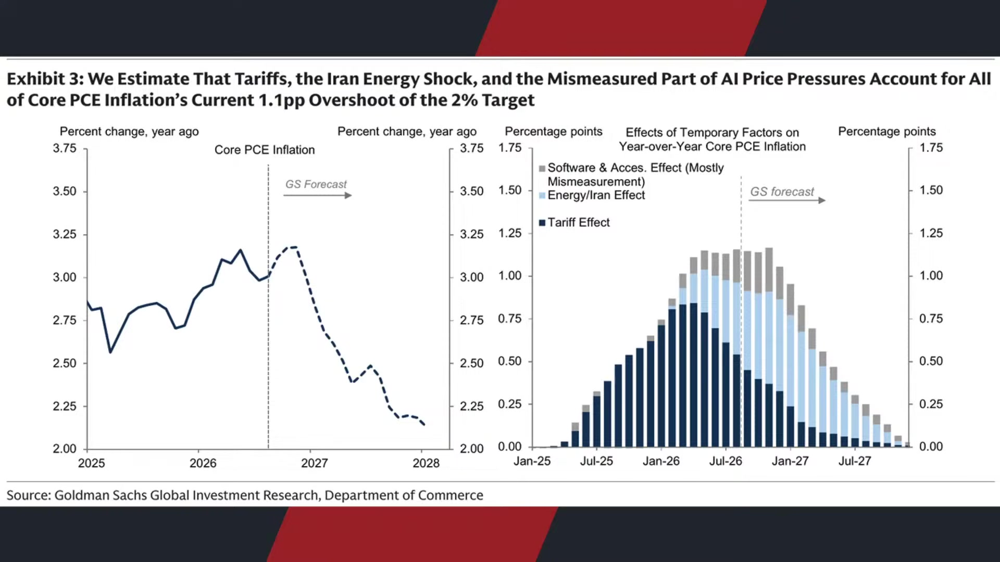

**逐字稿片段：** 目前美國的核心個人消費者 物價指數大概是3.1% 這說明核心端已經開始反映能源端了 那 包括川普的關稅政策 它有滯後的效果 伊朗的能源充齊現在呢 也有AI帶動軟體和配件價格的上漲 都會導致現在的 統計值比想像中來得高 那唯一好處就是 雖然通膨是高了

**話題推測：** 提及美國核心個人消費者物價指數具體數字，可能顯示PCE指數圖表。

---

## 00:04:41

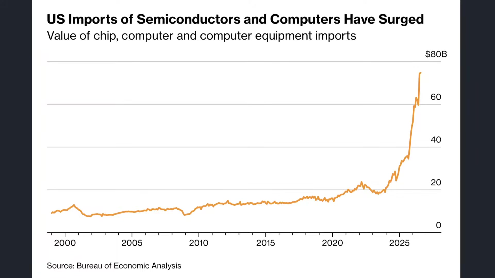

**逐字稿片段：** 可是經濟成長也很快 第三季的GDP預估會成長到3.2%呢 好這其實就說明著 本來在今年一二季度 我們都還算是穩健擴張 因為大概在1.8 然後到2 %左右嘛 現在瞬間掉到3 % 其實就說明著整個增速正在加快哦 目前我們幾乎可以肯定 美國的經濟屬於強勁擴張 你說那強勁擴張 臺灣11 %算什麼 算天靈蓋式的擴張了 所以整體而言呢 我們必須承認 AI現在的確造成了某種物價通脹 的確造成了某種極化 可是已經成為了撐住 美國經濟的重要關鍵 畢竟從現在未來8年的投資來看 大概也會接近有10.3兆美元的投資 這個規模就有機會 超越歷史的鐵路建設 過往我們看 不管是鐵路建設 或者 我們看到工業革命呢 的確對於經濟投資在初期 可能都是0.8到1個百分點呢 但如果這個比重越來越大的話 那就有可能來到兩到三本線左右 AI就有可能撐起1/3左右 的美國經濟成長 再來呢就是高利率 也讓華許認為 AI投資熱潮 是高利率造成的一個重要原因 現在的利率預期 不能夠完全怪給伊朗戰事 伊朗戰事提高利率當然不能夠下降 可是公債殖利率不斷的瘋狂的往上走 他也不認為完全歸咎於能源因為 原油期貨價格並沒有 持續的創下新高 重點還是來自於 資金本身更稀缺了 所以AI投資熱潮的旺盛 本身就是高利率的一種可能性 或者說一種傳導效果 那現在呢 華許認為 高利率讓資金重新挑選投資標的 這種狀態其實是相對健康的 最後就是金融環境 他認為已經收緊了 美國總體金融環境 他認為其實過去幾個季度 其實都還算偏寬鬆了 那就是沒那麼寬鬆 你也不要認為他多緊 他認為流動性現在其實 還勉強可以撐過去 重點其實來自於12月份 到時候的升息預期變化 會不會導致市場有 流動性預期的賣壓呢 來就是這樣子 因為現在華爾街跟花許哦 幾乎是屬於完全對賭狀態 因為大家都不知道你 下個季度會怎麼做 你也沒有明確的現在是升息路徑嗎 還是現在有機會進入到降息循環 都不確認 因為已經沒有前站溝通了最後呢 雙方就這樣子 預判來預判去 我預判你的預判 你在預判我的預判的預判 最後就形成現在的僵局 12月份到底是升還是不能 不太可能降息 還是不升 這件事情其實還是很難說的那至少 鮑威爾把這個想像空間留給了市場

**話題推測：** 談論第三季GDP成長預估，可能顯示GDP成長率圖表。

---

## 00:07:18

**逐字稿片段：** 那最後呢 是聯邦總會重大制度的改革 2027年呢只會投7次票 2028年預估會投到只有6次票左右 好這個是鮑威爾過往他 採取的一個制度改革 基本上他希望能夠減少聯邦會 參與市場決定利率的空間 決策權以及頻率 用這樣的一個方式 能夠往更廣泛的貨幣政策來做研究 也是政策放慢 減少前瞻指引呢 那當然就代表著 聯總會不會再輕易的去 預告未來的利率方向 華許的態度很明確 除非是重大的危機 或者極端的緊急情況 否則華許或者聯總會未來 不會預先承諾未來可能往 升息或者往降息的方向走 永遠都是停看聽 即便我可能升了兩次 也不代表我下一次升的幾率很高哦 這個就華許目前的態度 除非遇到金融海嘯 那我就告訴你 我可能要寬鬆一年 寬鬆兩年 把你的信心給救回來 好這個就是一個新常態 好所以不管怎麼說了 這一次如果我們把它做一個統整 聯準會過去 歷次經歷了不同的升息循環 那升息幅度 最大的是從2022年的3月 到2023年的7月份左右 累計16個月 整體的升息幅度高達525個基點了 好那現在問題就在於 我們都知道未來偏 緊縮的可能性是高的 畢竟整個利率預期不斷的走升嘛 可是呢 我們又無法確認聯總會一定會升 為什麼 因為他不告訴你現在是不是升息迴圈 這是最大的區別 以前鮑爾都會透露出 沒錯現在就是偏 緊的循環沒錯 現在就是偏鴿 那華雪這個態度就是 等下一次數據出來 你自己判定 我到時候再告訴你 這大概是市場的感覺 那當然從通膨因子 從AI因子以外 現在對於美國政府而言呢 比較大的壓力 其實就來自於美國公債 市場是否能夠撐得下去 這個方面 華雪並沒有做太多的表態 因為如果公債殖利率真的這麼高哦 那美國政府的財政問題 發債成本壓力其實就算是蠻大的 我們從美國美債市場來看哦

**話題推測：** 介紹聯準會重大制度改革，涉及投票次數減少，可能顯示決策會議頻率圖表。

---

## 00:09:21

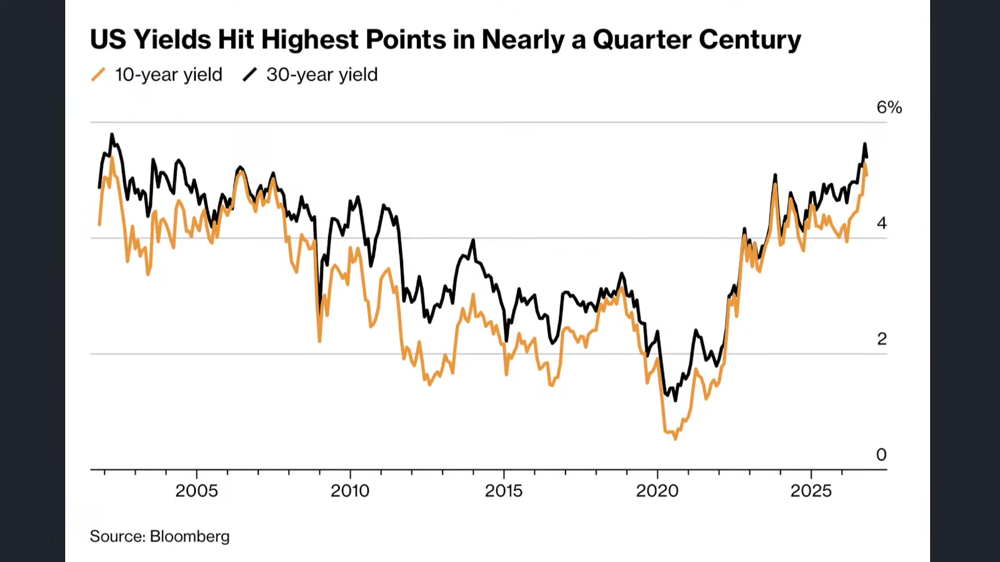

**逐字稿片段：** 現在的確內部的結構出現 了比較大的一個轉變了 過去20年間 美國公債的規模大概 擴張了接近有7倍左右 達到32兆美元 但買家跟組成已經跟過去大不相同 我們以外國政府各國 央行和退休基金來看 以前都是長期的主要持有者但是呢 現在私人投資者持有的美國公債 大概已經接近到70%了 這是1990年以來的最高 避險基金大概是2.7兆 占大概8.5% 也成為了一個重要買盤 那與央行不同 因為私人投資者 他常常一下就全部出清 他跟那個 以前那種臺灣央行 日本央行不一樣 那就買了就放著 買了就放著嘛 但是對於一般投資人而言呢 他有可能今天買美債ETF 明天就給你出清了 造成美債的波動性有可能持續加大 這個是市場上會擔憂的 這也是美國政府擔憂的 就說如果以前呢 那個利率 可能慢慢走深 可是主要買家都是海外 的央行或者退休基金 那這樣的話 某種程度而言呢 它至少可以維持住美債的穩定買盤 就算它不想買了 它也是漸漸的不買 也不會一次就出清了但是呢 現在市場上 很明顯私人投資者越來越多以後 對於公債殖利率也會 相對來得更加敏感

**話題推測：** 介紹美國公債規模擴張數據，可能顯示美國國債總額圖表。

---

## 00:10:39

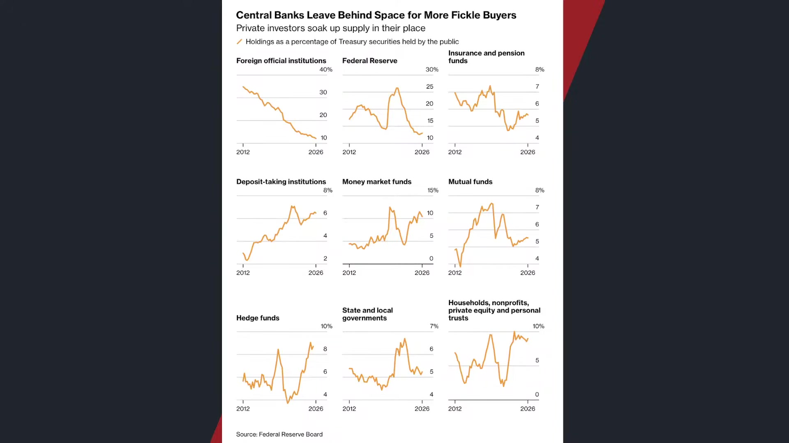

**逐字稿片段：** 尤其過去長期協助 美國政府融資的亞洲盟友 最近也在大幅的減少購買美債

**話題推測：** 聚焦亞洲盟友減少購買美債的現象，可能顯示各國美債持有量變化圖。

---

## 00:10:46

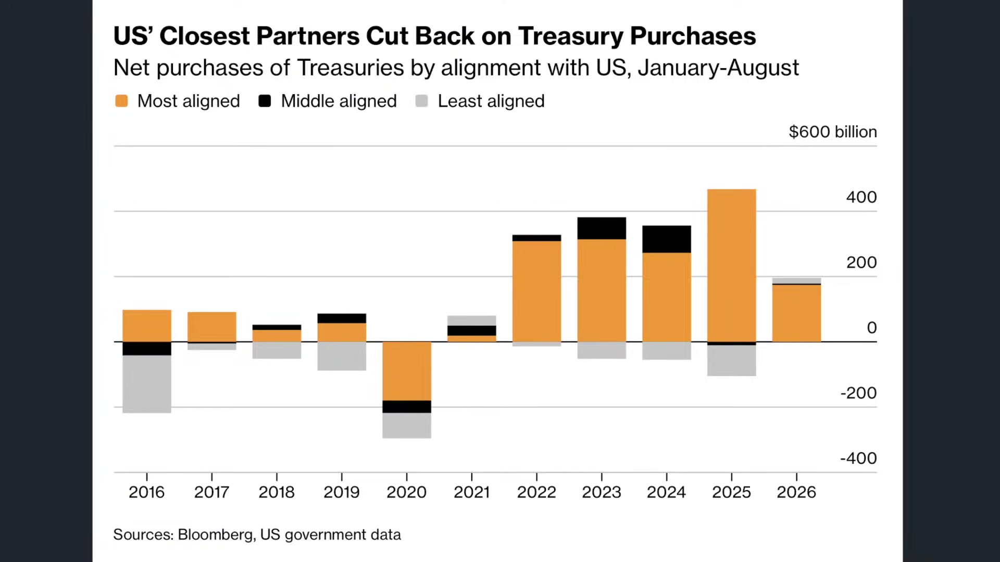

**逐字稿片段：** 我們根據彭博的分析發現呢 今年前8個月 跟美國外交立場相對接近的國家 一共買進了1,743億美元 的中長期的美國公債 可是這個買盤哦 比去年少了6成哦 日本還是全球最大的 外國的美債持有者 但今年8月才買3.8億美元 比去年同期暴減了99% 那當然跟日本央行的升息是有關 還有日央的 護盤政策 南韓賣了238億美元的美債 這是1977年有史以來最大的賣超紀錄 臺灣呢也屬於淨賣方 那造成這種原因的結果 其實還是很複雜的啦 一方面你看日元韓元的貶值 所以有部分資金回流嘛 亞洲股市吸引投資哦 所以日本和歐洲公債殖利率上升可是 唉那臺灣央行又沒升息 那臺灣人在賣什麼呢 也許也是適度的資金上的配置 或者主流投資意見的轉變 臺灣人現在聰明到連 買房都不太願意了 誰要去買債 唉結果股市資金全部都灌進來了 所以也不代表說你說 亞洲盟友不信任美國了 或者說川普已經沒有能力去 命令這些人接受美債了 只能說呢 市場全球資金的配置正在改變了 我不能說是美元霸權瓦解了 只能說是在這個年頭 美債已經變成一種 不太是傳統的避險資產了 其實如果我們細節來做觀察 那南韓資金現在很明顯偏好股票嘛 臺灣呢也流向了股市和流向了存款 日本投資人對於本國公債 殖利率都創下10年高點了 日本人連日債都不買了 你還要叫我買美債 所以總體而言 美國公債也不是完全找不到買家 但是大家都開始計較計較那個利率 你給我這麼一低低 那個投資等級債殖利率多高 我去買輝達 我去買本國大盤指數 那個報酬是你的好幾倍 還要繼續買嗎 所以我們也不要預設立場說 好像台日韓現在都在減持美債 開始不信任美國了 或者川普已經叫不動了 這通常很多人想到就覺得 我還能在美國財政 應該要出問題了 連盟友都不相信美元了 也沒有這麼嚴重 這叫預設立場 日本現在減少美債 我覺得主要是因為日本 公債殖利率提高速度太快 韓國減持應該跟匯率跟資產配置有關 那臺灣臺灣很明顯嘛 臺灣現在只買股票 除了股票 房子什麼都不想要買 當然 跟最近那個臺灣經濟走高 出口創高 台幣重貶是一樣的 就是很多人會預設立場嘛 會覺得那央行是不是在阻升 在搞事 但其實你稍微看一下 現在台商的對外投資 你大概也發現這些 台商賺了美元好像也不急著換回來了 要直接在美國直接就地擴廠嘛 所以就造成了台幣的 買盤沒有想像中來的大 所以這種總體經濟 我們倒是不要先預設立場 之前看到一個男孩 跟女孩子出去吃飯 那女的很直接 開門見山 問男的 你請我吃飯是不是想睡我 男的很生氣呀 我哪有要請客！ 所以投資最重要的一件 事情就是不要預設立場 很多時候我們看到一個現象 就急著想要替它找原因呢 甚至還沒有弄清楚事實 就已經認定背後一定 有什麼樣的陰謀 很多人覺得好像今年大家都不買美債 那美元體系是不是要崩了 連盟友都不願意承接 其實就是新的時代來臨以後 所有投資人的觀念都已經改變了 尤其現在私人買盤已經 默默地大於央行買盤了 私人跟央行最大的區別在於 央行買了 他都是做長年期規劃的 那私人部門今天買了避險基金 搞不好明天全部給你出光 造成美債的波動性持續加大 好那這個是第二層 我們看到對於美國公債的壓力 也是美國政府端的壓力 華許還沒有表態 但這一定是未來需要顧忌的方向 直利再這麼升上去哦 真的沒有人要買了 而且價格對於美國公債的 發債成本會來得越來越大

**話題推測：** 引用彭博分析數據，可能顯示相關數據表格或圖表。

---

## 00:14:39

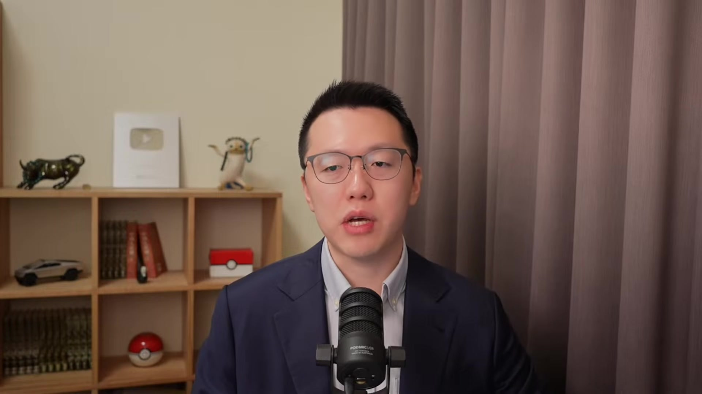

**逐字稿片段：** 那第三層當然是我們 最近看到的AI通膨 從整體AI的PPI 我們講的零組件通膨

**話題推測：** 切換至AI通膨與零組件通膨話題，可能顯示AI相關PPI指數圖表。

---

## 00:14:47

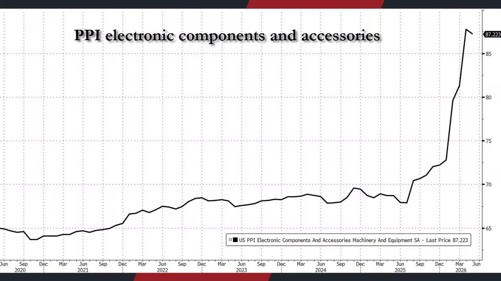

**逐字稿片段：** 我們知道在本季度 已經上升到87%了 這個水準其實非常高 我們的比定價格就算今年 漲價也沒有漲到這麼離譜 大概只平均漲兩成到三成 說明著現在的AI通膨 主要還是集中在資料中心端 由科技巨頭進行優先的吸收 那遲早 這種通膨如果明年 還沒有快速的年增地緩 那他遲早要轉嫁 他轉嫁的唯一效果是什麼 調漲AI費用嘛 那你說調漲AI費用會 影響到他們的市占率 沒錯所以某種程度來說 就必須要麼靠市場的消費力的提升 要麼呢就是你對於AI的生產力 已經有某種程度的依賴 必須要遷入到實體民間的生活 現在其實美國的經濟就是這樣子了 通膨真的是很嚴重 實質購買力衰退也是真的 可是對於大量的中產和資產而言呢 這場遊戲還勉強玩得 下去的原因就來自於 股市漲幅至少還是遠遠跑贏通膨的嘛

**話題推測：** 提及本季度AI相關PPI上升到87%，可能在圖表上強調此數值。

---

## 00:15:42

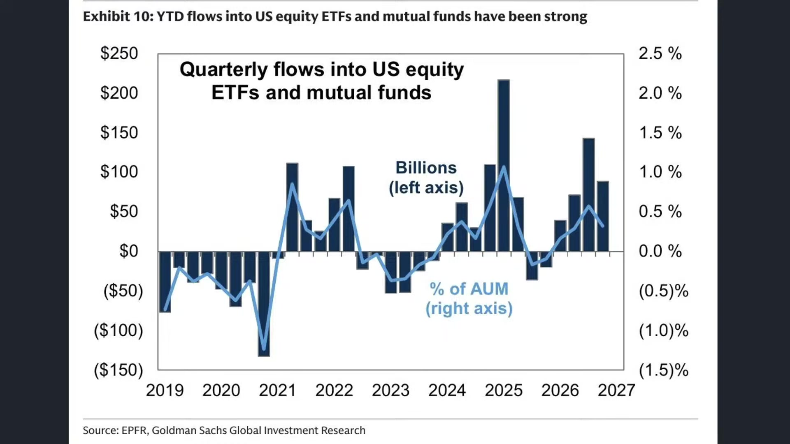

**逐字稿片段：** 如果我們細看呢 美國散戶的交易熱度雖然 相對於今年中旬已經下滑了 可是透過ETF和共同基金 投入股市的長期資金 買盤還是非常強勁的 我們看整個二季度大概是流入了700億 第三季美國股市有1,400 億的買買盤來湧入 第四季大概現在也有900億左右 這說明其實今年整個26年到27年 雖然 可能曾經在3月份呢 或者7月份有適度去杠杆 但總體來說大家還是願意接盤的 這也導致美國股市的財富效應呢 就開始做高度集中了

**話題推測：** 討論美國散戶與機構資金投入股市的熱度與買盤，可能顯示資金流向圖表。

---

## 00:16:16

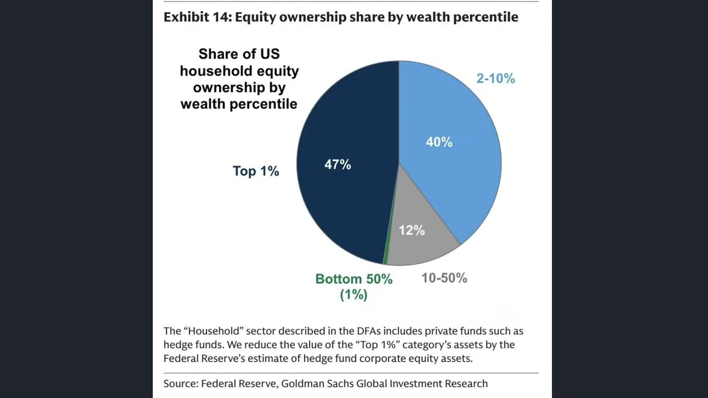

**逐字稿片段：** 美國財富排名前一趴的家庭 大概持有全美國家庭股票資產的47% 排名二%到第十% 大概持有40%左右 所以總體而言呢 你把前面前十%的家庭全部加起來 大概持有了全美87%的股票 所以從這樣的一個角度來看 你就可以瞭解 只要這些人他消費還在持續 那整個消費就撐住了 那相反的 就算大多數人都不消費 只要這些人還在消費 那經濟感覺也可以往上走 那再往換個方向想 就算所有人都在消費 只要頂層的家庭不消費 那經濟一樣會不好 這就是k型化集中 總體經濟的向好 完全取決於這10% 的人的消費習慣 這是真實跡象 所以從不同角度來做觀察 會發現內部AI的極化 正在產生分歧 那當然某種程度來說 等同於未來的k型 經濟會來得更加嚴重 可是也說明著接下來 聯總會能夠做的事情 其實非常有限的 因為你如果再聲習 說明實體民間已經不是特別好了 沒有太多空間 美國政府的債務壓力 融資成本也是如此 但是呢你說要往降息的方向走 更沒有太多機會 因為現在通膨的確處於高位 只能保持在這樣的一個區間 期待生產力提升 有一天我們的薪資重新追上通膨 好那回過頭說現在美股

**話題推測：** 分析美國財富集中度，特別是前1%家庭持有股票資產的比例，可能顯示財富分配圓餅圖或長條圖。

---

## 00:17:39

**逐字稿片段：** 股市四大指數表現 道瓊指數上漲97點 0.19% 收在52,475點 標普上漲21點 0.28% 收在7,743點 納指上漲72點 0.27% 收在26,549點 費半上漲2百零一點 1.76% 收在11,684點

**話題推測：** 回歸美股四大指數表現，可能顯示即時指數畫面或日線圖。

---

## 00:18:00

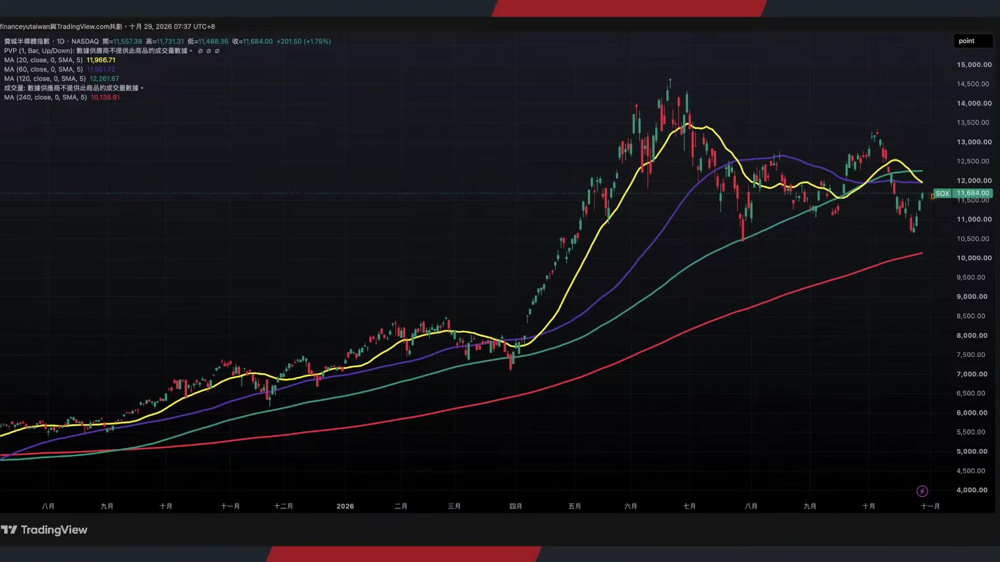

**逐字稿片段：** 如果我們細看 在昨天財報公佈 兩大巨頭當中 包括微軟和Google 兩方是呈現不同的方向 我們先看微軟的部分 微軟這一次營收是高達922億美元 年增幅19% 比預期來得高 每股盈餘是4.89塊 也比預估的4.73塊來得高 盤後股價大概漲4 %左右 那最大亮點當然是來自於雲端業務

**話題推測：** 再次詳細分析微軟和Google財報，可能顯示兩家公司的財報比較圖。

---

## 00:18:24

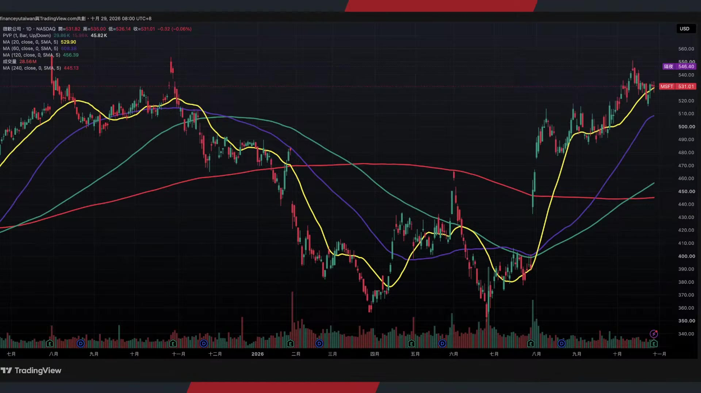

**逐字稿片段：** Azure的單季營收331億 也年增幅有48% 比前一個季度42還來得快 說明看起來這個AI的業務雲端收入還 勉強可以保持在40趴到50趴的快速拉升 那與此同時 棄業已經簽約 但還沒有轉為認列 未來營收是高達6,771 年增幅有73 % 這說明其實未來AI前景 看起來非常非常不錯 即便你要知道傳統業務正在弱化 像Windows作業的授權裝置年檢還有22% Xbox服務營收還下滑兩%呢 所以光是靠一個AI就把 整個雲端收入給拉上去了 那唯一的問題就是本季的資本支出

**話題推測：** 提及Azure單季營收增幅數據，可能顯示Azure營收成長圖。

---

## 00:19:07

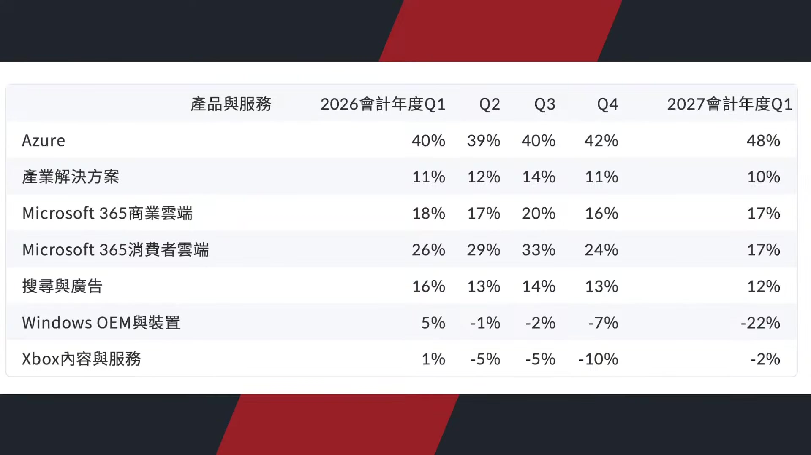

**逐字稿片段：** 加上 融資和租賃大概是425億美元 年增幅30%哦 誒這個沒有高於預期哦 所以我們看到部分設備股或者 新興雲端廠商股價反而在因此而下跌 因為 微軟看起來資本支出沒有大幅調高哦 誒這跟Meta走勢不太一樣哦 它也是有陸續做拉升了 可是沒有比預期想像中還要來得高 從投資人的角度來看 這說明著第一 AI的確已經開始反映 在營收和獲利上 但是呢還沒有完全轉化成現金流 但是重點在於哦 它的資本支出也不是 毫無節制的往上拉升哦 它的自由現金流已經年減27%了嘛 而且75%的資本支出還是集中在那些 晶片或者折舊年限比較短的設備 未來可能會增加折舊 或者設備淘汰的壓力哦 但是至少可以看得出來哦 微軟感覺花錢也不是毫無節制的花 而且AI營收進來也很快 價格上就會給他比較公正的評價 誒反而我們看現在微軟不軟了 但是Google反而不硬了 微軟股價我們看整個 大底已經逐步形成了 基本上 不會說他還在M頭區間呢 可是Google的部分完了 有點M頭的感覺了

**話題推測：** 比較微軟和Google股價走勢的視覺描述（大底與M頭），預計顯示兩公司股價技術分析圖。

---

## 00:20:19

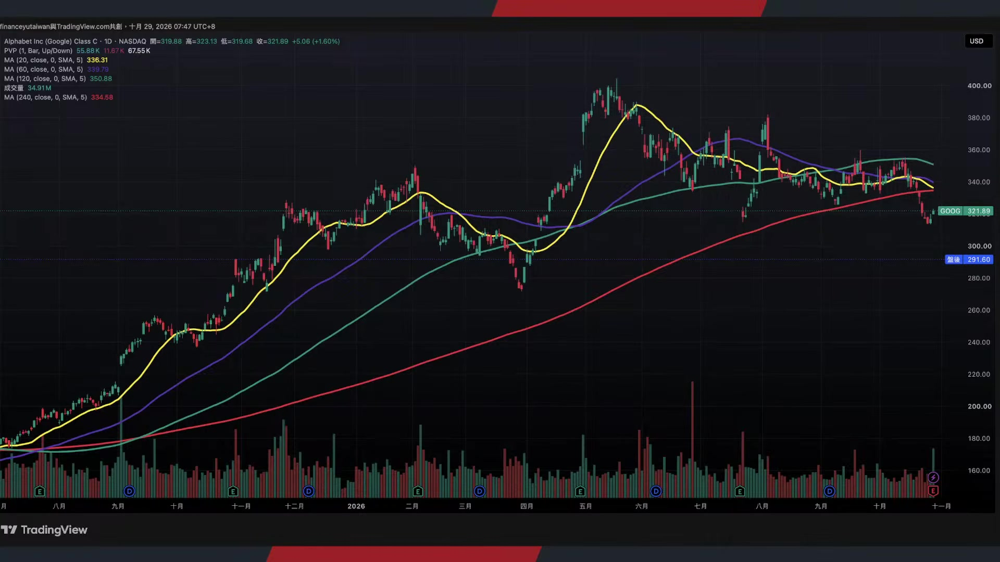

**逐字稿片段：** 從母公司阿發貝這次 所公佈的第三季財報 扣除支付給合作夥伴的費用以後 營收是1,112億美元 這比預期來的低一些哦 核心廣告收入 820億這待我們要聊哦 這個比預期來的低哦 這是恒大的警訊哦 那廣告居然沒有持續的往上拉升 高於預期哦 說明是不是全球某種 廣告商的經濟刺激 已經來到一個相對的高點了 因為全球廣告市場 其實過去幾年還是可以 每年保持20%到30%的成長 那是不是代表這股龍井已經不復存在 每股盈利只有2.12塊 哦這個就遠遠低於市場預期的2.99塊

**話題推測：** 專注於Google（阿發貝）第三季財報的具體數據，可能顯示Google財報重點摘要。

---

## 00:20:58

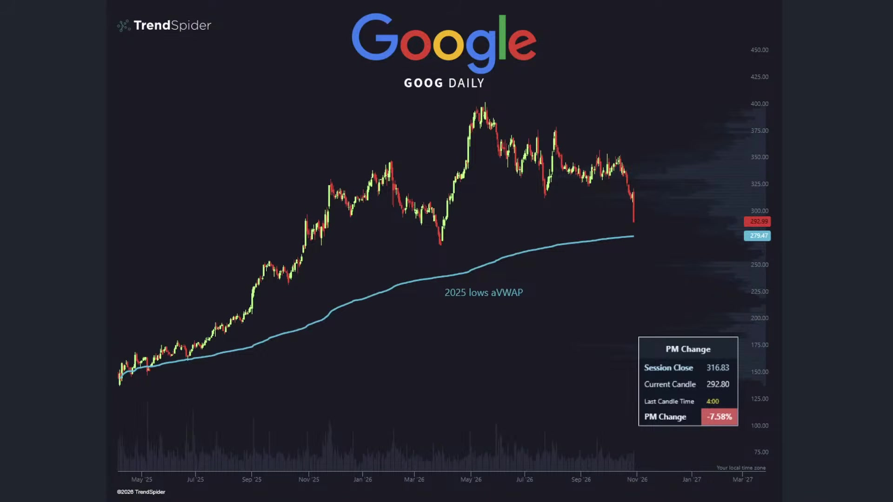

**逐字稿片段：** 主要是它的股權投資認 列87億美元的損失 那其中很大一部分跟 那個Spacex的股價有關 那我們看 不管怎麼說 母公司阿發貝出現的集體賣壓 最值得觀察重點是從量價圖來看誒 它跌破了 什麼意思呢 就是在從今年 4月到5月進場Google的投資人 他被套牢了 那這群人貢獻了非常大的成交量 是今年主要的量價成交區 也就代表著 這有很大一批在今年主要 買入的投資人被套牢了 會不會形成未來的長線賣壓 那往好處想 至少呢從下方的長期均線來看 它還是有所支支撐 而且Google的雲端業務表現也不錯 營收307億哎 年增幅103%好 所以現在唯一的問題其實就來自於 怕現金流的問題 進來速度不夠快 那個Windows 至少那個本業收入進來還是蠻穩定的 是Google呢 其實有很大程度取決於全球的廣告 下廣告的人多不多

**話題推測：** 提及Google股權投資損失具體數字，可能顯示其損失來源細項。

---

## 00:21:58

**逐字稿片段：** 拉發貝這一次也預估26年的 資本支出最高是來到2,050億美元 超過去年的兩倍 其實還在拉升 未來採購的承諾也高達9,240億美元 加上尚未開始的追認 還有其他的義務合約有1,520億 大概是接近1.076兆 這些金額就代表著未來的 投資還是非常龐大的哦 好所以不管怎麼說 某種程度而言 不管是從微軟的財報還是從Google 的財報來做進一步延伸的 也許也許因為現在跌 10趴是真的有點重了 搞不好明天開盤前就拉回來了 但至少可以承認的事情是 看起來市場投資人都在斤斤計較 大家都是用每一分數據 來佐證對於你的前瞻預期 股價表現呢 看起來市場波動都在陸續加大

**話題推測：** 提及Google未來資本支出預估，可能顯示資本支出預測圖。

---

## 00:22:45

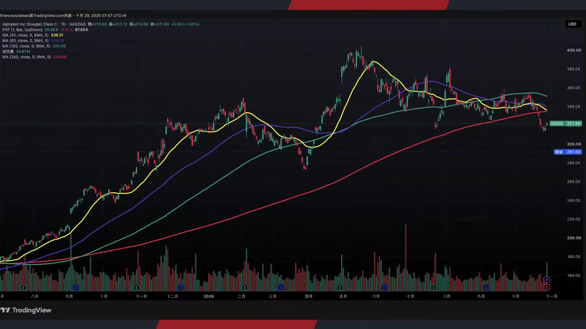

**逐字稿片段：** 那如果我們回過頭看 現在在7巨頭 統計到前天為止 整體今年呢 跑贏大盤的也不是特別多 細看漲最多的今年以來是蘋果

**話題推測：** 比較「七巨頭」今年以來的市場表現，可能顯示七巨頭股價漲幅比較圖。

---

## 00:22:55

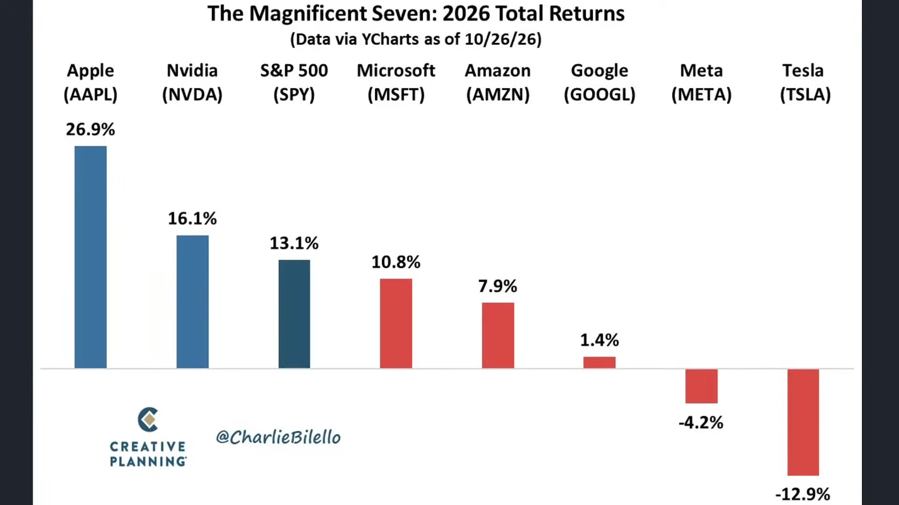

**逐字稿片段：** 26.9%今年是AI爆發年 然後蘋果漲最多 英偉達漲了16.1% 標普漲了13% 其他都跑輸給大盤 微軟大概漲10% 那今天會追上大盤 Amazon7.9% Google本來只漲1.4 哇今年會不會跌到負報酬 Meta跌4.2% 特斯拉跌12.9% 特3好像都是7巨頭這幾年 相對比較沉悶一點的 那加我就八巨頭了嘛 但不是重點呢 重點來自於市場的評價 產生了不同結構的改變的 那我個人的看法是 其實都會否極泰來的 這些巨頭他的本業收入都很強 他都撐得過去 要預設單一一家公司 但重點來自於 自由現金流按照明年後年 我們講的算力牆來到高峰嘛 明年只要度過了 算力就回來了 自由現金流就回來了

**話題推測：** 逐一列出蘋果、英偉達、標普等具體漲幅數據，可能顯示數據列表。

---

## 00:23:46

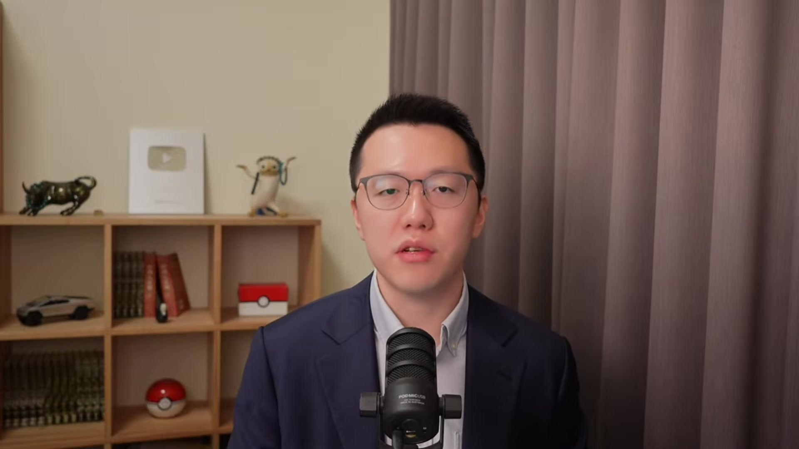

**逐字稿片段：** 我們看甲骨文呢 在昨天公佈的長期財測預估 已經針對2028年有信心 預估現金流即將轉正 這個盤後股價也是大漲了 接近有10%左右 這一次甲骨文預估

**話題推測：** 切換至甲骨文長期財測預估，提及現金流轉正預期，可能顯示甲骨文財測預估圖。

---

## 00:23:59

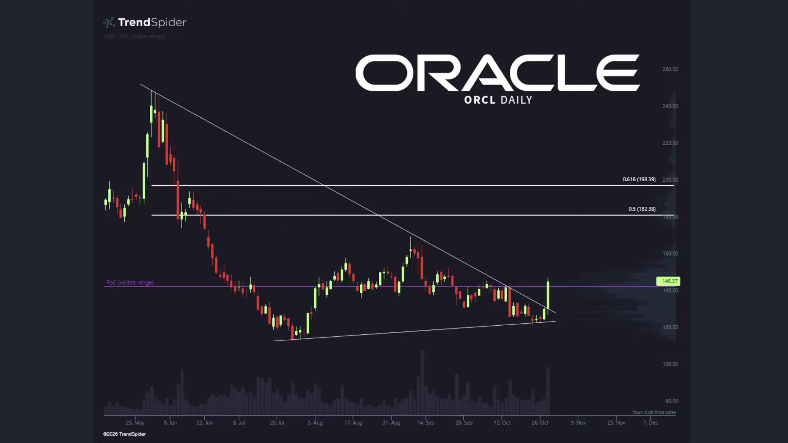

**逐字稿片段：** 2030年會計年度營收會 至少來到2,250億美元 調整後的營業利率超過40% 所以現在市場上只是因為 你的融資成本玩不下去 會有所擔憂 但是本質上算力的需求是很強的 差別只在於你能不能熬到後年 熬到後年 你這場遊戲你的融資 都還沒有出問題哦 那你就會是贏家 因為需求真的很強勁嘛 完全取決於算力到時候 能不能順勢的履約交付 這是給投資朋友多做的一些觀察 當然從這些資料來往下延伸 其實就說明著這些巨頭 其不太能夠跌 Google 也是怕這是蠻嚴重的事情 那如果帶動其他股價有所鬆動 那會很恐怖 因為現在整個美國股市 我們是過去所看到的極化現象 就靠這幾隻在撐 我們撇開七巨頭 看其他股票 的確已經受到十分大的承壓了 我們從不同角度來做一些省思觀察

**話題推測：** 提及甲骨文2030年營收目標，可能顯示營收預測數字。

---

## 00:24:55

**逐字稿片段：** 具體來說 像消費類品 奢侈股的部分 歐洲六大上市精品集團 今年大概蒸發了2,510億歐元的市值

**話題推測：** 切換至消費品和奢侈股市場分析，提及歐洲精品集團市值蒸發，可能顯示奢侈品公司市值變化圖。

---

## 00:25:05

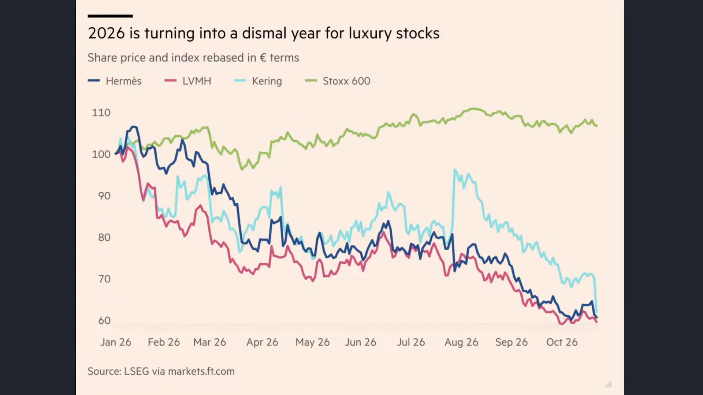

**逐字稿片段：** 其中像LVMH 今年市值已經減少了1,300億 愛馬仕減少了933億歐元了那當然 很大的問題來自於 中國市場消費的疲憊 可是就算你把中國市場給拿掉 全球的奢侈品市場 銷售還是很差勁的 只是中國更差而已 中國大概總體銷售減少了15-20% 另外一方面 全球的頂級富豪和中產階級的 消費品的購買力也開始出現分化 愛馬仕雖然受到中國市場的拖累 鉑金包還在成長 就是說明 就是有錢人還可以繼續買嘛 可是大量原本很多的 中產想要借由買一個包包 然後晉升資產這條道路 已經被阻斷了 所以導致 k型分化 會買的還是會買 可是大量的中產已經無法有能力去 填補我們講的奢侈品的買盤了 再看一下賓士 現在我們叫做兵敗如山倒 賓士昨天公佈了第三季財報 獲利暴跌51% 降到5.6億歐元 營業利益率只有2.5%

**話題推測：** 點名LVMH和愛馬仕市值減少具體數字，可能顯示相關公司數據。

---

## 00:26:06

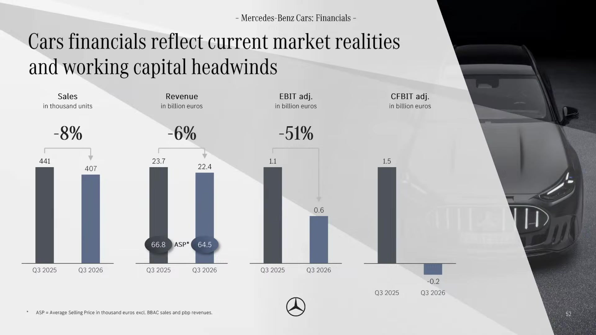

**逐字稿片段：** 100萬的車他才賺2.5萬 中國市場大幅衰退了3% 34% 歐洲市場也下跌0.8% 我們知道賓士過去 主導的是高價的豪華車 希望透過高單價來提升獲利 不過整個歐洲車廠 表現其實都比想像中還要來得差勁 包括BMW 包括奧迪 包括我們講的豪華車品牌 或者保時捷 都是如此 在今年一整年的總體銷售 都比想像中還來得差

**話題推測：** 提及賓士營業利益率的具體數字，可能顯示利潤率圖表。

---

## 00:26:36

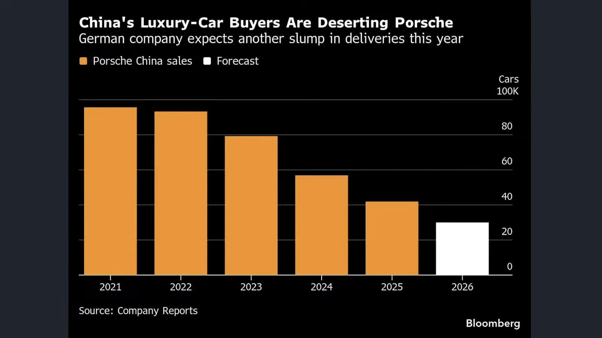

**逐字稿片段：** 我們過去提過 在保時捷的總體銷售 以前21年22年呢 一年還可以賣個10萬輛 今年能不能賣到4萬輛都偷笑了 能賣到4萬輛都很不錯了 總體而言 都可以看到在歐洲市場的疲憊 一方面當然是中國電動車的崛起 另外一方面很明顯 在全球的汽車市場當中 已經逐年進行飽和了 能夠買車的人口其實是有限的 大家當然就會因此精挑細選了 加上電動車型成主流以後 很多以前那種維修 保養費用的收入 其實也不像是前幾年這麼好賺了 甚至大家可能現在 因實質購買力衰退嘛 更要精挑細選 也許就不回原廠保養了 而這也形成在售後服務端 可能形成的收入來源的壓力你像 我我平時是比較喜歡回原廠保養 那我這幾年也在考慮 也許就不用了 車可能開個5年以後 就沒必要回原廠了 我比較喜歡回原廠 原因很簡單 因為有黑絲襪嘛 因為一開始是放心嘛 可時間久了以後 你會覺得 尤其是電動車車主 電動車車主 那有時候會覺得 應該想說 對於維修費用 對於保養費用 他來的更為在乎 回原廠是可以理解的 可是對於燃油車 我們看到全球 尤其在美國市場 也出現了比較大的一個變化和改革 好那不管如何 這些事情呢 都說明著部分傳統零售業 或者我們看到的傳統市場 或者我們看到的非AI市場 其實是有開始走皮的現象了 一個是車市了 一個是精品了 我們再看一些其他產業

**話題推測：** 提及保時捷總體銷售輛的變化，可能顯示保時捷銷量圖表。

---

## 00:28:10

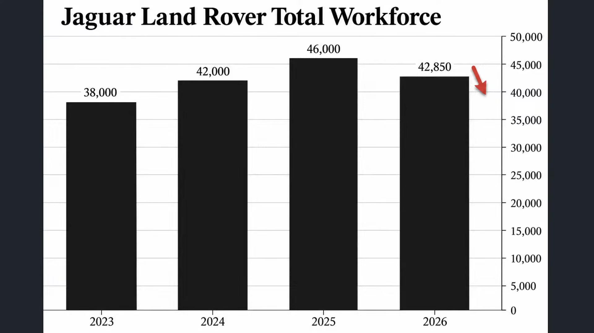

**逐字稿片段：** 這是Jaguar 或者Land Rover整體已經進入到顯著裁員 這是過去3年的擴張以來 第一次出現顯著裁員了 那我們過去跟投資朋友提過 這是華爾街日報的報導 在昨天呢 這個報導蠻有趣的 他講的就是全球的廣告業務市場 到底誰出的錢最多 那其實過往來看 出最多的大概分為幾項了 有房地產的 有汽車的 那作為主要耐久財 大概就圍繞著這兩大方向

**話題推測：** 提及Jaguar和Land Rover裁員消息，可能顯示相關新聞報導或公司聲明。

---

## 00:28:38

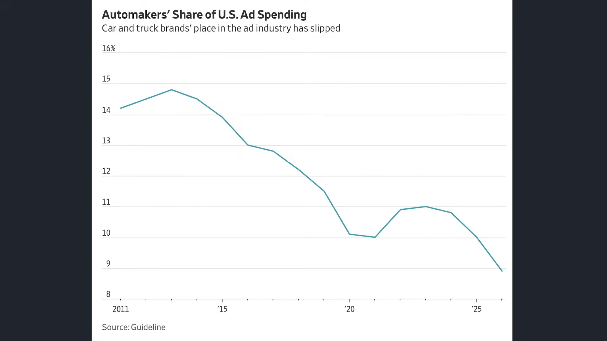

**逐字稿片段：** 那現在呢 美國2026年 美國職業美式足球聯盟開季的首播 傳統電視的轉播15場 有107支廣告 誒你感覺很多 但是比三年前16場 比賽的158支明顯減少 汽車產業快要投不下去廣告了 你大概可以做一些連接 就是Google的AI收入正在 快速的拉升 AI資本支出也在快速拉升呢 可是Google的主要營收來源就是來自於 這些耐久材的主要廣告客戶組哦 那這些廣告客戶組 他的車已經賣不好了 他已經砸不下去錢了 那最後這場現金流的遊戲 就會形成壓力了 跟剛才Google的廣告營收收入 其做了適度的連接

**話題推測：** 提及美國職業美式足球聯盟開季廣告數量減少數據，可能顯示廣告量對比圖。

---

## 00:29:20

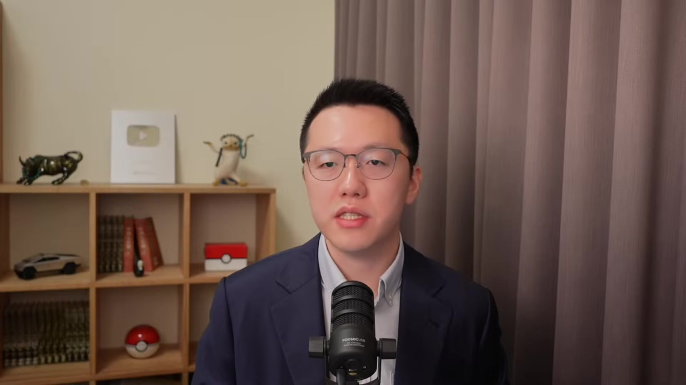

**逐字稿片段：** 2011年美國汽車品牌占 全美廣告的支出比例哦 大概10四% 13年來到14.7%之後呢 你就慢慢慢慢 尤其在疫情跳升之後 快速的下滑 現在只剩下9分線了 美國的汽車品牌在廣告 的那個收入的重要性呢 越來越低了 這個就形成比較大的一個市場壓力 也說明著有些人快要撐不住了

**話題推測：** 分析美國汽車品牌在廣告支出中的佔比變化，可能顯示汽車廣告支出比例圖。

---

## 00:29:43

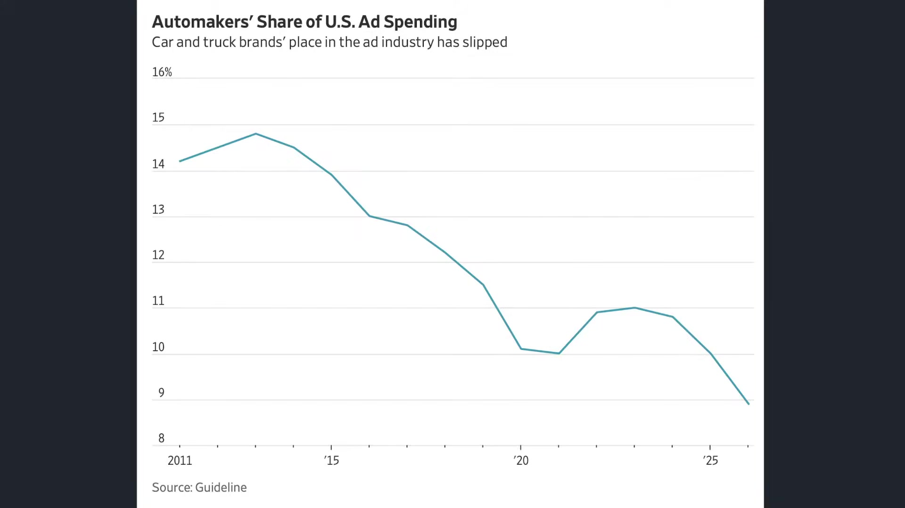

**逐字稿片段：** 再看其他不同的公司 昨天惠而浦也公佈了第三季 去年營收同期 從400,000.3億美元來到36億 年減幅有8.8% 惠而浦作為美國的 家電的幾隻重要龍頭 好現在居然淨利屬於虧損2.49億美元呢 好那這種耐久材 冰箱洗衣機烘衣機 一旦購買 通常往往可以使用10年以上 所以當消費者面臨高利率 或者生活成本上升之後 就會選擇延後汰換 所以形成市場上不管是 現在因為房屋交易也減少了嘛 也影響了新家電的需求 再看寶僑 寶僑的部分呢 最近公佈 由於能源和運輸成本的上漲 預估成本相關對於 年度獲利影響的衝擊 從10億美元上升到14億美元了 預估要麼進行成本調升 要麼呢可能在財報認列當中 會受到比較大的衝擊 你知道寶僑底下有 那個什麼吉列刮胡刀 還有很多洗衣機嗎 尿布嗎很多Costco也是賣它的 所以這就是日用產品面臨 美伊戰士最大的一個困境

**話題推測：** 切換至惠而浦第三季財報，提及營收下滑與淨利虧損，可能顯示惠而浦財報摘要。

---

## 00:30:47

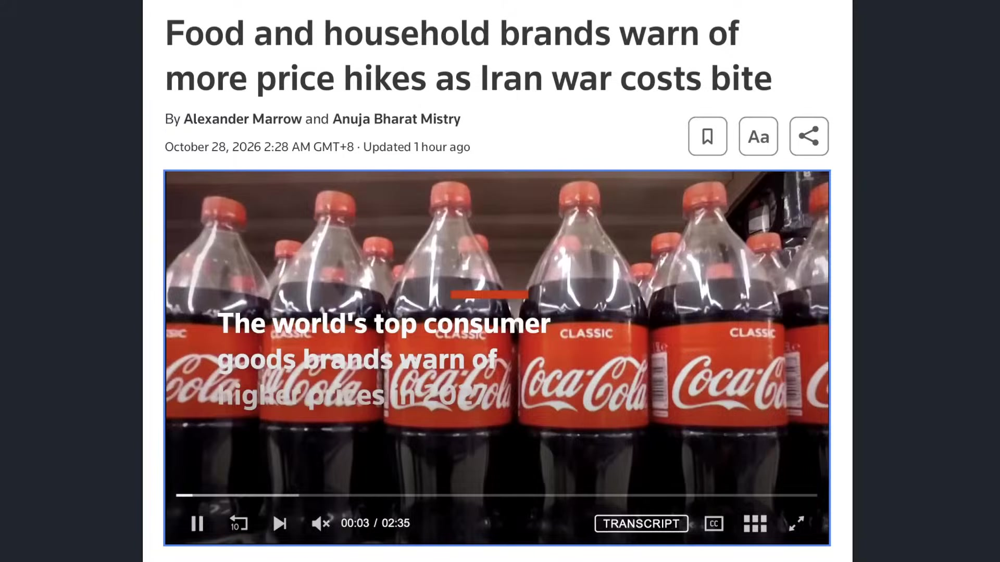

**逐字稿片段：** 再看一下可口可樂 可口可樂的確稍微調高了獲利的預測 不過呢可口可樂執行長也預估 消費者所面臨的支出壓力 可能會到2027年 所以預估未來整體在26年底到27年初 的消費有可能會持續受到壓力 可口可樂是不不打算漲價了但是呢 預估總體銷售量可能會適度受到承壓

**話題推測：** 切換至可口可樂獲利預測與消費者支出壓力，可能顯示可口可樂財報預測或消費者信心圖。

---

## 00:31:09

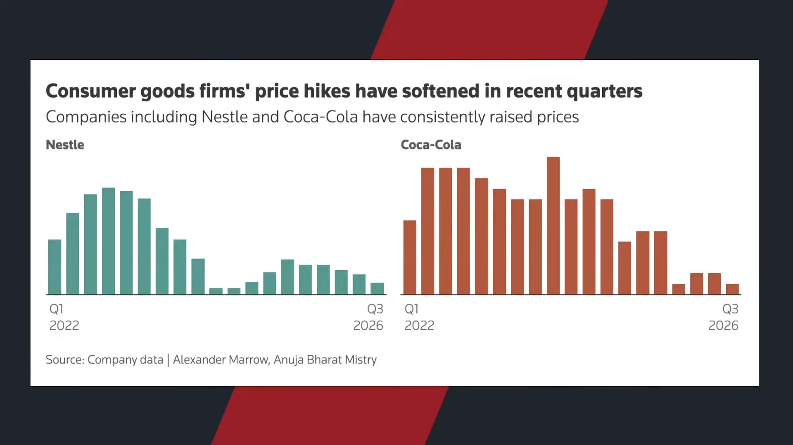

**逐字稿片段：** 其他像是3M AI製藥中心帶領的業務成長 不過3M也承認 目前汽車和消費性電子 消費是幾乎是疫情以來的最差 好從這些數據 我們大概都可以稍微理解到 今天我們看到的AI龍錦 就靠幾隻巨頭 持續撐著 那投資人也就靠這 幾隻巨頭的資本支出 台商也靠這幾隻巨頭的訂單持續活著 那你說那現在反反過來 巨頭不要走了 那由傳產跟上 好像也有點難度 畢竟高利率的環境已經逐步形成了 唯一能夠做的事情就是 這些巨頭不能夠倒 股價不能夠跌太重 要穩住整個大盤 穩住之後呢 看看能否進行生產力提升 讓這場遊戲玩的下去 要不然連巨頭都垮了 這些人已經在地獄了 只剩下巨頭還活在 不能講地窖 因為因為今年也沒有跌多深 還在地板價 那從這樣的一個角度來說 等同於市場對於未來5年的10年投射 就只看這幾隻巨頭了 也給投資朋友多做一些參考 當然呢我們投資最重要的事情是 也不要每天被 達訊牽著鼻子走 我們主要是瞭解 這個k型分化當中 不同股票的一個分享 為什麼大家很關注 這一次的第三季財報 就是因為 不好的已經不好了 從今年年初 去年年底就已經不好到現在了 那像好的 你擔心在融資成本壓力循環底下 他可能玩不下去 那必須要靠這幾隻巨頭 持續玩下去這場遊戲 也給投資朋友做一些思考

**話題推測：** 切換至3M業務表現，提及汽車和消費性電子消費為疫情以來最差，可能顯示3M各業務板塊表現圖。

---

## 00:32:35

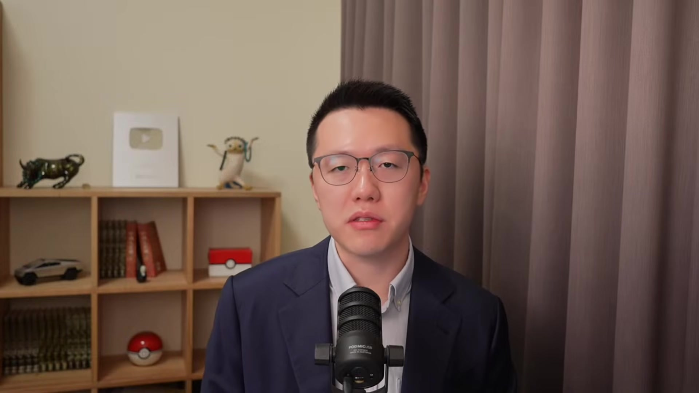

**逐字稿片段：** 好所以我們今天主要就是做三層梳理 第一個是聯總會的表態 我們把高利率 我們把市場聯總會和 華爾街的博弈給說清楚 大家知道高利率會維持一陣子 可是越來越猜不透聯 總會到底想要幹嘛 我們也無法確認12月份是否 板上釘釘一定會升息 第二件事情是來自于巨頭 目前所財報市出的氛圍 代表投資人更加精明了 可是也代表著市場已經 關注到這場融資成本遊戲 跟聯准會跟市場利率密不可分 你要證明你能夠玩得下去 而且可以繼續 賺到錢那第三呢 就是隨著部分廣告主 的業務收入快速下滑 它也慢慢回過頭去 影響到Google的廣告營收 那它會如何影響到接下來 的現金流和AI資本遊戲呢 說明的事情是 AI還是發展趨勢 可是看起來有時間線了哦 你不能夠一直這樣玩下去哦 因為你的現金流 你的廣告主 快要不夠下單了 再給投資朋友多做一些觀察 如果喜歡我們節目 就幫我們訂閱按讚加分享 我們就明天早上8點半 早晨財經速解讀再相見 祝各位投資朋友看盤順利 操盤愉快

**話題推測：** 總結今日討論的三個主要方面，可能顯示總結投影片。

---
