# yutinghaofinance_jh9CCNUy0XY — 關鍵畫面索引

- 來源逐字稿：[yutinghaofinance_jh9CCNUy0XY_GT.srt](yutinghaofinance_jh9CCNUy0XY_GT.srt)
- 影片：https://www.youtube.com/watch?v=jh9CCNUy0XY
- 截圖數：36

## 00:00:34

**逐字稿片段：** 美股股市週五是漲跌互見 看起來大家正在等待這 一次期中選舉的結果 那目前已經開始逐步開票了 費半是反彈了2.63% 但因為過去跌幅比較大 比較類似於空單回補 納斯達克指數是小漲0.8% 現在正在開票過程當中哦 當然大家會期待 好這一次在期中選舉之後的行情 如果如同意料 民主黨有望能夠奪回眾議院 那因為參議院有所變數嘛 至少可以看得出來 對於AI的監管以及未來在 投資支出環境成本呢 相關的成本是否會進一步 壓縮到未來的獲利和現金流 以及股價到底已經反映了多少 這件事情呢 我們就等明天早上 大概可能也開出了60%到70%的票了 其實民調是準確的啦 過去幾次的大選呢 只不過每一次准的都是普選票但是呢 由於美國的以前 不管是選舉人制度 還是我們看全集中選舉 由於在計票過程當中 我們必須以單一席次來做規劃 所以容易形成誤差 那我們就看好 到底這一次的民調跟最後所 統計出來 實質上的選舉結果到底 有多大的一個差距哦 但我覺得其實也反映的差不多了 你說會因為民主黨真 的成功的奪回眾議院 市場上就十分緊張嗎 就算他沒有奪回眾議院 AI的資料建置 其實已經延後了 這是來自於電網跟不上的問題 所以上半年問題可能是怕缺GPU 怕缺被動元件 怕缺記憶體哦 那到下半年到明年很清楚嘛 就算你有足夠的GPU和記憶體 你可能也沒有足夠的電 這是最大的問題 當然美國股市哦 這一波我們只能夠把它 當成第一波的空單回補 這一次的估值修正 納斯達克指數是三個交易日 大概已經跌了6-7% 其實對於大型股來看 也算是跌幅蠻重的哦 不過今年以來 其實全球市場也並非全面的走弱

**話題推測：** 介紹美股股市週五的漲跌情況。

---

## 00:02:28

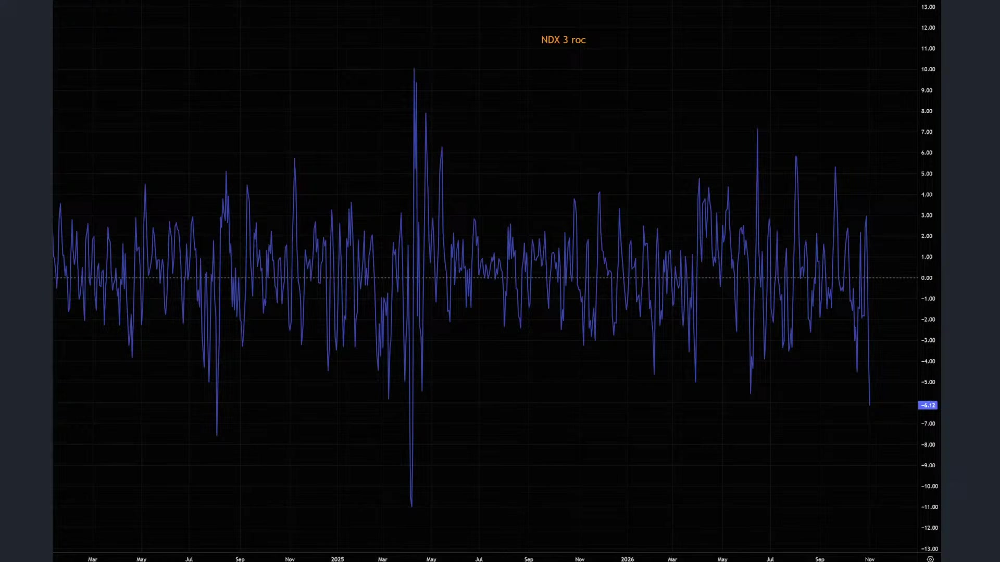

**逐字稿片段：** 今年標普五百指數的等權重指數 是每家公司都設定為1/500 還漲了15% 羅素2,000上漲13% 納斯達克100指數大概上漲10%左右 那費半呢 從未來12個月的預估本益比 已經誇張到只剩下12倍 除非明年訂單全部消除 要不然這種機器其實 是很離譜的低的 其實在過去一段時間 個股的跌幅對於大型 股而言也算蠻重的

**話題推測：** 提及標普五百指數等權重指數的表現。

---

## 00:02:56

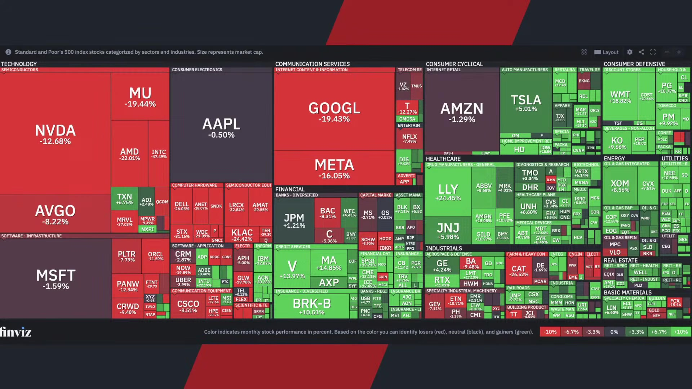

**逐字稿片段：** 輝達在過去一個月跌了12% 超微跌了22% 美光跌了19% Intel重挫了47% Google跌了19% 臉書這一次也跌了10六% 其實大型科技股有很多 都已經入到熊市當中 那即便它入到熊市 好像今年也還是正報酬 好這個就是今年比較吊詭的 就是上半年實在漲太多 下半年估值回檔 會超出過往那種5%到 10%的慣性預估 動不動就給你進入到熊市 這一堆指數今年其實在全球 股市當中也進入到熊市了 可是今年年初到現在 它居然還是正報酬 至少這一波是的確殺出一點恐慌了 我們以衡量

**話題推測：** 提及輝達在過去一個月的跌幅。

---

## 00:03:36

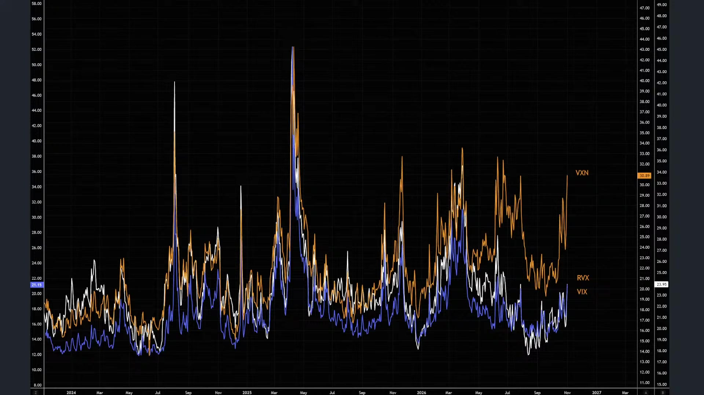

**逐字稿片段：** 納斯達克100指數的預期波動 指數VXN我們可以當 把它當成納斯達克指數的恐慌指數 大概來到30.89 這個是比標普500波動率 指數VIX的20還要高蠻多的 羅素2,000的波動率指數RVX大概是24 好所以現在看起來 真正的恐慌好像是 集中在大型科技股哦 那我們都清楚知道 避險基金呢 通常喜歡從 不管是從SPY QQQ或者SOXX當中 選擇那些大型科技股 流動性比較好的股票 來放大杠杆 或者單壓股票來擴張 更多的實質報酬 結果這一次市場上最受損的是誰呢 似乎也不是散戶 散戶其實這一路以來 跟臺灣市場一樣 它都是逢跌必買逢跌必買 一路待到現在

**話題推測：** 提及納斯達克100指數的預期波動指數VXN。

---

## 00:04:25

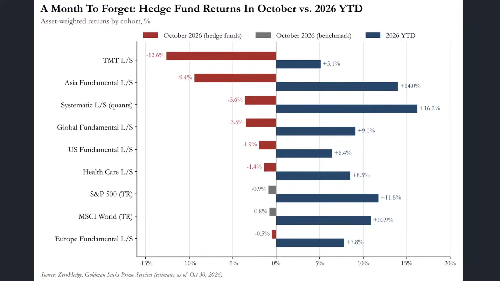

**逐字稿片段：** 那全球基本面多空避險基金呢 在10月份平均是虧損大概3.49% 量化多空基金平均也下跌3.6%那 相對之下 標普五百指數其實 它今年10月份也不過下跌2到3%而已 這說明著其實 避問題問題在於哦 避險基金雖然開始減少了股票的避險 可是整體杠杆處於歷史高位 大多數的避險基金的整體 杠杆率是比散戶還要來得高的 所以光是大型科技股的 波動稍微加大一點呢 一不小心可能受害 壓力就比較大一點了 甚至呢我們知道很多的量化基金

**話題推測：** 提及全球基本面多空避險基金的表現與虧損幅度。

---

## 00:05:01

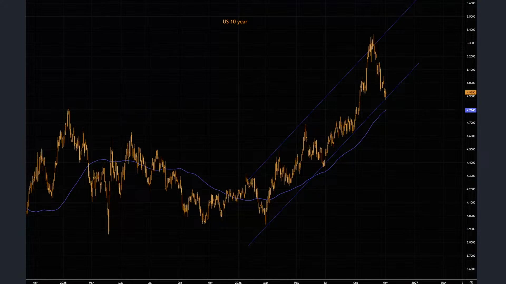

**逐字稿片段：** 在過去一段時間 是高強度的去積聚集美債 那美債殖利率這一坡 誒從上面掉下來也掉蠻多的 從5.35%一路掉到4.9% 好那有很多空頭部位來到極端 水準的這一些避險基金 它被迫就要進行回補了 因為整體美債滑落的幅度也非常快 現在呢 市場上也開始要進一步觀察 隨著納薩克指數開始做反彈 費半開始做反反彈 那這一批人他會不會 選擇做新一輪的加空呢 因為現在第一波的空單回補 其實真正放空的人也不是特別多了 可是由於整體現行或者趨勢 會讓大家意識到也許只是一波反彈呢 要看上方的加空量是否會因此而加大 我們看追蹤

**話題推測：** 提及量化基金高強度累積美債的情況。

---

## 00:05:44

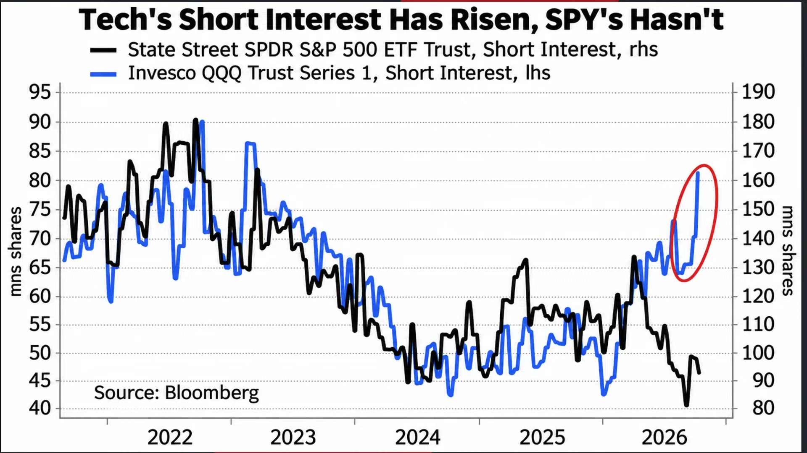

**逐字稿片段：** 納斯達克100指數的QQQ放空股數 26年初大概是1.3億股 現在已經增加到1.6億股了 增幅是23% 接近2022年科技股熊市期間的高水準 所以其實現在放空的人 這個比例好在今年10月- 11月增幅算是蠻快的哦 那就看這群人是大獲全勝 還是會成為未來 軋空行情的重要的推動力 值得留意 但至少下半年的波動性呢 在11月份以後有可能還會持續加大 那我們 對於不管是價值投資還是週期投資 我們重視的是什麼 其實重視的並不是短期的資金輪動 或者呢短期的行情選舉行情的預判 而是來自於基期是否已經到位 如果從整個大方向來做觀察 到11月2號為止

**話題推測：** 提及追蹤納斯達克100指數的QQQ放空股數變化。

---

## 00:06:33

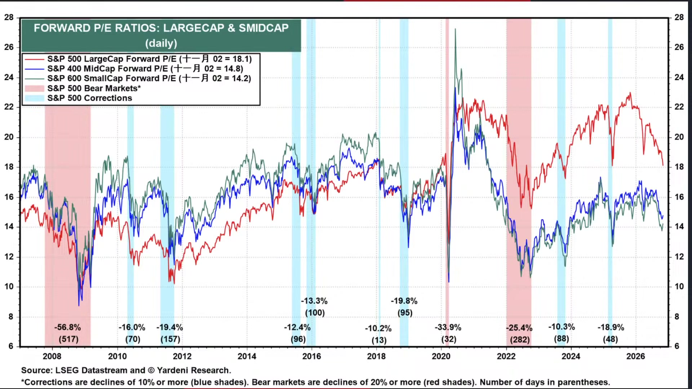

**逐字稿片段：** 標普500大型預估的本益比 大概已經降到18.1倍了 這個是比25年到26年初的22-23 倍的高檔低蠻多的 標普400的中型股大概是14.8倍 標普600的小型股大概只有14.2倍 所以從歷史經驗來做觀察 18年美國股市修正時 當時大概跌了兩成大型 本益比哦 大概曾經一路到15倍左右 還差一點點 2022年的熊市下跌 本益比也是差不多接近16-15倍哦 說明現在就是美國股市 其實估值已經消解蠻多的 但是也沒有到那種熊市 極低估值很離譜的地步 其實主要還是針對部分大型科技股 往下拉的原因 因為現在有避險買盤 反而流到那些傳產股當中嘛 所以其實是把標普 勉強撐在高位的 像蘋果股價 像伯克夏股價 它就可以把一些指數 嘗試地推在高位 那現在呢 如果回過頭把錢粘本益比來做觀察 可能呢會從18倍滑落到14倍 所以股價不漲哦 對於價值投資者現在就是最大的利多 尤其是針對這些科技巨頭

**話題推測：** 提及標普500大型股的預估本益比。

---

## 00:07:39

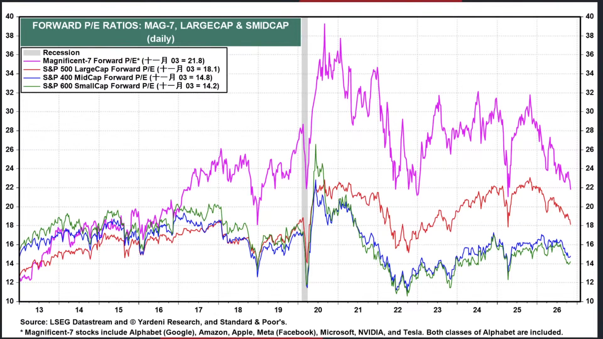

**逐字稿片段：** 科技巨頭的預股本益比 現在大概是降到21.8倍 你說是比大盤高那沒錯 可是相對於2020年 那個時候是接近40倍 那就算是25年 去年一整年平均也大概是30倍 所以現在的本益比是比去年關稅戰 的一整年其實都還要來的便宜哦 那這就意味著七巨頭 現在除非是關稅戰 要不然呢 基本上已經比過去兩年 的平均值還要來得低了 這是另外一層角度 那一樣嘛 除非你認為接下來是大衛斯按兩下 你認為股價先跌 之後跌一跌 然後它的獲利就衰退了 就暴沖下跌了 要不然呢 如果獲利你認為是穩定的 那它就是越來越越來越便宜 那有些人不習慣用本益比 他習慣用本益成長比 就是我們講的PEG 本益成長比 它的計算方式哦 是把預估本益比除以 每年的預估的獲利成長率 為什麼要這樣算呢 因為有些公司哦 它本來就要比較高的本益比 比如臺灣的IC設計公司 它本益比本來就比較高 你怎麼可以把聯電的本益比 拿來跟上游的IC設計公司的 本益比來做直接對照呢 所以一家公司的本益比20倍哦 如果預估未來成長的速度更快 那我應該要給你更高的本益比 比如說一家公司的本益比20倍 我們預估未來每年獲利成長20% 那PEG就是一倍嘛 一般而言呢 PEG如果低於一 就是代表著相對於獲利的成長速度 股價的估值可能偏低 高於一就代表投資人 願意支付更高的溢價嘛 那現在呢 標普500的PEG是多少

**話題推測：** 提及科技巨頭的預估本益比。

---

## 00:09:11

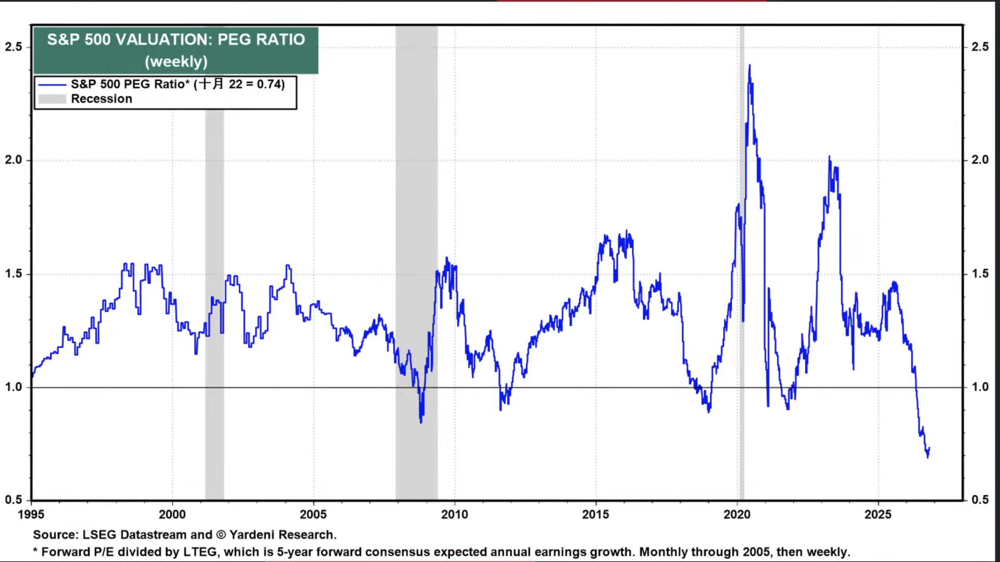

**逐字稿片段：** 本益成長比只有0.74倍 這個就不是過去三年來的新低了 這個是本世紀以來的新低 因為成長的速度太快了 這個指標這麼低的 原因不是因為本益比低 是因為獲利成長的速度已經比 本益比成長的速度實在快太多了 所以這個是給投資朋友 做的另外一層思維了 我們從不同角度來做觀察 可以稍微理解 好即便本輪的下跌好像有點恐慌感 可是對我們來講 感覺處處是機會的 根本原因到底在哪裡 當然最後取決於 那你相不相信AI行情呢 它還是有一個大前提判斷的 我們看一下美股股市四大指數表現 道瓊指數下跌197點 0.38% 在51,786點 標普上漲27點 0.36% 收在7,568點 納指上漲207點 0.83%收在15,372點 標普上漲270點 2.63% 收在10,600點

**話題推測：** 提及標普500的本益成長比。

---

## 00:10:06

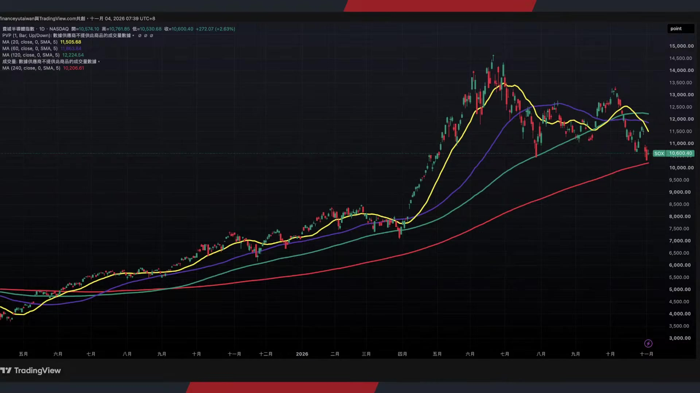

**逐字稿片段：** 昨天是超微財報大爆發 營收年增長45% 所以我們才講說 那個業績根本沒有任何鬆動的感覺 這比市場預估高非常多 每股盈餘2.09塊 也比市場預估的1.95美元還要來得高 盤後股價是上漲了8% 它今年股價也 這樣子摔下來也算摔蠻重的 那蘇姿豐也表示 未來幾年的資料中心 處理器有望繼續成長 公司預估在27年大幅的增加供應鏈 那目前呢 也正在透過新一代的AI加速器和整櫃 是的系統來直接挑戰 英偉達的市場地位 那的確 目前看起來整體業績增長的速度 似乎還在加快當中 所以從業績面來看的話 這是確認的 我們差別只在於 從價格面到底這個 價位吸不吸引你而已 其實美國股市已經算很不錯了

**話題推測：** 提及超微（AMD）的財報表現。

---

## 00:10:54

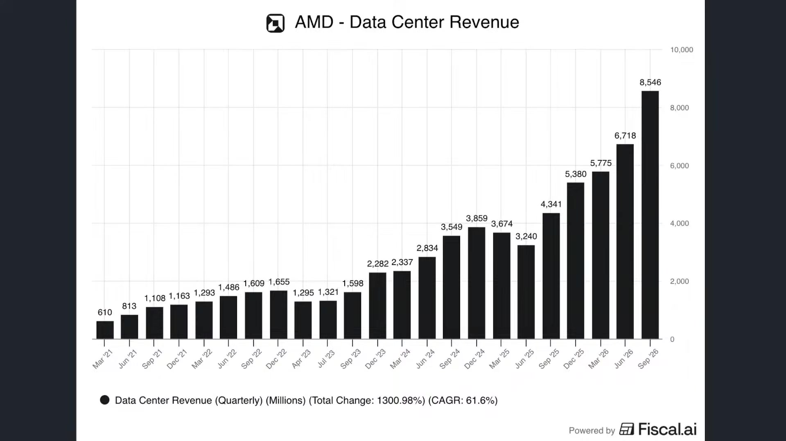

**逐字稿片段：** 你看一下陸股 你就知道真實 市場上的恐慌情緒到底是如何發酵

**話題推測：** 轉為討論陸股的表現。

---

## 00:11:00

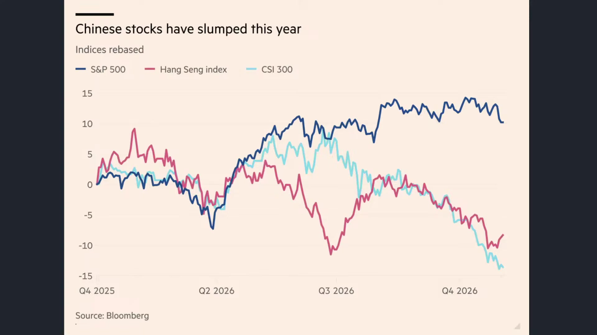

**逐字稿片段：** 這個滬深30010月份是重挫8.5% 這是過去十年來最差的單月表現 今年累計以來大概下跌15%了 但是呢如果從高點降下來 大部分不管是恒生還是滬深300 早就已經進入到熊市了 那我們清楚知道 中國國家隊在過去 一個月早就已經進場了 但是還是無法阻止資金的大筆流出了 最後呢 採取一樣的措施 限制新股上市 宣佈不准上市為什麼 因為你上市可能會 導致資金被新股給吸收 進一步加重原本現貨的賣壓嗎 那中國人行也宣佈把股票回購的專項 再貸款利率 從1.25%降到1% 越來越便宜嘍 鼓勵上市公司趕快買回股票 不要讓股價再下跌了好 所以整個中國國家隊已經全數進場了 就差量化寬鬆而已 這件事情其實意味著 好這個中國科技股在這一輪AI 行情其實摔得蠻重的哦 臺北股市昨天是暴跌1,613點 外資連續4天的大逃殺 那當然這算是史上第7 大的單日跌點記錄 本來點位越高 這個創紀錄的可能性就比較高 重點來自於 其實昨天外資也沒有賣很多 大概賣1,000億而已哦 但是那個恐慌感是有慢慢出來 2026年光是 十月十五號就賣了3,000億嘛 當時是創下新高 十月三十號又賣了1,100億 那短短三個交易日 現在又出現了一個千億式的賣壓 所以雖然他沒有一天賣得很離譜 如果這樣子賣下來哦 哦今年要賣個兩兆3兆 搞不好都是有機會的 外資這種高強度的撤出

**話題推測：** 提及滬深300指數在10月份的跌幅。

---

## 00:12:35

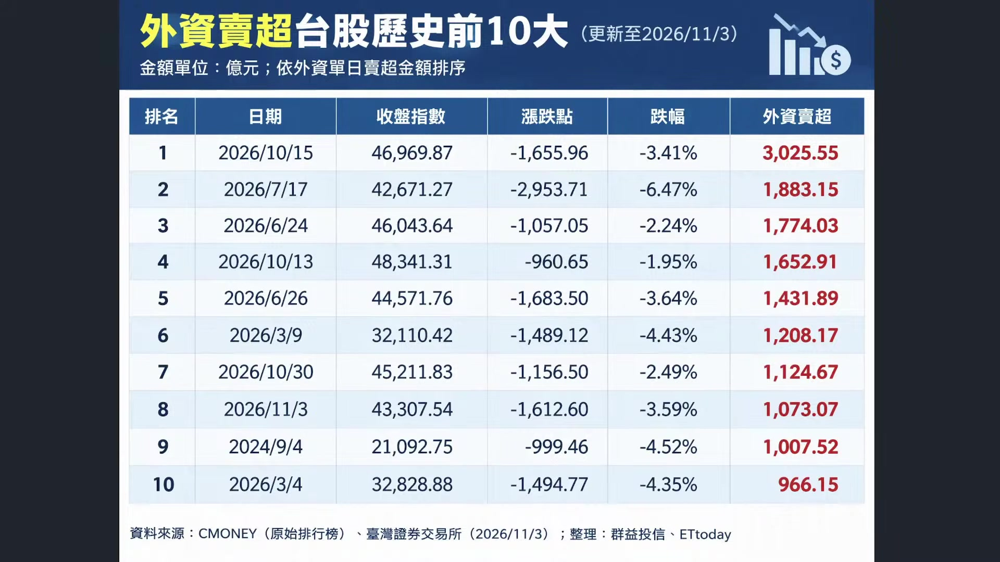

**逐字稿片段：** 直接導致了新臺幣面臨的貶值壓力 哪有人經濟成長14% 結果貨幣貶到32.8的了 好這說明那外資匯出的 速度實在是有點快 快到 東北調這個央行看起來好像護盤 效果也是非常有限的 其實外資針對全球股市都在做調節了

**話題推測：** 討論新臺幣面臨的貶值壓力。

---

## 00:12:53

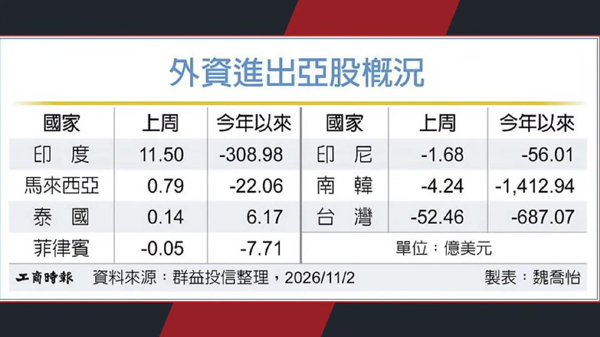

**逐字稿片段：** 調節最多的是其實是南韓市場 如果是細節觀察 在年初到現在為止哦 今年以來 外資調節南韓已經 調節了1,412億美元 針對臺灣也不過調節600-700億美元 你要知道臺灣市值是 比韓國股市來的大照理講 如果你是用等比例調節 那臺灣應該賣的更重 所以外資已經算是對臺灣人很好了 他賣南韓股市 賣的才離譜呢 難怪跌的這麼重 好那當然 這樣的一個效果導致亞洲貨幣 面臨比較大的一個貶值壓力之後 形成了內部資金適度的鬆動 其實臺北股市最近 從大盤來看 修正幅度也沒有想像中來的多了 拿來跟韓國股市來做比較的話 可是從個別股票的話 那個痛感是非常強的 你看昨天跌了一大堆 唯一沒跌就台積電嘛 所以你那個指數型投資人 ETF持有者 你感覺不出來 好但其實個股而言 大家的確是受傷頗重了 我們看幾隻權值股 從高位這樣子摔下來

**話題推測：** 提及外資在南韓市場的調節情況。

---

## 00:13:52

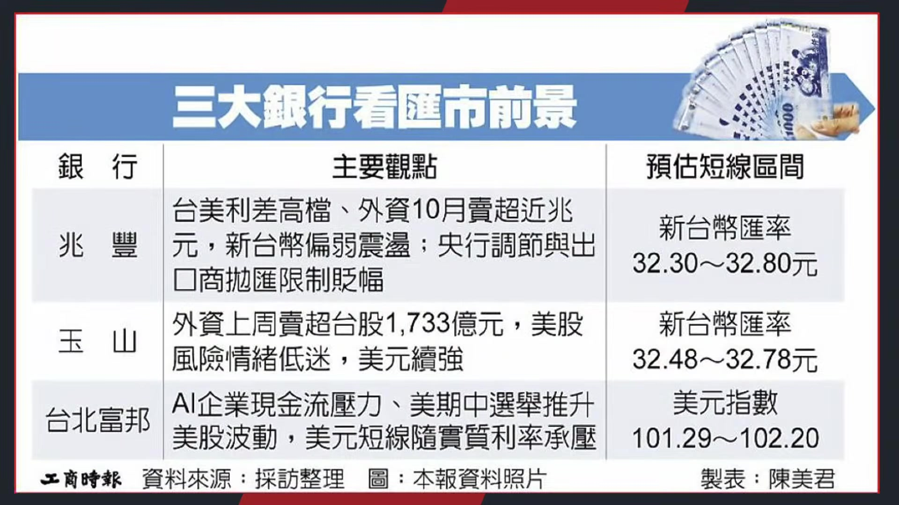

**逐字稿片段：** 像台達電 台達電從高點2,585塊跌到現在1270 那回落已經腰斬了 跌5成了 線形上從月線季線 半年線到年線全部跌破 而且呢是把前波低點也全部給跌掉了 那就不知道下方的支撐在哪裡了 那你說市場說擔心擔心那個供應鏈 或者說客戶資料中心 會不會因為延後建設 所以電網的升級也跟著延後 那第三季的毛利率現在要降到34.08 所以呢壓力很大 短期獲利有壓力 當然不是嘛 我們看美國的資料中心 最新的報告都是表現著 即將迎來爆發式增長

**話題推測：** 提及台達電股價從高點下跌的情況。

---

## 00:14:29

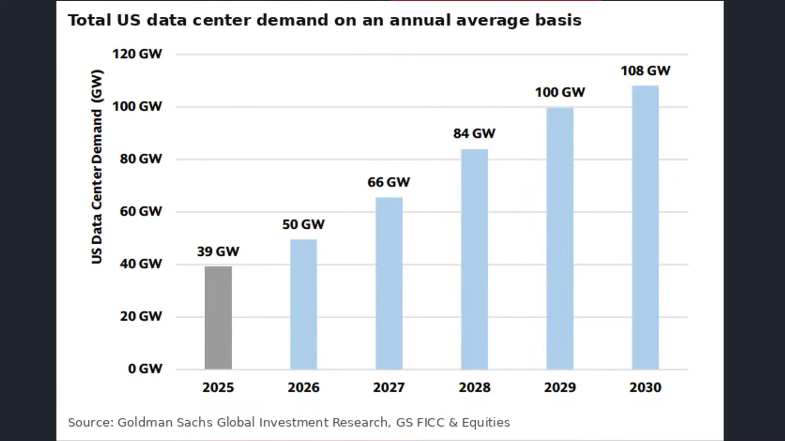

**逐字稿片段：** 美國製造中心的平均電力需求 2025年是36GW 到26年是50GW 明年是66GW 28年是2028年是84GW 成長這麼快 短短5年成長177% 怎麼可能會沒訂單呢 說明什麼 那就估值回檔嘛 它以前漲這麼多 現在就依次給你跌回到年初的位階

**話題推測：** 提及美國資料中心的平均電力需求預估。

---

## 00:14:48

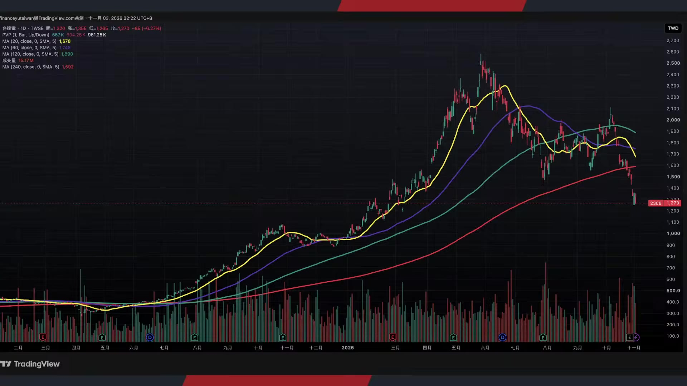

**逐字稿片段：** 聯電的部分呢 跌回到百元附近呢 回落幅度也有40% 好那現在就看年線到時候 能不能有效的來做支撐了 不過也看得出來 這個大m頭已經逐步形成

**話題推測：** 提及聯電股價的回落幅度。

---

## 00:15:00

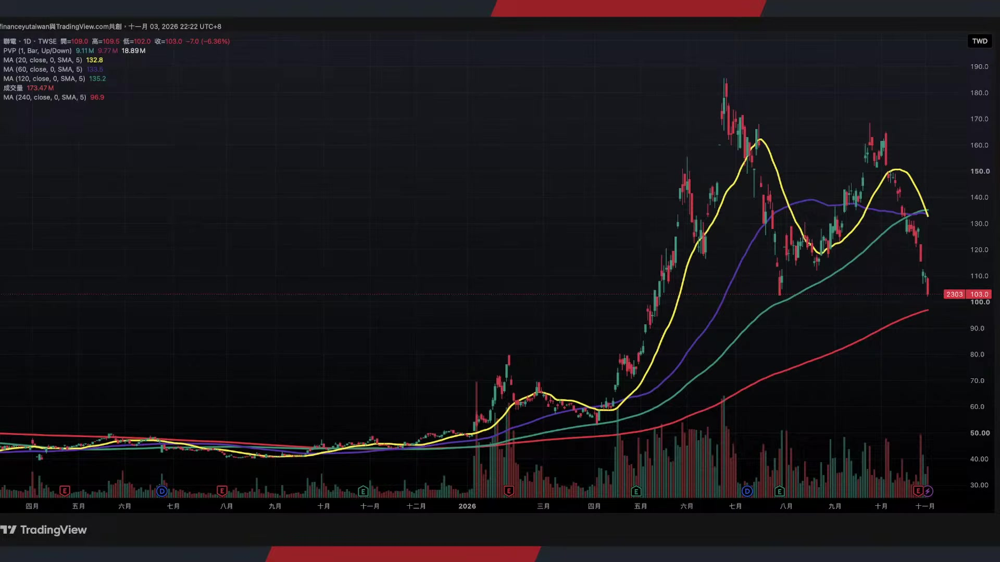

**逐字稿片段：** 台光電從 最高點6,400塊 跌到4,300塊 回落也超過3成了 5,000台幣的整數關卡已經正式失守 那現在就看下方 年限還有段距離 看能否借由本輪的反彈 嘗試的以盤代別

**話題推測：** 提及台光電股價的回落情況。

---

## 00:15:16

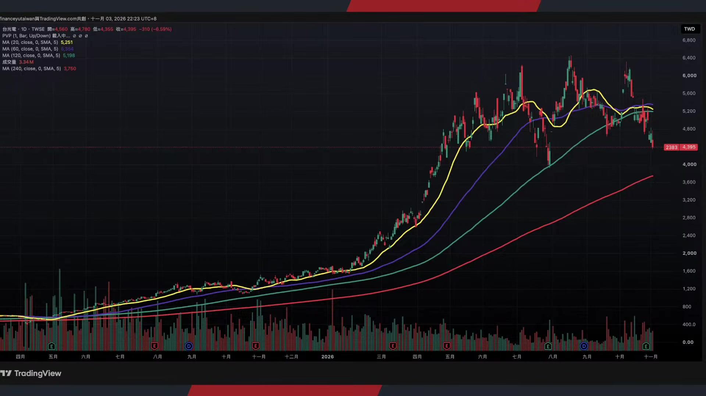

**逐字稿片段：** 我們從聯發科來看 這一次從5,000多塊 5,400吧 現在跌到3,600 也跌3層了呢 哦聯發科在今年也是 4月5月也是驚驚掌格局 那你就看這一波平臺區 是否能夠有效的守住

**話題推測：** 提及聯發科股價的跌幅。

---

## 00:15:30

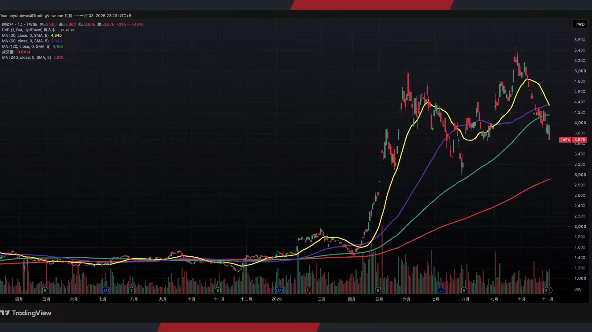

**逐字稿片段：** 廣達從400多 哦當時最高點就是6月份了 就一路的這樣摔下來 其實你不要看好像還在一個盤整區間 還在年線 可它已經跌3成了 所以某種程度而言 你現在月線季線 半年線都在股價上方 就差年線還支撐住

**話題推測：** 提及廣達股價的跌幅。

---

## 00:15:46

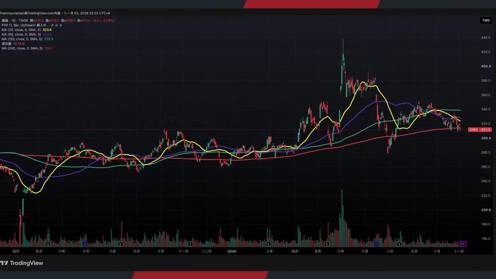

**逐字稿片段：** 鴻海已經算是很不錯了 可是鴻海也進入熊市了 鴻海從最高點314塊 跌到現在245塊 回落幅度也有21%了 所以雖然均線上是有所支撐 可是其實大家受傷都算是蠻重 如果是最高點

**話題推測：** 提及鴻海股價的跌幅。

---

## 00:15:59

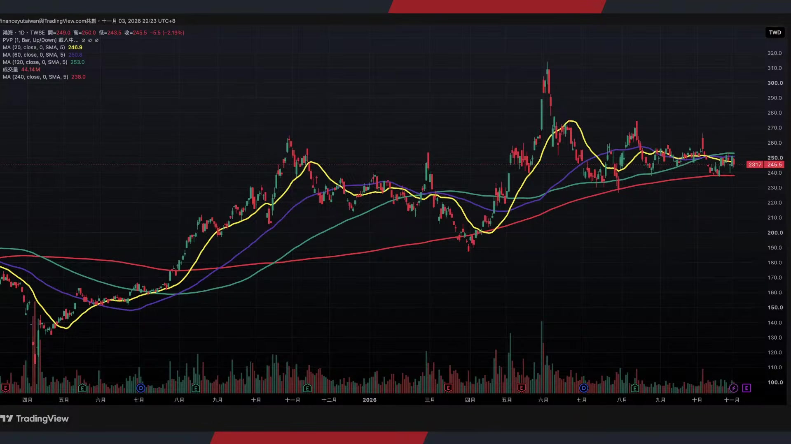

**逐字稿片段：** 日月光稍微好了一點吧 線形圖比較好看 可是700多塊跌到616塊 跌幅其實也兩成了 它也進入到熊市了 好所以我們才講說 市場上其實有部分個股 鬆動條件已經算是蠻大的 當然了 那是很多人覺得 對昨天看那iPhone dou 8萬塊你都嫌貴 那股票賠80萬都無感了為什麼 因為的確這一波回檔 幅度稍微比較快一點了 那現在大家最關注的就是誒這麼痛 那應該會有人停損吧 停損那壓力比較能夠減輕了 第一其實台股現在反映的是美股了 沒有什麼 從光是從融資的減幅 就能夠判斷是否止跌 看的是國際股市嘛那第二 那它有利於市場籌碼的一個奠定 讓大戶勇敢進場

**話題推測：** 提及日月光股價的跌幅。

---

## 00:16:41

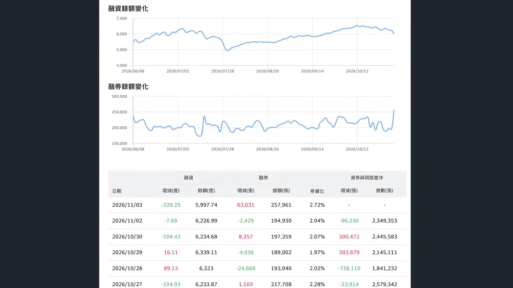

**逐字稿片段：** 我們從現在台股的歷史高點從49,968點 跌到 11月3號的43,307點了 大概是跌了6,000點左右 其實跌幅沒有很大 大概跌13%而已哦 融資餘額從6,533億降到現在5,997億 大概 減少535億左右 誒降幅才8% 什麼意思 就是大盤已經修正超過一成 可是融資其實降下來的速度 其實是比大盤的跌幅還要來得輕的 融資是減8% 大盤已經跌13%了 那你更不用講 貴滿其實跌得更重 好這說明著看起來市場還沒有 非常明顯那種徹底去杠杆 完全失望透頂 壓力很大的那種壓力 大家感覺就是 哎喲會痛會痛哦 那降一點杠杆吧 有這樣的感覺哦 我們從整戶維持率來看的話 大概在161了 那如果我們用以前的演算法 以前演算法都是扣除ETF的資券進出嘛 那大概就來到142 上一次7月的低點大概就是131132左右 那現在是142嘛 所以還有一小段距離要走 這個情況我猜就大概 再一根再一根 散戶就要肯恰拿了 就追繳電話 肯恰那 叮叮叮叮叮 就電話來了 就時間不多了 這臺北股市重挫 反而現在是比較擔心的是 有些散戶感覺越來越敢借錢了

**話題推測：** 提及臺股歷史高點與目前點位。

---

## 00:18:01

**逐字稿片段：** 待會我們也聊這個融資買正二 打算靠下一波反彈把虧損一次賺回來 當然我們相信市場長期會上漲 可是融資維持率能夠 確保你等到那一天嗎 因為很多人是這樣 正額本身已經有杠杆了 你再借錢買進了 那行情繼續往下掉 追繳壓力可能也會因此而放大對不對 那到時候電話就真的打過來了 所以我們一直跟投資朋友分享 杠杆是拿來超車用的 不是拿來飆車 超車是為了達到資產配置的優化 但是你不要拖累你後面的車飆車 你很有可能最後就翻車 所以還是要給投資朋友做分享 就是誒現在這個階段呢 不管你是準備要進場 還是誒可能被迫了 必須要等反彈 適度地做停損 都要清楚知道 這個時間線 其實很趕很急的 往往稍微一天的波動就容易碰到的 個股更是如此 所以時間不多了 要好好掌握住 那營業員現在打電話過來 你時間不多了 之前看一個絕症的病人問醫生 我還能夠活多久 那醫生很委婉的比出了一個5的手勢 那病人問 只有5年嗎 醫生搖搖頭 只剩下5個月了嗎 醫生還是搖搖頭 難道只剩下5周了嗎 醫生終於開口了 5432 時間不多了嘛 所以我們才想說 你杠杆你就有時間的問題 你沒杠杆你買了 那最多就放著 那還能夠虧到哪裡去 即便是這些權值股 其財報表現都很不錯 雖然他們 從上面跌下來 可能跌4成5成了 我都相信 按照現在資料中心的建置速度 終有一天會回來的 因為他們的業績還在往上走 很多人是把杠杆當成刺激 但成熟的投資人會把 杠杆當成超車工具 不是飆車工具 超車本質是你看准路況你 短暫你提高速度嘛 快速完成資產配置 讓自己能夠脫離低效的位置 避免被通膨低報酬 或者錯誤的配置拖慢人生進度 飆車不一樣嘛 你都已經買正二了 我看看到有人融資買正二 還要借信貸融資買正二 那你不就杠上加杠 那到時候就翻車了嘛 哦所以我們才講說 一定要沉下心來 優化自己的資產配置哦 那當然了剛才講 即便他們重錯這麼多 你覺得今年以來他們的績效有很差嗎 這就是時間尺度的問題

**話題推測：** 討論融資買進正二型ETF的現象。

---

## 00:20:16

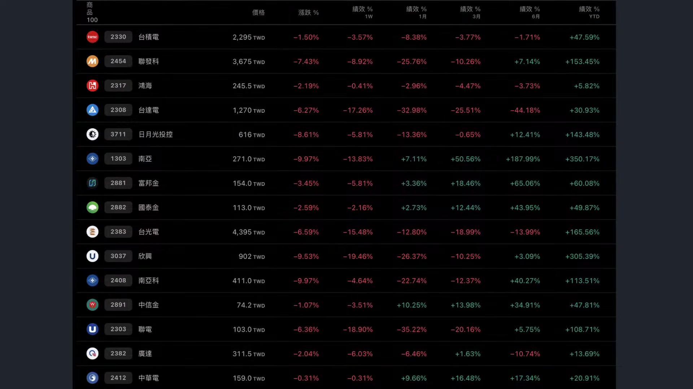

**逐字稿片段：** 我們從26年初到現在為止 來看看這幾檔股票到底漲了多少 剛才從高點跌下來都跌四五成的 台積電今年還上漲 累計上漲47% 聯發科上漲153% 鴻海上漲5% 台積電30% 日月光143% 南亞科350% 你看最右側的YTD 就今年以來報酬哦 富邦金60% 國泰金49% 台光電165% 新興305% 南亞科113% 中信金47% 聯電108% 廣達13% 沒有一家收跌的啦 哦這說明著投資人對於市場的感受 往往只取決於你觀察的時間長短 我們以台達電為例 過去一個月跌三成個 過去六個月跌了44% 但今年它都還是成長有接近30%哦 所以基本上完全就取決你的尺度 你基本上年初就持有的投資人呢 你還是能夠保有非常可觀的獲利 差別就在於你是不是 買在最高點而已嘛OK 所以這是第一波我們要觀察的重點 其實行情沒有想像中來的差 這是估值回檔 由於上半年擴張比較快 這次就回檔比較快 那第二件事情呢 才是真正要比較謹慎的因為哦 本來想說誒 可以趁市場上的情緒降溫 能夠適度讓籌碼做沉澱 那的確在個股層面呢 有部分已經面臨斷頭風險 可是在上杠杆的正2型ETF層面 看起來沒有

**話題推測：** 討論從26年初至今個別臺灣股票的累計漲幅。

---

## 00:21:37

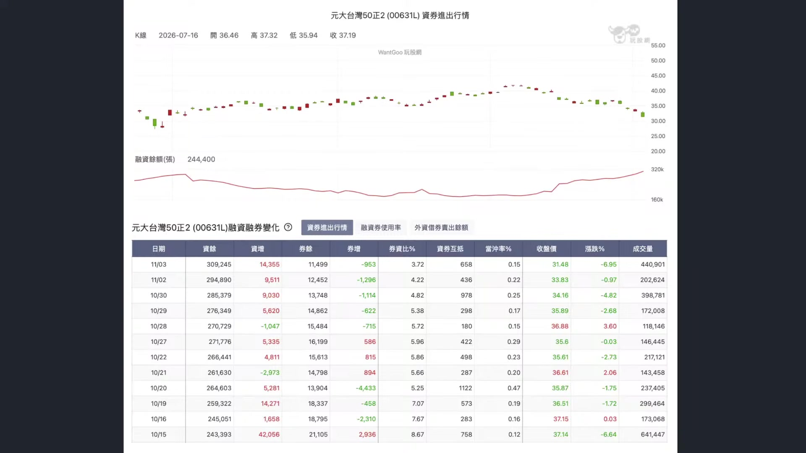

**逐字稿片段：** 我們看兩檔ETF 一個是00631L 元大臺灣50正2 10月15號股價還有37塊 到昨天跌到31塊嘛 累計下跌幅度大概也15%左右 那融資餘額 它從24萬張增加到30萬張 怎麼越增加越多 我們如果細看 其實其實從10月中旬以來 它大概也只有兩天是支減的 其他全部在支增的 你再看昨天 昨天那個支增的幅度特別大 就是不跌還好 一跌給你 杠上加杠 不止買正二 而且還要借資 或或者我們看到 進一步的借錢來擴張本身的杠杆 那我們當然知道 正二本來在持倉的 摩擦成本會比較高 但是足以說明投資人的信心呢 在部分個股或者部分 商品還是存在的對不對 賭博哪有天天輸all in啦 贏了會所嫩模 做了下海幹活嘛

**話題推測：** 提及元大臺灣50正2（00631L）的融資餘額變化。

---

## 00:22:31

**逐字稿片段：** 那另外一個是00685L 是群益臺灣的加權正二 當時10月8號的融資餘額是15.7萬張 到昨天是29.4萬張 短短一個月是增加了13.7萬張 哦增幅是87% 哦那你要知道他累計 下跌也是跌了兩成多 進入熊市嘛可是 一樣杠上加杠 這個10月以來沒有一天是資減的 大家都在繼續的擴張自己的杠杆呢 完蛋了大家還不恐慌 好至少看得出來有一群人呢 他是完全不怕本輪的跌法的 行情大跌 的確也不要慌了 我個人的看法是哦 唉如果這段時間呢 你可以好好思考自己 到底適不適用於杠杆 那第二件事情 那對於買方 我們肯定是堅持的 但是股價回落讓我們有機會用更便宜 的價格慢慢買進原本就看好的資產 可是要切記 你不要看到一跌就一口氣all in 融資又重新上杠杆 因為沒有人知道底部在哪裡哦 本來都會有適度的怪力回檔 今天便宜 明年可能更恐慌雖然 Google本益比現在來到接近14倍了 那難道不可能到13倍 12倍嗎 它很便宜 不代表不會更便宜嗎 子彈要一點一點打 資金分批的做投入 替後面的波動性保留一些餘裕 重要的不是一次買在最低點嘛 你跌下來時 你要有現金 你要有耐心 照著自己的能力和節奏走 你沒有必要急著投入嘛 前陣子看了 一個很老的韓劇哦 反正裡面就是那個男主角 跟女主角在理髮廳中邂逅 那兩個人就很恩愛嘛 那有一天那個女孩 不知道被什麼液體給撥到 然後眼睛就失明了 看不到了 那男主角就很愛她嘛 就把自己的眼角膜捐給她 最後一幕就是那個男的 手上拿著女孩的照片 然後戴著墨鏡坐在公園椅子上 旁邊坐著一隻可魯導盲犬 然後風一吹 照片吹走了 男生很慌忙 到處找照片 結果照片被路過的女孩找到 就是那個他喜歡的女孩 那女孩已經恢復視力了嘛 滿是淚水 看到深愛自己的男人變成這樣 反正我看到的第一個想法就是 他為什麼要捐兩隻眼角膜呢 為什麼不捐一隻就好了呢 這樣的兩個人剛好都變虎克船長 就可以一起看東西了 所以我們投資也一樣 你沒有必要全部投入嘛 你看到一個價格感覺 可以介入的一個時機點呢 你也沒必要一口氣就all in 一口氣就上杠杆嘛 沒有人會完全知道底部在哪裡 今天便宜 明天有可能會更便宜 哦所以給投資朋友做一些思考了 但是很多人說要要靠殺融資來足抵 其實這一波的 台股的崩跌 主要還是靠費半了 因為費半的跌法才導致台股鬆動 所以重點還是要看海外的 部分是否能夠有效的站穩 我們看長期

**話題推測：** 提及群益臺灣加權正2（00685L）的融資餘額變化。

---

## 00:25:14

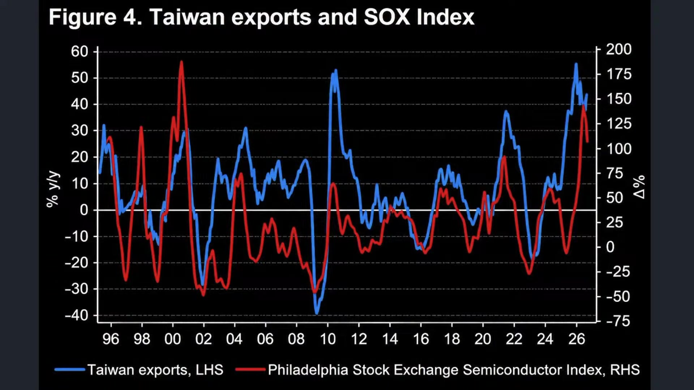

**逐字稿片段：** 臺灣的出口成長跟費城半導體指數 是維持高度聯動 從96年到26年歷史走勢來看 每一次全球科技需求復甦 費半指數上漲的時候 臺灣的出口年增幅也會同步增加 那現在問題就是 可是現在 你看以前01年或者08年或者 22年的半導體庫存調整期 費半多因此而先下跌 跌久了臺灣的出口就跟著下滑了 可現在有趣的事情是 臺灣的出口還在往上走哦 可是費半也回檔了一個多季度 快要兩個季度 等於半年了 那到底是誰先走錯了方向呢是出口 過度樂觀了 未來要修正 還是廢辦其實短期內已經超跌了呢 至少我們從臺灣的 經濟增長率來做思考 這次第三季的經濟

**話題推測：** 討論臺灣出口成長與費城半導體指數的長期聯動關係。

---

## 00:25:59

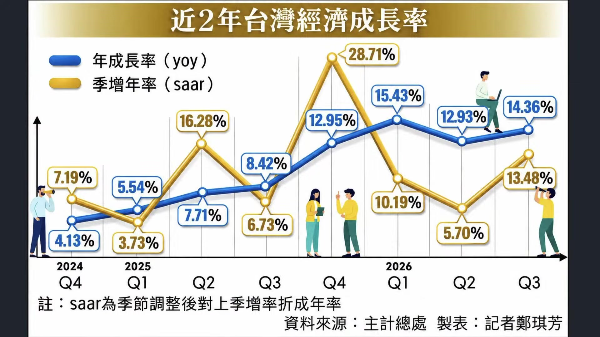

**逐字稿片段：** 增長率已經來到14.36%了 我本來一直都講說是本世紀新高了 後來我看了一下數據 如果剔除掉當時1977年到1981978年的話 有可能是 二戰以來的新高 就1946年經濟大爆發以來的新高 那等同於接近70年左右的新高了國際 這機構也是全面上修 今年臺灣的GDP成長 那我們也知道 因為臺灣在本輪的受惠者當中 如果你把AI的科技循環

**話題推測：** 提及臺灣第三季經濟增長率。

---

## 00:26:29

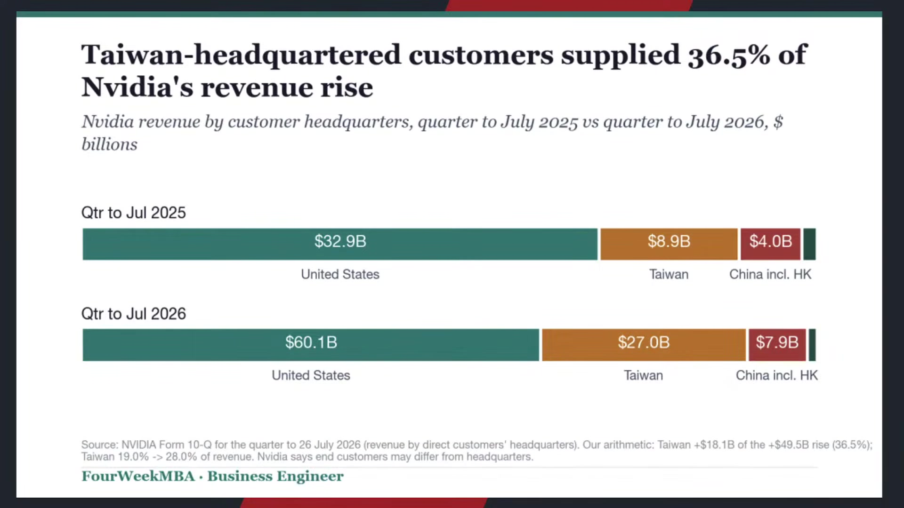

**逐字稿片段：** 貿易的鋪顯占GDP的比重 大概是來到12% 這個是比其他國家來的高

**話題推測：** 提及AI科技循環貿易曝險占GDP比重。

---

## 00:26:35

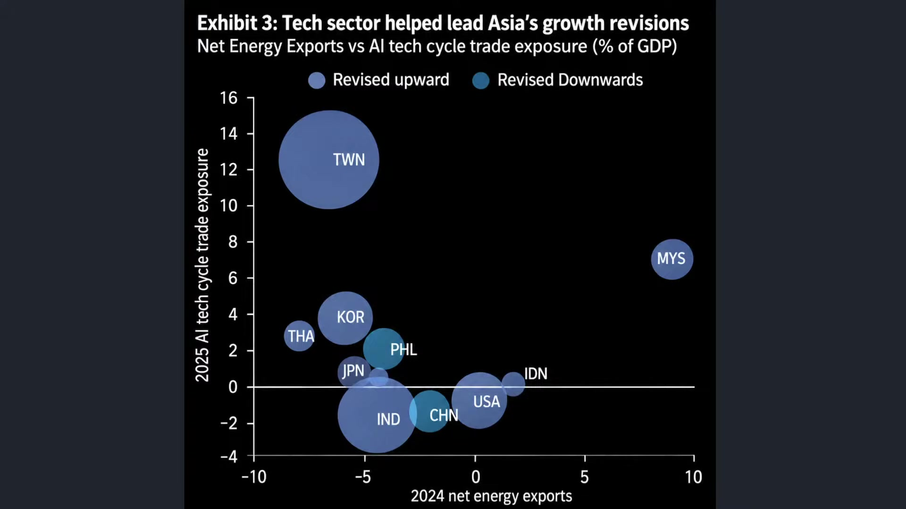

**逐字稿片段：** 馬來西亞大概6% 南韓是4% 菲律賓大概2到3 % 說明臺灣經濟對於全球AI 的需求敏感度來得更高 所以受惠幅度也會因此而持續的加強 所以我們就要回過頭來說 要怎麼解釋臺灣經濟這麼好 但是那個匯率貶成這樣呢 一個條件呢 當然就是外資的賣壓 它是真實存在的 正在進行亞洲股市的全面調節 另外一個就是很多錢的確是沒匯回來 我們知道臺灣對於美國的順差 今年已經創下歷史新高了 可是呢按照中央銀行的統計哦

**話題推測：** 提及馬來西亞的AI曝險佔GDP比重。

---

## 00:27:06

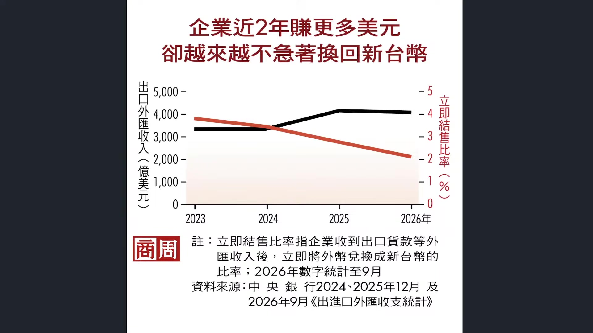

**逐字稿片段：** 26年前9個月 臺灣出口外匯收入年增幅38% 可是立即結售結匯的 比例居然只有兩% 哦這個就非常低了 這說明什麼 就很多像 台積電廣達緯創這些國際大廠 賺到美國客戶的美元之後 他沒有匯回來 他直接就地做新建 他們有龐大的美元資產的一個需求 導致今年外資已經賣了兩兆多了嘛 所以這是 台幣的一個賣壓 另外一個就是臺灣人賺了美元 他沒有換回台幣 他直接在美國繼續的擴廠 這跟我們過去所提到的 這種擴廠建制潮 其實是高度聯動的 就你也不能夠阻止他不投 因為他現在就是有這樣的一個需求 可是兩重因素交疊底下 就變成了居然經濟成長14% 貨幣還可以貶值這樣 這個中央銀行 在本周已經 陸續傳出

**話題推測：** 提及臺灣出口外匯收入年增幅與立即結售結匯比例。

---

## 00:27:57

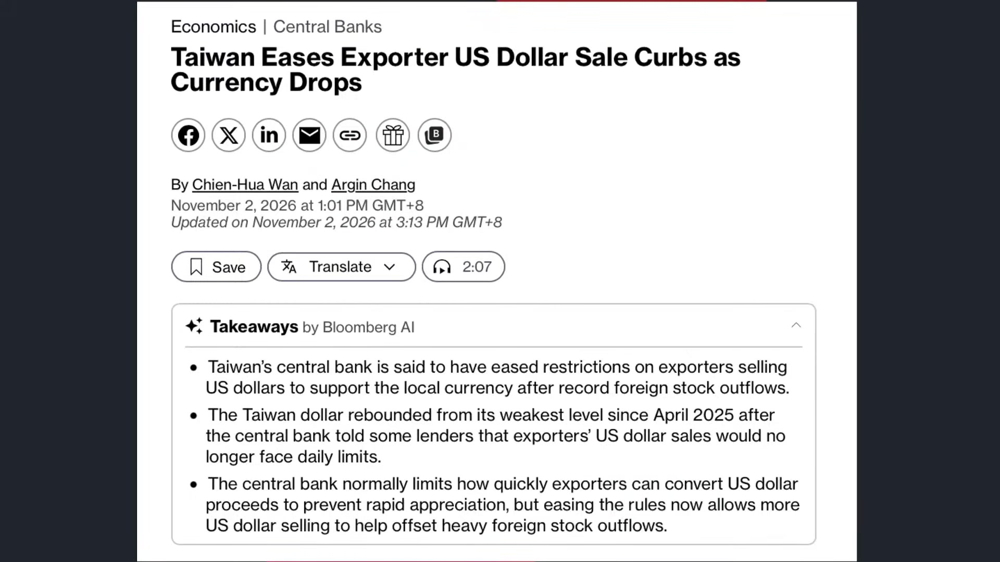

**逐字稿片段：** 可能會暫時取消出口商 每日賣出美元額度的上限 這個是彭博社的報導 目的就是為了要減緩 新臺幣貶值的速度 看起來央行早就在護盤了 但有點護不太住 因為以前央行原則上是要限制 出口商每日賣匯大概1,000萬美元 就是你不能夠賣匯 幅度這麼大 但是如今呢 他已經通知4家銀行解除限制了 什麼意思 就是你想要錢多快回來都可以了 我已經不阻止你 因為以前怕錢匯進來速度太快 台幣會暴升嘛 那現在呢 不管你這麼多了 你想匯回來就匯回來吧 目的就是為了以防 市場上針對新臺幣採取進一步的狙擊 這給投資朋友多些思考 它背後隱含的概念呢 一好一壞了 壞處就是 有很多錢沒有流回臺灣 好處就是那在海外擴廠 它一樣是進一步的營業收入 而且會導致設備廠的擴張嘛

**話題推測：** 提及央行可能暫時取消出口商每日賣出美元額度的上限。

---

## 00:28:49

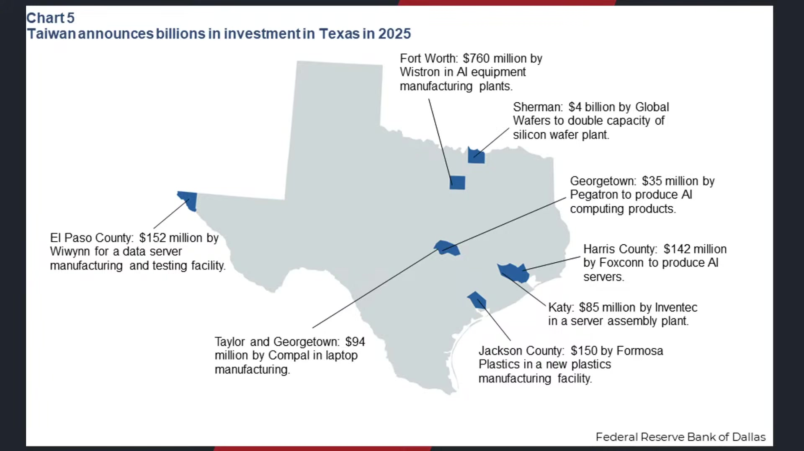

**逐字稿片段：** 舉例來說 從8月份當時成立在德州的 臺灣貿易服務投資中心呢 它就是協助台商在整個德州地區 建立新一輪的半導體科學園區哦 哦那這筆金額是由經濟部 來做最後履約保證的哦 金額幅度會非常非常的大 熊本也是如此 最近我們看三井不動產正在熊本縣 進行新一輪的熊本科學園區來做推動 希望由台積電作為核心 持續的吸引臺灣企業進一步的佈局 所以臺灣人大量的到美國 大量的到日本做投資以後 對於台幣匯回的需求感 幅度就沒有這麼強烈了 好臺北股市上漲357點 在43,665點 其實股市我 我們想說現在這個位階很重要 我覺得不管是 臺灣政府還是美國政府 都會相對重視的一個根本原因 其實很簡單 好那就是這股票市場

**話題推測：** 提及德州成立的臺灣貿易服務投資中心。

---

## 00:29:40

**逐字稿片段：** 它已經形成當屆政府 財富效應的重要緣由 我們不只是我們個人有財富效應呢 我們看到企業 它也有可能會因為股價的 漲跌而選擇要不要繼續的擴倉 所以把整個次級市場撐住 一定的情緒是很重要的 那人家不是常開玩笑 什麼日本的泡湯之旅 現在變成日本之旅泡湯了 這就是財富效應就是 你本來就準備好要去玩了 可是你就因為自己的股市漲了或跌 你也沒有要賣 未實現損益的擴大而已結果呢 你就決定自己的消費行為產生決策 這個就是我們講的 股票市場所形成的財富效應 那各國政府我覺得會 越來越重視這一塊 這個上漲無限 下跌哦政府其實不能夠接受的 對於大多數來看 因為財富效應對於 經濟的貢獻越來越大了 本來要飛歐洲的 那股價如果給你跌到3萬點 改去蘆洲嘛 本來要去米蘭的 現在只能去宜蘭了 舊金山變成金山 本來要去沖繩 現在只能在家裡沖水 本來要去美洲 現在只能回家煮粥 本來要去大阪 現在連去大阪根都有問題 本來要去舊金山 現在只能去金山 本來要去大溪地 現在只能公園掃地 本來要去關島 現在只能關電腦 本來是海景第一排 現在直接住海邊 本來要飛矽谷 現在蹲五股 本來要考慮瑞士 現在去瑞芳 大阪環球影城變成國賓環球影城 本來要去北海道 現在回北海岸 本來要去巴厘島 現在變社子島 本來要去上海賺錢的 現在下海賺錢 所以我們講說

**話題推測：** 討論股市財富效應對政府及經濟的重要性。

---
