# yutinghaofinance_jm9T-NgW0pY — 關鍵畫面索引

- 來源逐字稿：[yutinghaofinance_jm9T-NgW0pY_GT.srt](yutinghaofinance_jm9T-NgW0pY_GT.srt)
- 影片：https://www.youtube.com/watch?v=jm9T-NgW0pY
- 截圖數：23

## 00:00:38

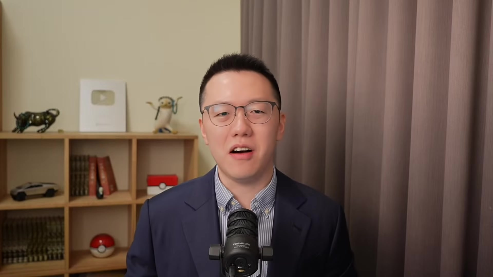

**逐字稿片段：** 我們看美國股市的重挫情況 道瓊指數暴跌了1,833.3點四% 收在51,523點 線型看起來還好 但是越往科技股越慘 標普百指數下跌3百三十四點 4.36% 收在7,353點 納斯達克指數下跌1,421點 5.52% 收在24,315點

**話題推測：** 開始討論美國股市的重挫情況，預期顯示整體市場圖表。

---

## 00:01:00

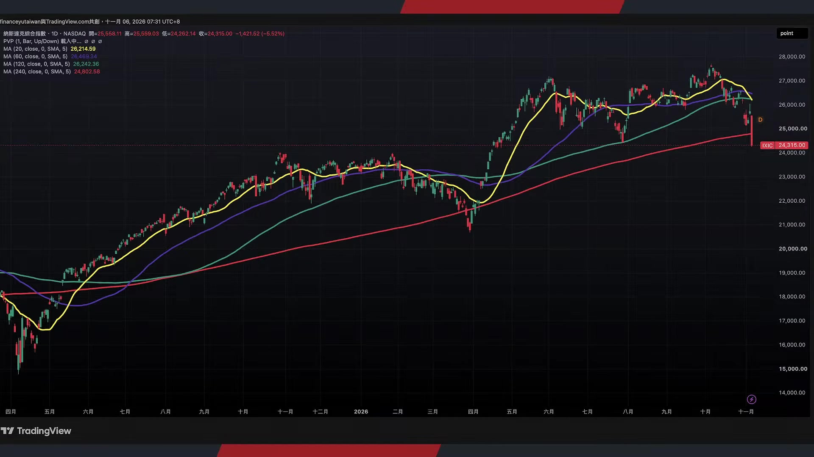

**逐字稿片段：** 重點是費半 這一根有夠痛 下跌1,257點 12.25% 已經跌到9,011塊了 費半已經正式跌破了萬點大關 費半這一根真的要跌死人 直接跳空往下掉 萬聖節已經過了 我們還在公園扮窮鬼 美國股市現在這一波的劇烈賣壓 它算是板塊上的熊市哦 因為其實從其他三大指數來看 還算是一個正常的均值回檔 從周乖離等級哦 可是費半這種下跌它已經 媲美於月線等級的下跌了 等同於 似乎有一點流動性系統性風險的味道 雖然 今年即便跌到現在這樣的位置哦 它今年年初到現在都還是正報酬 可是肯定大多數今年投資人 是非常有感衝擊的

**話題推測：** 講者將焦點轉向費城半導體指數，預期顯示其特定數據或圖表。

---

## 00:01:48

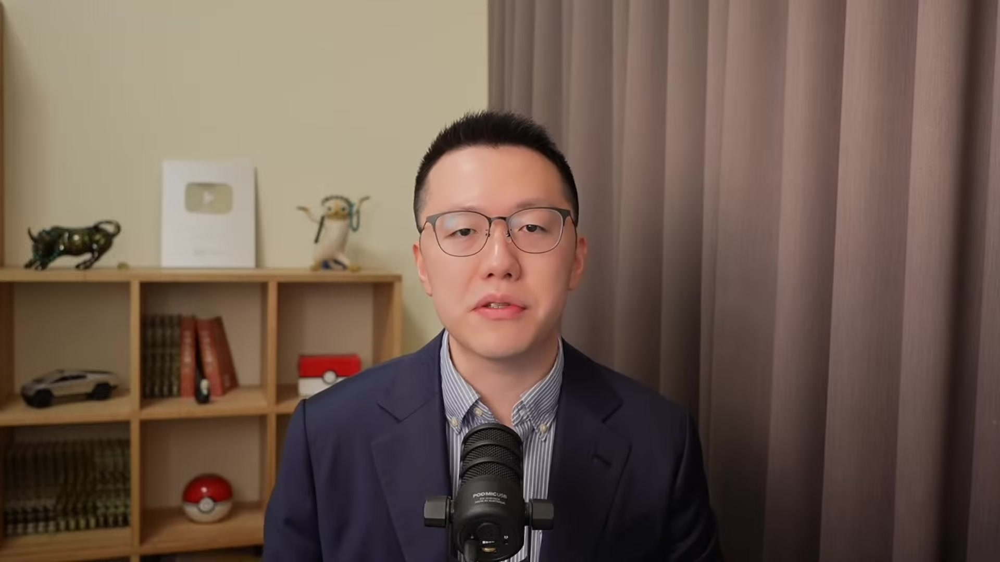

**逐字稿片段：** 昨天AMD是暴跌了17.26% 博通跌10.4% 輝達跌了9.2% 英特爾跌了13% 高通跌了9.49% 那記憶股更不用看 剛才韓國股市已經停牌了 美光跌了17% 威騰跌了7.35% Sandisk跌了22% 希捷跌了16% SK海力士ADR是跌了13.4%

**話題推測：** 開始列舉個別半導體公司的股票表現，預期顯示各股數據表或走勢圖。

---

## 00:02:11

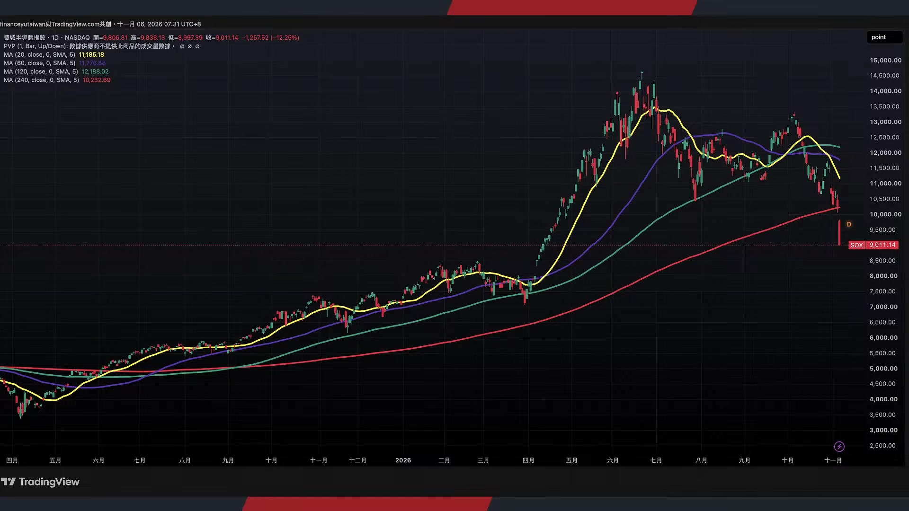

**逐字稿片段：** 那臺北股市台積電ADR的 部分是跌了10.78% 日月光ADR跌了20% 聯電ADR跌了16% 中華電信ADR誒 小跌0.24% 還沒收漲 但至少可以看得出來 民主黨的AI監管真的有比 關稅戰還要來的恐怖嗎 連我這種 只持有現貨的 我都感覺已經到痛了 心臟有點痛 那上杠杆的人 這一波真的撐得下去嗎 我現在已經沒有在大久保公園了 這種慘狀根本擠不進去

**話題推測：** 話題轉向台北股市的ADR，從台積電ADR開始列舉。

---

## 00:02:42

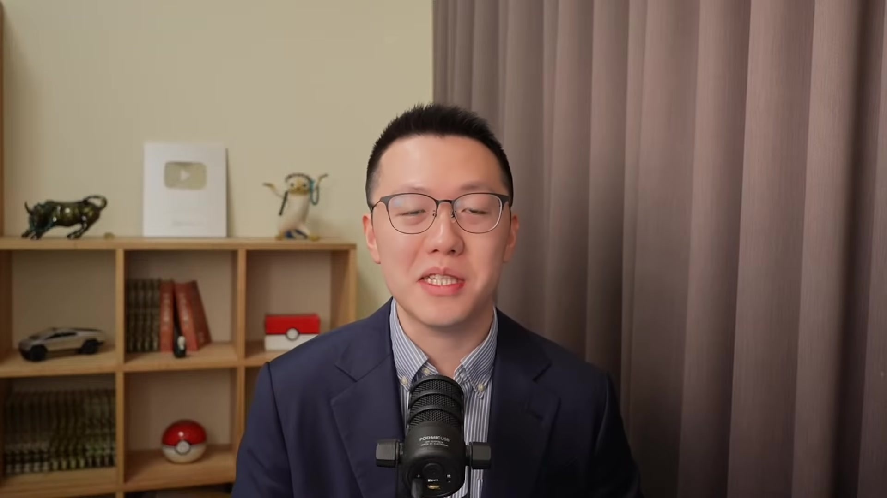

**逐字稿片段：** 我們看昨天台指期夜盤了 昨天也跌了差不多有接近 3,000點了 好那現在我們就看待會的市況 會不會真的跟韓國股市一樣 開盤即收盤哦 但這到底是一場人造危機 還是一場 買入的機會呢 我們今天要從不同的角度來做思維 正常來講 長期投資人這種利空沒有人躲得掉了 這種利空沒有人想到嘛 因為光是一個AI監管會 比去年的關稅戰恐怖 如果你一點部位也沒有 要麼就做交易的 要麼大概過去2年行情你也不在場了 那這一次我們叫細節來做觀察 因為民主黨奪下國會參眾議院之後 造成市場針對AI資料中心 評估建設速度的放緩 形成全面性的衝擊 那這樣的一個情緒反應 到底是否有其道理呢 先從恐慌情緒來做觀察

**話題推測：** 討論台灣期貨夜盤的最新表現，預期顯示相關走勢圖。

---

## 00:03:33

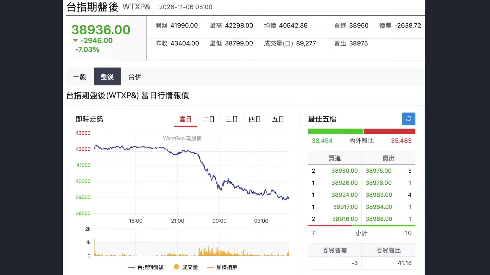

**逐字稿片段：** 從恐慌指數VIX哦 這一次是單日暴漲了70% 來到28左右 不過呢恐慌指數急漲也不代表 股票市場一定會持續下跌了 以前呢常常我們看到歷史前 二十大的VIX單日漲幅事件 標普百在事件發生之後 未來一個月平均還上漲兩% 三個月還上漲5%呢 好所以的確這種恐慌感的上行哦 它的確已經奠定了某種情緒基礎 那你到底是VIX指數在下方 15 16的時候是相對一個好埋點 還是來到20以上呢 上一次這麼恐慌大概 是美伊戰事的時候 當然了現在的恐慌感跟關稅戰呢 還是無法媲美的 不過這種跌幅其實算是蠻像的哦 值得特別留意

**話題推測：** 開始分析恐慌指數VIX，預期畫面顯示VIX指數圖表。

---

## 00:04:15

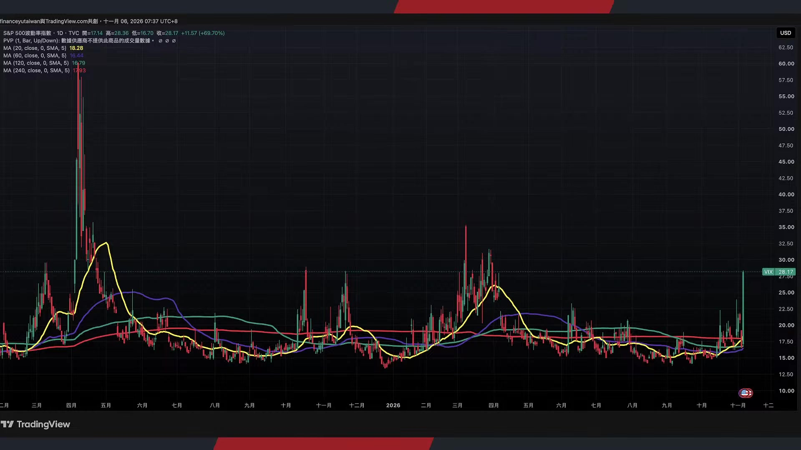

**逐字稿片段：** 至少川普 剛才在5-10分鐘之前呢 也在truth social發文呢他 表示說今天的股市崩盤 就是因為民主黨在週二大勝 看到這種情況實在是令人擔憂 但是你們只能怪你自己 哈哈 與此同時呢 他也發了另外一條推文 他說現在呢 美國股市 經歷了史上最糟糕的交易日 原本花費大量的努力才能夠讓 股市達到前所未見的高度 結果卻因為選舉結果遭到破壞 那連民眾的401K退休帳戶都跟著縮水 川普特別強調 記住這是共和黨 造成美國股市的繁榮 但是呢民主黨是破壞的象徵 他也呼籲支持者不要害怕 美國很快就會以某種方式 比過去來得更加強大 你還在講風涼話 趕快拉股市 川普的態度這樣 你看吧不選我就這樣 他是不是忘記去年4月 份他搞的事情呢 民主黨現在還只是喊了 也都還沒做 你已經先做了關稅戰了 所以不同角度 同樣回到關稅戰的時間線 你會用同樣的邏輯來看待現在行情嗎 都是外部性的這種衝擊 當然民主黨這一次勝選之後的停喊AI 它主要是從幾個因數互相爆發而來 我們看這一次

**話題推測：** 轉向討論川普對股市崩盤的社群媒體發文，預期顯示推文內容或相關新聞截圖。

---

## 00:05:29

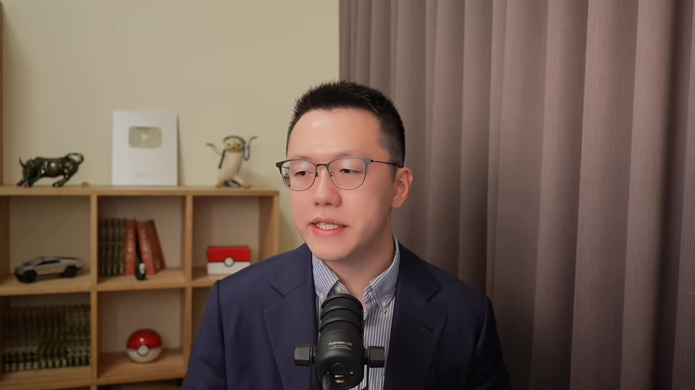

**逐字稿片段：** 一方面當然是桑德斯 因為桑德斯一直就是極左了 本來就是一直希望 針對AI做更進一步監管 我們主要觀察的是 部分的黨內的進步派 中間派 的確也開始贊同全面 的整頓人工智慧產業 這一次來自亞利桑那州的

**話題推測：** 深入探討AI監管政策的推動者，從桑德斯開始介紹。

---

## 00:05:44

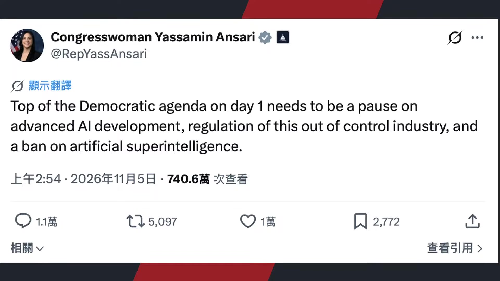

**逐字稿片段：** 民主黨的眾議員安薩里 他在昨天在 社群平臺上表示 民主黨上臺之後的首要 議程就是暫停先進AI研發 監管這個已經失控的產業 並且全面禁止人工超級智慧 恩薩里 他是從25年起就已經 擔任了聯邦眾議員 參與國會的網路安全 那隨著現在民主黨在明年 即將握有全面優勢以後 市場上就開始做更進一步的投射 當然了這項法案不只是要求科技 公司放慢AI的研發進度 他是希望計畫成立新 的聯邦人工智慧部 我們應該由中央來進行全面性的監管 因為 之前我們知道川普只是跟幾隻 巨頭一起簽了一份聲明書而已 根本就沒有具體的 中央法律來做AI監管 現在都是地方而已 所以呢他認為 應該要採取這樣的一個方式 直到政府完整的 建立安全監管機構 同時禁止開發可能超越 人類認知能力的超級AI 如果違規者可能會面臨20年的監禁 到時候Jensen就要坐牢了 態度是這樣子 當然了你看這不就是 反映民意嗎 民意他可能反映有點有有點極端了 但民意就是希望你增加監管呢 果然是左派大勝 你看一天就瞬間拉近了 貧富差距 一下子我跟馬斯克的財富 距離就稍微縮水了一點 好那不管怎麼說

**話題推測：** 介紹亞利桑那州的民主黨眾議員安薩里對AI監管的具體主張。

---

## 00:07:02

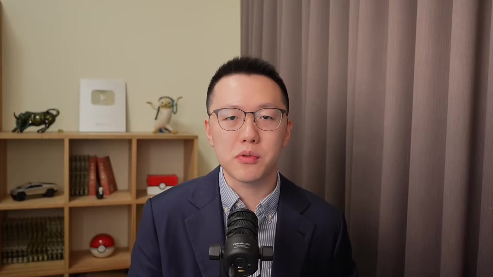

**逐字稿片段：** 這一次德州因為民主黨幾乎全拿下 德州只是第一槍 我們就要看一下到底 針對資料中心的建制 到底會有多大衝擊 你要知道 民主黨一堆眾議員 他的股票也都是科技股現在呢 具體具體來說 的確整體在資料中心的 容量最大的還是德州

**話題推測：** 話題轉移至民主黨在德州選舉的勝利對資料中心建設的影響。

---

## 00:07:21

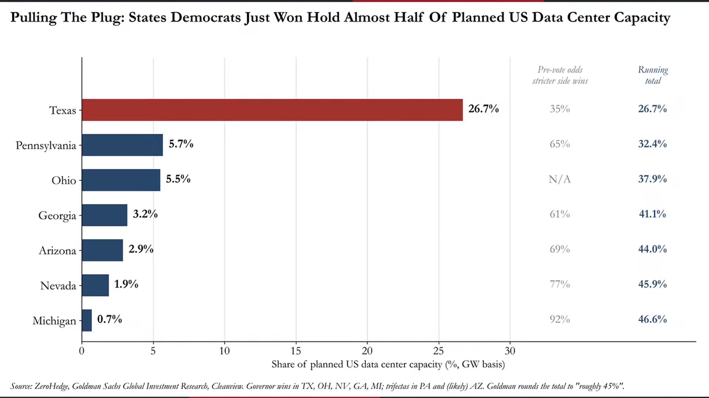

**逐字稿片段：** 大概占了26.7% 你把其他主要幾個搖擺州加 起來都不如德州還要來的多 那可是呢 民主黨現在的操作 難道他不知道 如果造成經濟上的絕對危機 會形成在2028年 民主黨難以奪回總統寶座嗎 民主黨一定清楚知道 這一輪他的勝選 基本跟dei 跟民主黨的理念也沒有什麼太大相關 根本就是購買力衰退 通膨的問題嘛 所以現在民主黨所採取的做法 他是不是真的是為了心中的理想 還是只是必須要快速的反映民意呢

**話題推測：** 提出德州資料中心容量佔比的具體數字（26.7%）。

---

## 00:07:55

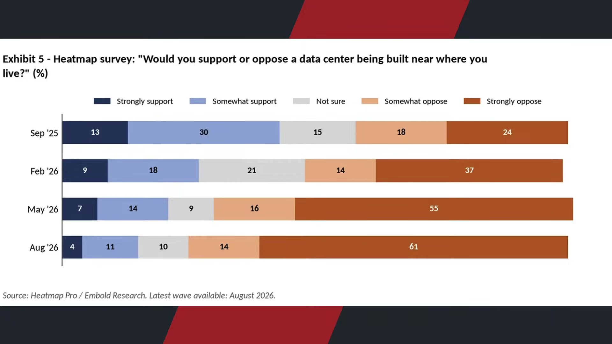

**逐字稿片段：** 我們按照過去益普索的統計哦 在今年10月份 基本上本來在 支援家裡附近新建資料中心的比例 是從去年的10月份的42% 到現在只剩下15% 反對比例來到75% 在美國住在資料中心旁邊 跟住在焚化爐旁邊 幾乎根本沒有任何的區別 這個就是美國民意的一個反應吧 那當然 隨著美國20州陸續發表 可能要考慮暫停建設之後 德州的衝擊當然是首當其衝的 因為德州剛才聊到嘛 是AI製藥中心最大 目前增長最快的核心重鎮 那另外一方面

**話題推測：** 引用益普索的統計數據，分析民眾對新建資料中心的態度。

---

## 00:08:31

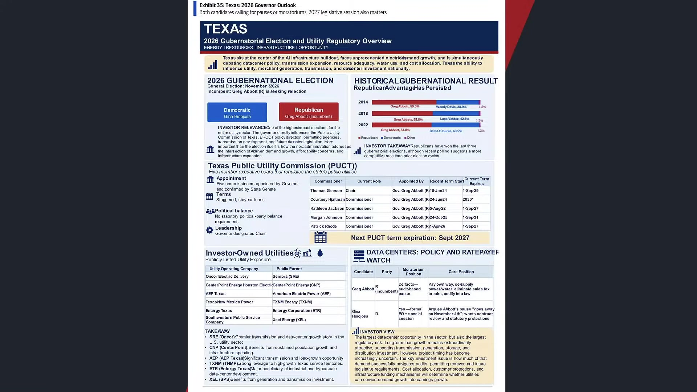

**逐字稿片段：** 像是喬治亞州 好現在呢 民主黨因為波頓斯 他在選前是主張全州 暫停新建資料中心 至少1年起跳 把電價環境衝擊漢社區 負擔全面評估好之後 讓大型科技公司自行 承擔電網擴建成本 那我們就允許你繼續建下去了 但是要給我們1年的 時間來做細節探討 那另外一方面是俄亥俄 俄亥俄是兩黨其實都宣佈 要限制資料中心的發展 民主黨比較傾向于直接停止開發 然後呢進行細節溝通 電費上或者在各種配套措施的調整呢 那共和黨的部分呢 則是認為 應該要放緩進度 針對電價和電網投設 要求更多的一個要求 但不管怎麼說全 全美的建制量好像 瞬間就這樣子縮下來了 有可能嗎 我覺得基本上更像是 一種政治上的表態 而並不是 全面性的放緩 就算放緩 那就股價就盤一年嘛 等隔一年EPS再後續跟上 但是呢從目前來看呢 其實市場上的建制需求還是很強烈的 更何況 美國不建 難道海外市場不能夠建嗎 我們看一下這一次德州所採取的做法 民主黨因為這一次是擊敗了 連任三屆的共和黨州長亞伯特 所以呢共和黨籍的州議員呢 在昨天哈里森公開呼籲 趁著共和黨因為還有10州嘛 才要進行政權的交接 應該要立即召開特別立法會 來修改州長的緊急行政權限 他主張州長不得夠 任意的去暫停或者修改現行法規 緊急命令未經過州議會批准的話 應該要在30天內自動的失效 所以現在就是 因為已經當政當太久了嘛 怕你一上臺把我們之 前政策全部推翻了 我現在先限制你州長的權利那 現在眾議院還是共和黨吧 用這樣的一個方式來去制衡你 這就是我們看到的實質現象 當然了這一種股價上的一個重挫 到底是否反映的是系統性危機呢 我覺得我個人覺得 股價是認跌蠻重的 但是第一 今年四大指數都還正報酬哦 今年臺北股市哦 搞不好今天跌這一根 今年臺北股市應該也還是正報酬 那重點是什麼 民主黨大勝 它的確對於短期內的AI資料 中心看起來有劇烈傷害哦 可是資料中心的放慢擴建 難道不是讓AI榮景可以 延長更久的關鍵嗎 我們仔細想一想 這一次集中選舉最大 的一個意涵是什麼 就是通膨嘛 你AI已經造成的副作用 造成的3C電子通膨 零組件的通膨 已經侵害到原本的民間的 生存壓力了 所以我要求你處理通膨問題 那你現在處理了 你讓AI資料中心 你也不是停止發展 要緩下來 更多的監管了從 民意角度而言呢 它完全是反映民意真實的要求 它又不是禁止你發展AI 而是要求更多的監管 從這樣的一個角度來做思考的話 等同於 科技巨頭 現在借由適度的讓利 更多的成本考量 更多讓利給民間 來換取AI資料中心長遠的建設 要不然過2年 如果總統大位真的是民主黨拿下來 到時候才採取AI監管 那個衝擊會有多大呢 所以我個人的看法是 不會因為換黨就真的把AI 行情全部給停下來了 我覺得現在 這種行情呢 你還不吸引你想要買 點股票做長期投資的 那你大概就真的不相信AI了 那可能是價值觀的問題哦 所以不管你怎麼說啦 我們現在看各大股票市場的表現

**話題推測：** 討論喬治亞州對資料中心建設的政策和主張。

---

## 00:11:46

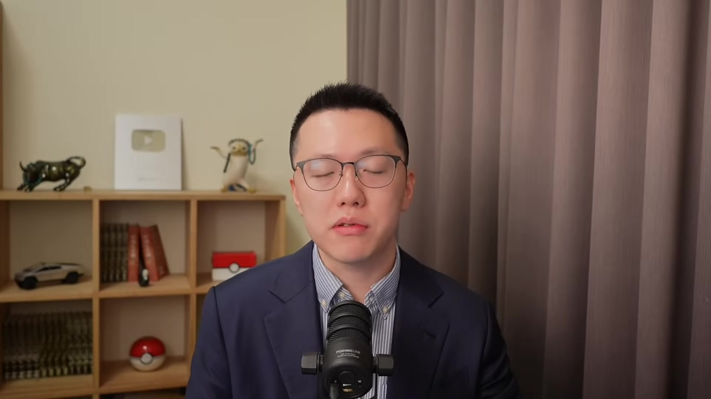

**逐字稿片段：** 從SOXX來看 從高點這樣跌下來 大概已經跌了3成5左右 接近到4成了 那即便大家的獲利都在暴增呢 可是我們看得很清楚 現在本益比 就是瘋狂的下滑 因為獲利還在往上拉 但是股價已經全面做鬆動了 從目前晶片股來看 半導體的股票估值哦 因為輝達GB200晶片的算力相關 的價格大概是今年上漲50%左右 H100價格年增幅大概26% 甲骨文的AI服務續約和轉售 的平均溢價也來到20% 這說明其價格都還在上漲當中 但是呢獲利不斷的進來 它沒有造成非常顯著的價格上漲 就是本益比的持續走低 費半 現在本益比 現昨天是16.18倍 這樣子一跌哦 今天搞爆剩下14倍哦 這個不是什麼近年的相對低點哦 這有可能會接近到2022年或者 本世紀以來的相對低點了 那我們就看到底本輪行情 只是一個景氣循環的過渡期 還是它是AI生產力爆發期當中 難得一見的低點 納斯達克指數 也難得完全跌破了200日移動平均線 所以其實重災區是在費半 不過呢我們也過去也提過 那全球股市現在的重挫 市場那個恐慌的氛圍又開始到來好像 世界末日了 你把時間稍微拉長來看

**話題推測：** 開始分析SOXX ETF的表現，預期顯示其走勢圖。

---

## 00:13:05

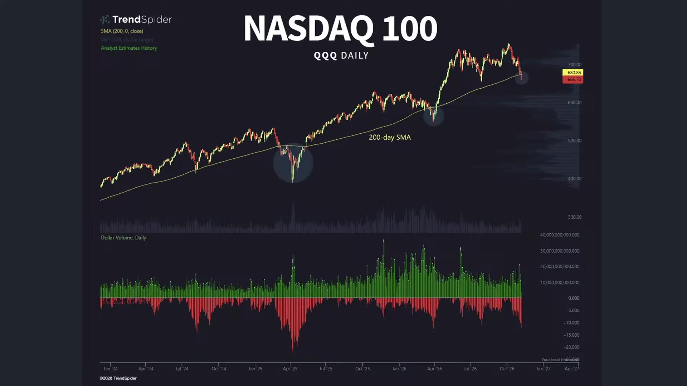

**逐字稿片段：** 你看一下標普百指數 過去幾百年歷史的表現 你會發現一個有趣的事實 其大多數美國股市都是上漲的哦 今年今年就算這樣跌成這樣子哦 今年標普都還是正報酬 就好像2020年的新冠疫情 誒全球經濟都停擺了 美國股市 短時間內多次的熔斷 每個人都覺得經濟要完蛋了 結果標普百指數從2020年年初 到年底居然漲幅還有18.4 2025年川普發動了關稅戰 大家都擔心全球貿易要崩潰了 經濟要進入衰退了最後 年成長還有17.9% 好那現在回過頭看到2026年 市場上因為各種消息 有AI的監管 有美伊戰士的停止性通膨 我跟你講 你放大10-20年的投資生涯當中 你往往只是長期上升 曲線當中的一個小波動 再過幾年呢 我們搞不好根本忘記2026年 的利空到底在跌什麼了 但是你卻會記得自己當年 因為恐慌而砍在最低點 那你當然 我們不建議大家過去一段時間呢 極度的放大杠杆 就是在等待這個線化 有持續拉回的時機 那當然有些人覺得資金已經很緊繃了 那也沒關係嘛 你這個時間點 你不願意放大杠杆沒關係 有些人可能這個時間點 可能去持押去質借了 但重點在於哦 長期的美國股市的三代牛 它就是這樣子一年一年形成的 每一年都有重大利空 對美國股市 我們一直講說有一個信任 一個不信任 一個不信是 我們不相信美國股市只漲不跌 一個相信是 長期來看 美國股市其實都是上漲的 股市本來就是一個等待的行業 誰能夠等得起 誰就是最大的贏家 投資中心哦現在 資料是否會建制延後 這個股價會影響到 但是你的中心投資邏輯不會改變嘛 那就跟你那開車握方向盤一樣 你只有不斷的左右調節 你了解說本來市場就會擺蕩 車才能夠開成一條直線嘛 所以為什麼我們建議大家 以ETF的方式來參與行情 因為個股應該熬不過去哦 但是我們未提過 你投資年限太長了 很少有企業確保我們30年 50年之後還能夠在榜上 那操作上你就要變成一直換股票 那判斷越多失誤就越多嘛 所以你借由看好AI科技型ETF的方式 持續地看好大盤一方面 看看你們能夠在低點 的時候多加買一點 超越大盤的報酬 另外一方面 你也能夠分散風險嘛 我們講量變引起質變嘛 你跟一個男的聊天 你會栽在他手裡嗎 你跟一群男的聊天 機會就往往掌握在你手裡 所以這個時候就 彰顯了分散風險的作用 不然個股的話 一次就把你給少期少出場了 所以我們才講說要適度的做回測 要了解說我們在長期河流圖當中 其實只是一個小小的點而已 不要因為一天的股價 大幅的影響到心情 你加上指數 再做上回測的明確結果 你就不會有那種個股終究 有掛牌時間上的局限了 之前我們講說嘛 公司有4種 好的普通的爛的看不懂的 那股票也有4種嘛 低估的高估的合理的估不准的 那人的時間呢精力腦容量都有限嘛 那看不懂的公司已經占了一半 看得懂公司估不准大概又占了一半 看得懂又估得准的 被高估也占了一大半 看得懂又估得准又沒被高估的 爛公司占了一大半 剩下的股票你去挑 合理股價的普通公司又占了一大半 所以一般情況當中 在多頭氛圍 那股票沒什麼好挑的 那一樣在股價回檔的過程當中 每一隻都好想買哦 那不如買ETF嘛 我們講說你就由回測的資料 來瞭解你的投資中心邏輯 現在如果你知道該怎麼做 那你一定有自己的中心邏輯 你現在才想該怎麼做 好你要好好檢討一下 我們一直講說要經過大量的回測 形成自己的投資中心邏輯 一個以前開玩笑嘛 一個女孩子哦 最值得擁有的丈夫是誰 考古學家嘛 對你年紀越大 老公對你越有興趣 所以你要看那個歷史河流圖 你知道嗎 就是指數你拉得越長看 你會發現 其實也還好啦 我們舉例 假設現在是整個科技 革命的一個初期 就算是從96年到2,000年的網路泡沫 納斯達克指數在正式崩潰之前呢 它其實也出現過非常多的修正 有的時候跌一成7 有的時候跌13% 有的時候跌到3成 有時候跌10% 哎納指現在才跌10%而已 跟費半比較起來 算是小巫見大巫了 好那我們回過頭看現在的重災區哦

**話題推測：** 以標普百指數的長期歷史表現來闡述投資觀點。

---

## 00:17:18

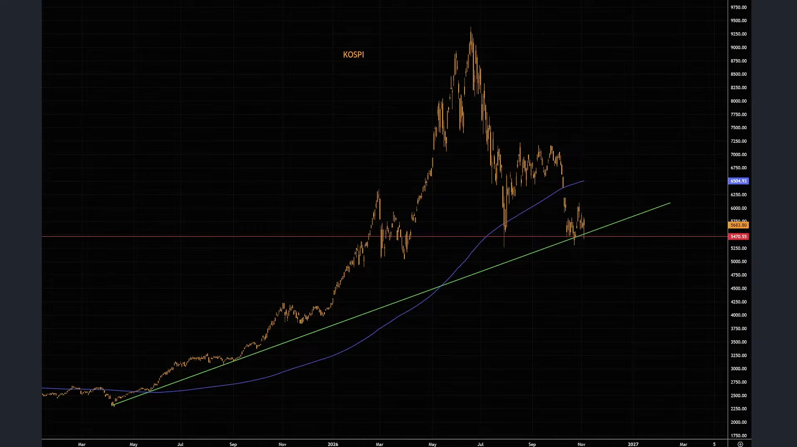

**逐字稿片段：** 因為韓國股市剛才已經熔斷了嘛 韓國股市這一次哦 其實在熔斷之前呢 整體跌幅已經算重挫了 韓國記憶體大廠 SK海力士從高點已經跌了53% 三星也跌了40% 避險基金在亞洲股市的調節當中 是針對韓國股市 做全面性的調節 比臺北股市賣壓還要來的重 最離譜的是什麼 昨天稍微看了一下 韓國KOSPI指數預估前瞻本益比 已經降到幾倍 兩倍了它只剩下兩倍它 如果是過去一年 它還曾經來到十幾倍以上 它現在兩倍的本益比 你能想像一個大盤只有兩倍本益比嗎 有夠離譜的 全球資金配置來看 韓國股市的確去杠杆的降溫 在7月份就已經開始了 8月9月10月其實上杠杆的 幅度也沒有持續加強 但現在仍然避免不了殺盤 說明什麼 這波跟那個殺融資 洗籌碼也沒有太大相關了 那個就是美國股市引發的壓力哦 就算台股都沒有融資沒有人 任何人借錢 台股都得跌啦 這個是國際股市的賣壓

**話題推測：** 轉向討論韓國股市因熔斷而重挫的現況，預期畫面顯示韓國股市指數。

---

## 00:18:19

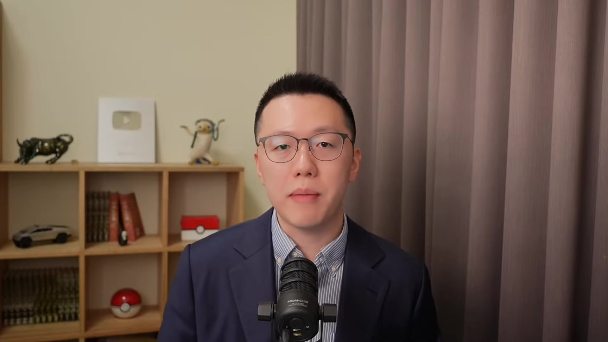

**逐字稿片段：** 好那我們回過頭看臺北股市 臺北股市因為過去 6天已經跌了5,461點了那今天 今天看起來搞不好開盤即收盤 那不管怎麼說 還是值得特別留意的方向是 現在外資針對整個臺北股市的調節 因為它的位階本來就比較高 相對于韓國股市哦 過去我們看到嘛 它可能從現行上有補跌的壓力哦 可是呢從內資的角度而言呢 今天是一個重要的關卡量畢竟呢 今天一定會有很多人接股票嘛 從心態來做觀察 其實你看在昨天呢 應該講這幾天呢 外資其實賣壓雖然很重 但其實它就是一個均衡性的賣壓 也沒有賣到史詩級高點呢 昨天三大法人 我還稍微看了一下 昨天外資是賣了1,024億 三大法人加起來

**話題推測：** 將焦點轉回台北股市的當前狀況。

---

## 00:19:03

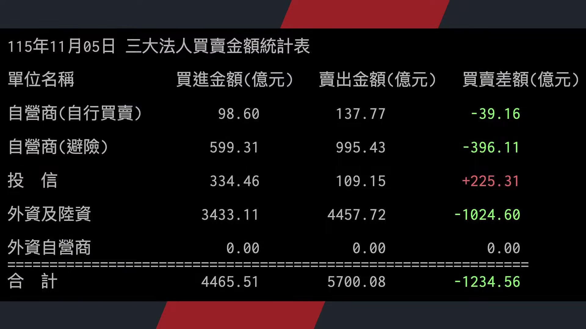

**逐字稿片段：** 一共是賣了1,234.56億 123456 台股順起來 怎麼賣的這麼準 不管怎麼說 其實這幾天外資也 沒有說針對臺北股市 做單一針對性的調節 但是呢我們都很清楚知道 這種系統性的調節 在今天外資就會是重要賣壓那今天 百80%了 那這個大多數散戶都是買的 我們看投信有沒有可能轉為正買超 今天如果按照過去的慣性 今天官股一定是大護盤 可能來不及 來做更多的宣誓和談話 好但今天一定會有複盤色彩 那股票市場為什麼講說 最可怕的地方在這邊呢 因為就是美國選完了所以 暫時沒有人很在乎 那已經選上的 股市跌一跌有什麼關係 剛好我可以買股票 那川普剛好就怪給共和黨嘛 也沒有什麼想管的 那臺灣還沒選呢 臺灣還有一個月 股票市場最可怕的地方就是它不 只是影響投資人的帳面損益哦 它還會透過財富效應來 影響整個社會的消費量 你台股每天創新高 看著股票帳戶不斷增值哦 還沒獲利你都覺得自己變有錢了 出國機票就該買下去 汽車開幾年就想換新車嘛 房子住得好好的也想換大一點嘛 那你如果台股像每天這樣 跌跌跌到月底就歸零了嘛對不對 情況就完全相反的 原本賺幾百萬的 現在變賺10萬 連本金都開始虧的時候 唉這個時候哪有心情消費 周年慶也不去了 機票也不買了 車子也不用換了 房子也不用換了 所以你大概可以瞭解 未來一個月的 我們看到中央的態度 一定是相當積極的 至少要守住市場上幾隻重要關卡 從整數關卡的4萬點 或者至少到年線 3年線差不多 那國安基金就要進場了嘛 這種就是財富效應的轉變 因為這幾年很多人的消費也 不是真的自己本業收入增長多少 就股票賺太多賺太多 他也沒賣就 財富效應的增幅嘛 那現在呢 財富正在緊縮當中 以前我們跟大家開玩笑嘛 前兩天我們講的 本來要去羅馬的 現在只能去羅東 本來要去泰國 現在變成去泰山 本來要去香港 現在變鹿港 本來要去蘇黎世 現在輸到要離世 本來要去俄羅斯 現在只能眼眶濕 本來想去東京 現在只能回家看東京熱 本來要去六本木買包包 現在只能在家看一本道 本來要去吃米其林 現在只能吃霜淇淋 本來要吃島語 現在改吃豆花 所以你看 美國股市這種賣壓 其實跟融資目前的一個 減幅也沒有太直接相關了 重點是費半要止跌了 那當然了 那如果假設這種跌法 那年尾大家也不用選了嘛 這臺灣也有地方選舉的問題哦 現在我們都很清楚知道哦 今天如果跌10% 那就到3萬83萬7了嘛 如果下禮拜每天都跌10% 下禮拜五就變2萬2了 那11月20號就變1萬3了 那到選前前一天就變7千 怎麼可能嘛 所以這種急跌哦 其實蠻有趣的哦這種 如果他是緩跌 每天跌500點500點哦 那個搞爆場控 這種級跌哦 哎我覺得乖離拉得很大了 非常不適合這個時間點離場 如果是杠杆的問題 那沒辦法但是哦 就算你想要離場哦 有個股的部分哦 可能都要等反彈再停損了 因為現在就是真的 完全被洗出場的時候了

**話題推測：** 報告三大法人在台北股市的總賣超金額（1,234.56億）。

---

## 00:22:18

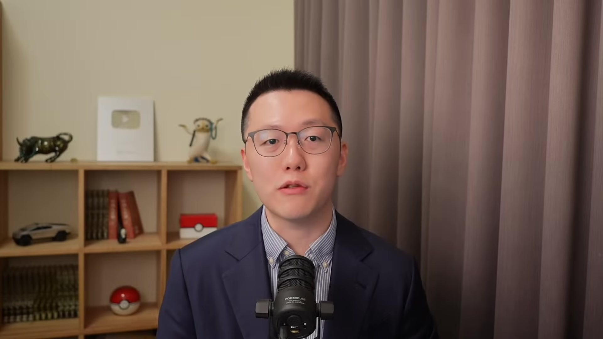

**逐字稿片段：** 我們看一下融資維持率的部分 如果是以大盤融資維持率來看 大概降到163左右 這個是從我們看 之前鄭交所所公佈的整戶維持率 我們現在重點要觀察的 是扣除ETF資券進出行情 因為之前都講133斷頭嘛 昨天其實已經碰到134了 所以昨天已經在一個邊緣了 基本上已經很多人先行離場了 那現在又進一步的往下降 短短兩周大概降幅有11%吧 雖然整體融資降的幅度還是 沒有比臺北股市還要來的快哦 不是差不多都已經碰到警戒線了 因為融資減少不代表 籌碼已經完全洗乾淨了 你看11月5號融資餘額雖然大幅下滑 但是融券餘額 誒還反而 我們看到有一點鬆動 還有點增加 好這說明的接下來的 融資餘額是否能夠下滑 它是一個重要的關鍵 可是最重要的還是看 美國股市只要止跌 好那這一波應該就穩了 最重要的事情是 我們過去提過 你像是臺北股市跌成這樣 那個正2散戶是真的沒有在怕了

**話題推測：** 分析大盤融資維持率的變化，預期顯示相關數據圖表。

---

## 00:23:18

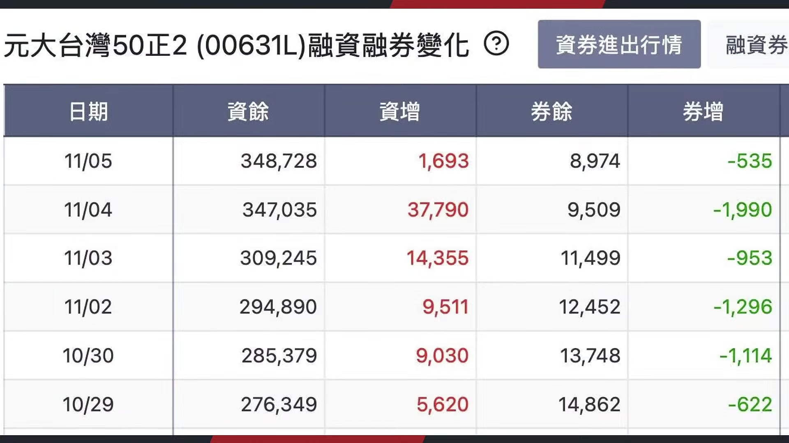

**逐字稿片段：** 我們看00631L 元大臺灣50正2 那真的是完全反方向 那沒有資減過 從 276,349張 到現在已經34.8萬張了 短短6個交易日已經增加了 72,379張唉 增幅是26% 臺北股市都跌了快要兩成了 結果它的融資還增加26.2% 這說明 這是有部分人真的是很相信 這種長期放大杠杆的進一步增長 那你買現貨也沒什麼問題 但你融資買 我相信肯定是有一點壓力的 我們一直講說杠杆是拿來超車的 不是拿來飆車的 你臺北股市連續的重挫那 你繼續的買現貨 其實也沒什麼問題嘛 那你就是長期運行著景氣 低點或者股價回檔來做佈局 有什麼關係 但是如果你是融資買正二 如果你是上杠杆來做投資 誒其實哦 這一波應該也是會洗掉不少人 事實上昨天必須承認 主動型ETF跌幅還比正二來得重 那 現在我們來具體觀察 現在股價從主動型ETF的回檔 今年都還是正報酬 有沒有可能把上半年 的漲幅全部給吞掉呢 因為臺北股市哦 雖然我們知道 部分投資人的確有上杠杆的意願 可是相對韓國股市哦 那個意願幅度其實已經小得多的 另外一方面呢 對於美國股市而言呢 其實有非常多人採取這樣的一個做法 也許這一波的洗盤 對於市場的穩定度來得更為健康 也就是今年雖然可能從 年底來看還是一個大牛年 可能漲幅還是十幾% 二十幾% 可是最終呢 獲得利益賺到錢的人呢 可能是極端少數 我們從美國股市上市ETF在10月 其實已經吸金超過2,000億美元了 那尤其針對杠杆型ETF 一個月增加了130億美元 那這樣的一個效果 就導致了其實市場上在 10月第一波下跌的時候 大多數人還是抱持著逢 跌必買的一個心態誒

**話題推測：** 探討00631L元大臺灣50正2這檔ETF的融資情況。

---

## 00:25:14

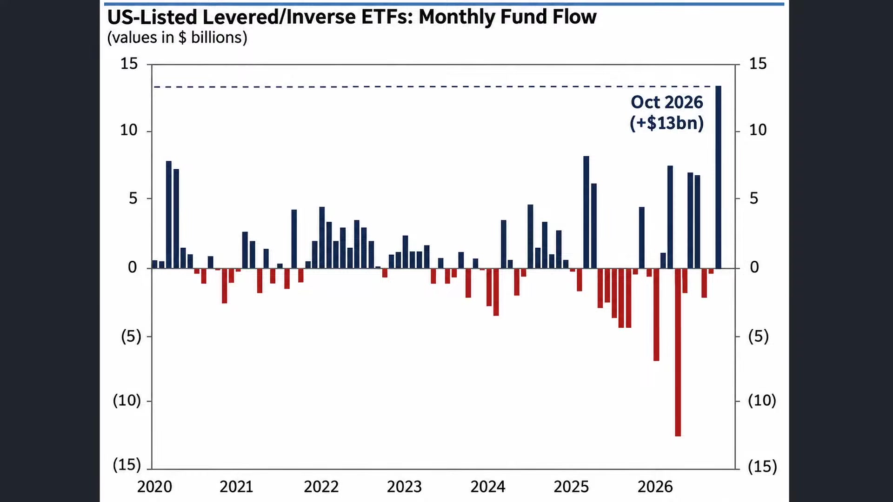

**逐字稿片段：** 現在呢如果我們看SOXL 很多人買的不是兩倍 買的是3倍 SOXL是費半的3倍杠杆型ETF 最可怕的地方就是漲的 時候你覺得自己是股神嘛 因為漲得特別快 跌的時候誒 現在已經回到年初的價位了 SOXL 26年一度衝高到300美元附近 現在跌到45塊 已經跌八成了 幾乎回到2025年年底的水準你跌80% 你要上漲500%才能夠 回到原本的高點 這個就是杠杆ETF最大的陷阱 而且它會有耗損的問題 所以如果只要波動長期 持續在這樣的一個區間呢 你一樣報酬會慢慢的被稀釋 這個就是又回到最初的起點 呆呆地站在鏡子前 不要糾結不要糾結 基本上 我覺得也不要糾結什麼AI資料中心呢 會大幅放緩的問題 按照這種效果 財富效應讓民主黨2028年也不用選了啦 也不是所有的反思都有用的 現在一直去糾結 嗯AI資料中心到底會拖慢多久呢 推慢三個月 推慢半年 推慢一整年 我覺得有時候糾結於這些 新聞也沒有太大作用 針對自己原本的操作 策略來做決定就好了 好並不是所有的反思都是有用的 有時候你要糾結對問題 你要糾結的是現在的現金規劃 能不能足以抵擋進一步的恐慌發酵 你能不能要確保自己不被洗出場 這個反思是有有用的 那如果你一直思考那資料中心 怎麼辦呢 到底會延多久 熬不熬得過去 我就想了老半天 你也不會有結果的啦 之前那川普不是講過 那個什麼政治笑話 之前一隻烏鴉站在樹枝上嘛 嘴裡就叼著一塊肉 下麵有一隻狐狸路過 那很經典的場景 狐狸就問烏鴉 烏鴉烏鴉 你懂政治嗎 烏鴉不出聲 狐狸又問 烏鴉烏鴉烏鴉 你這一次集中選舉你有投票嗎 烏鴉還是不出聲 烏鴉烏鴉 那你下一次總統大選 你要投給共和黨還是投給民主黨呢 那後來那個烏鴉實在忍不住了 我投民主黨 哎結果我們都知道 那肉就掉下去了嘛 那狐狸就叼走了 那烏鴉就站在那個樹枝上 很後悔呀哎呀 肉被叼走了 然後開始反思 哎我剛才的問題回答 如果我是不投民主黨 我投給共和黨 會不會好一點呢 會不會是這個結果呢 股票市場 它不是所有的反思都是有用的 你要瞭解現在最重要的是什麼 要控制自己的部位 要確保能夠在本輪的回檔當中活下來 好我們看一下美國股市 到底目前的回檔情況為何 如果是從美國股市科技股 標普百指數半導體類股的預估本益比 來看現在大概是13.8倍 比整個標普百指數還要便宜了25% 以折價幅度來看 哦那可能是12月份以來的最大哦 費城半導體指數的本益比 大概也比整個大盤大概低兩倍左右 那如果是從 相對標普500指數來做觀察的話 好大概是本世紀以來的最低 那另外一大方面呢 是其實從大型科技股來看 本輪跌幅並不重 所以它算是單一板塊熊市 那臺北股市又跟費半有高度聯繫 所以會形成這樣的一個影響 你看前陣子 前兩天微軟和蘋果還創下歷史新高呢 那第三個好處是

**話題推測：** 分析SOXL（費半三倍槓桿型ETF）的驚人跌幅及風險，預期顯示其走勢圖。

---

## 00:28:22

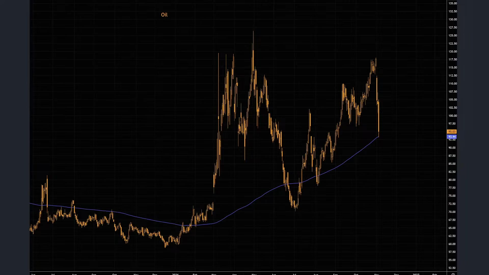

**逐字稿片段：** 誒你有沒有發現 殖利率下來了 過去我們一直擔憂的 那個利率水準很高錢太貴 現在其實是不是都是往 通膨降溫的方向走呢 之前你擔心通膨會造成停滯性通膨 會失衡 現在告訴你沒有停止性通膨啦 聯準會搞爆連12月份都不用升息啦 但是你好像也不是很開心 所以市場上 只是在尋找利空 給自己賣股票找一個藉口而已 那第三點呢 是從其中選舉之後 我們過去一直提過 本來在其中選舉當年的 市場波動就會相對來的大嘛 我們如果從過往角度來看 後續通常 在其中選舉年呢 平均跌幅 最大從高峰到低峰 大概平均跌幅是17.5% 那後續的彈幅一年呢 大概是30一%起跳 這說明著按照歷史經驗呢 如果其中選舉年所 造成政策的不確定性呢 最終在未來一年都能夠否極泰來 好當然這只是歷史經驗呢 如果不准的話 那我再找其他圖 這是唯一的方式 好臺北股市開盤下跌3,718點呢 至少沒鎖死嘛

**話題推測：** 提到殖利率下降這個新現象，預期畫面顯示公債殖利率圖表。

---

## 00:29:23

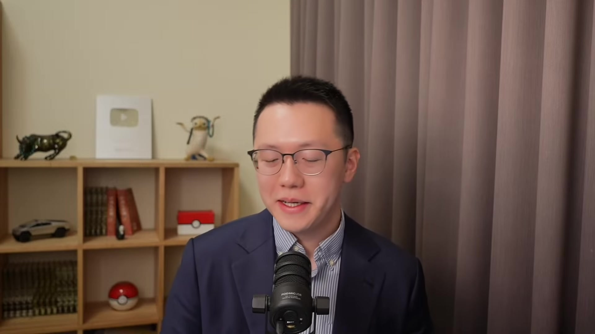

**逐字稿片段：** 今天我們跟投資朋友導讀一本書 每個禮拜五我們都會跟 投資朋友導讀書籍 今天導讀的這本書叫做富人的身體 對這個股票市場跌成這樣 一定要照顧好自己的身體哦 這本書是韓國家庭的醫學科 的醫師李東環先生他所寫哦 他裡頭其實寫了非常多 很淺顯易懂 從一些縱合的功能醫學 到大腦科學身心醫學 還有正向的心理學 好非常適合現在 臺北股市 美國股市的概況 18年前的他是長期過勞 每天看診看到晚上9點呢 靠暴飲暴食才舒緩壓力 體重超過100公斤 經常頭痛 但是借由不斷的生活方式的調整 他改善了自己的身心狀態 現在非常應景 非常適合大家看這本書 我們過去一直跟投資朋友分享 這個身體健康是在 股票市場當中投資最重要的 真的會影響到你睡不著的投資哦 那不投資也罷 你有能力可以靠本業收入賺得回來的 我們仔細想一想 司馬懿生於西元179年 死於西元251年 他活了73歲 在這個世界上 很多時候人與人的比較 它是兩大方面的 一個是比誰有錢嘛 另外一個就是比誰活得久 三國時期為什麼司馬懿是最後的贏家 就是因為曹操死了 他還活著 曹操的兒子曹丕死了 他還活著 曹操的兒兒子甚至孫子曹睿死了 他都還活著所以 活著就是勝利的贏家 我們當然覺得諸葛亮很厲害 他才活54歲

**話題推測：** 話題從財經轉向書籍導讀，推薦《富人的身體》一書。

---
