# yutinghaofinance_qaDEKdaJTto — 關鍵畫面索引

- 來源逐字稿：[yutinghaofinance_qaDEKdaJTto_FIN.srt](yutinghaofinance_qaDEKdaJTto_FIN.srt)
- 影片：https://www.youtube.com/watch?v=qaDEKdaJTto
- 截圖數：27

## 00:00:35

**逐字稿片段：** 所以美歐股市是漲跌不一, 企業的財報有一些利多開始傳出來, 原油價格開始回落, 不過呢, 頂多就是停止下跌。 我們真正要觀察的兩個角度 一方面是觀察隨著現在財報機一直開出 那股票沒漲啊 股票沒漲是不是代表著本益比繼續的下滑 目前的位階來到什麼樣的一個機器呢 那第二大方面來看看臺灣 臺幣這一次是真的貶值貶得有點誇張了 外資賣壓是蠻重的 那要如何理解一個經濟體經濟成長率10% 結果他的貨幣卻被拋售成這樣呢 要如何理解成這種股匯上的大矛盾 臺幣越貶經濟越強 另外一方面也來理解 我們一直講說油資氾濫油資氾濫 ETF的買賣根本就不用特別擔心 但為什麼又會出現錢荒 怎麼會油資跟錢荒同時出現 今天來跟投資朋友多做一些觀察 其實這一波美國股市似乎嘗試的要做主底 但是由於大型科技股像納指標普還沒有跌 這就導致其實從市場週期來看 還算是一定程度的肋骨輪替 因為大股票其實還沒有鬆動 那更重要的事情是 現在大股票的財報也陸續要開出來了 那如果仔細觀察 這一波其實財報開出來之後 因為大多數股票沒有創高 就變成了本益比的持續下滑

**話題推測：** 美歐股市漲跌不一，整體市場概況

---

## 00:01:59

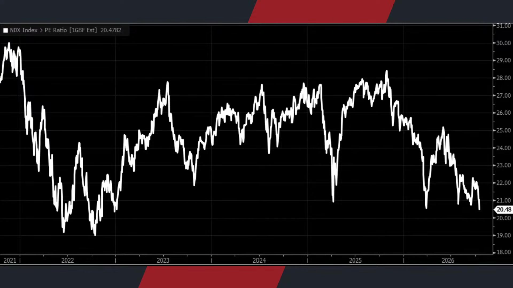

**逐字稿片段：** 如果我們現在來觀察納斯達克預估本益比 如果是以未來一整年來看 已經滑落到20.5倍了 去年年底的時候 大概還有接近25倍左右 那這個20.48倍 它到底是什麼樣的水準呢 差不多已經比今年 每一戰事的時候還要來得低了 也差不多等同於去年 2025年關稅戰的水準 甚至已經回到2022年 烏二戰事的低位 換句話說 即便還沒有比2022年的最低點 還要便宜 它也差不多是過去四年來的 最便宜的位階了 按照這個速度 等到本季度的財報一開完 這個本益比倍數有可能就突破到18到19倍了 所以如果是從本益比評價來做觀察的話 其實是蠻吸引人的 當然有些人會把債券市場的高利率給加進去 認為利率越高 當然本益比就不能夠太高 所以適度的均值回饋是可接受的 畢竟現在的基準利率 的確相對於過去20年的水準 已經算是高蠻多了 不過我認為這是一個很好的參考指標 至少它不貴 那便宜到什麼程度 你可以自己判斷 事實上納斯達克100指數 大概回到9月中旬左右的水準 現在真正的重點壓力 其實都不是這些大型科技股 在國家上有多大的流動性風險

**話題推測：** 納斯達克預估本益比下滑至20.5倍，可能搭配本益比走勢圖

---

## 00:03:20

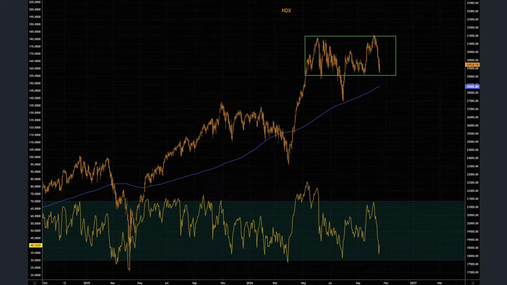

**逐字稿片段：** 或者鬆動 主要都是美國投資等級在 信用利差明顯的擴大 如果我們細看 現在像是輝達 像是博通 這兩大公司的CDS價格 那個上升速度有夠快了 我們看五年期的信用違約交換 CDS利差 6月大概35到40個基點 到10月已經到98到144個基點了 保險費還是沒有到特別貴 可是重點在於 那個上升的速度 大概是三倍到四倍 就短短的半年內 雙雙創下這段時間的新高 博通的信用避險成本 大概是增長了有三倍左右 納斯達克100指數也不過跌5% 你怎麼做那麼多避險 這說明的確有一部分人 看起來是非常非常擔心 股價還沒跌 那補貼可能性非常高 提前採取了一定程度的避險措施 這是我們可以觀察到的方向 那如果以整體來看

**話題推測：** 美國投資等級債信用利差擴大，可能搭配利差圖表

---

## 00:04:14

**逐字稿片段：** 就是看整個北美平均的投資等級 在目前的信用違約風險 CDX IG 也就是歷查大概從9月份的50個基點 現在也上升到了62.1個基點 這也是歷史性高了 因為不能講歷史性高了 因為以前爆發金融危機更高 但是也算是在今年4月3月以來的新高了 所以我們看整體來看沒有太大沖擊 可是從單一個股 其實已經有一點信用市場比股票市場還要急的味道了 看起來好像有不少人是相信 納指不是撐盤的原因 它要補跌 有一部分人是這樣想的 那我們可以做進一步觀察 可是反過來我們從本益比來做思維 我反而是站在比較偏買方 認為本益比這種下滑的速度 吃不了虧 這是我的看法 當然從美歐股市四大指數來看 其實都還在糾結當中 道瓊指數上漲529點 1.02% 收在52495點 慢慢的往上推了 標普上漲21點 0.28% 收在7712點 幾乎沒跌 納斯達克指數下跌6點 0.02% 昨天算是平盤了 費半下跌32點 0.29% 收在11283點 感覺好像要打第三隻腳 守住本輪的平臺區 現在大家最為關注的

**話題推測：** 北美平均投資等級債的信用違約風險(CDX IG)上升圖表

---

## 00:05:35

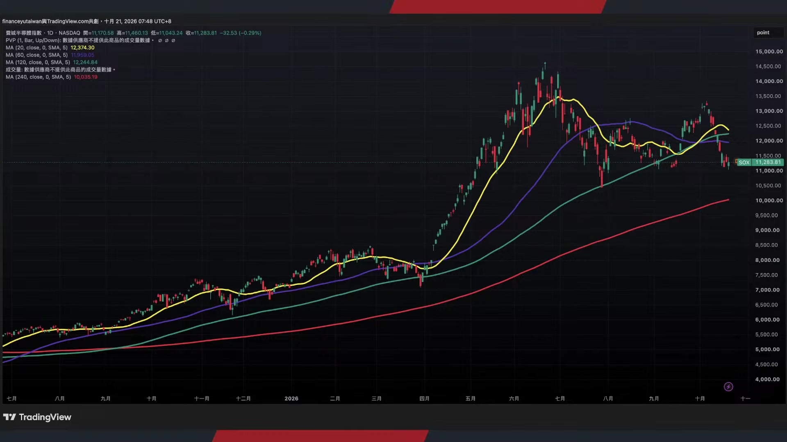

**逐字稿片段：** 當然是SpaceX的營收 因為這一次第三季的財報 營收145.8億美元 年增幅161% 這個很漂亮 也比預期的127.2億美元 還要來得高 淨利達到44億美元 比去年同期 去年它還虧損的 現在已經明顯大幅改善了 每股盈餘大概是45分 也遠遠高於市場預估的13分 更驚人的事情是 公司把明年第一季的營收 預估會來到331到370億 完全突破市場預期的高標 220億 所以股價在盤後 是有非常顯著的帶動 那這一次財報當中 最大的亮點

**話題推測：** SpaceX第三季財報詳細數據，包含營收與淨利

---

## 00:06:14

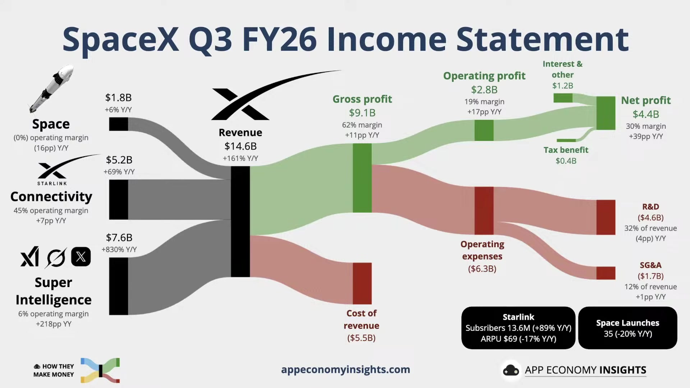

**逐字稿片段：** 就是SpaceX旗下超級智慧部門 在第三季的營收來到75億 比去年同期的8億 成長了超過8倍 說明AI其實是很賺錢的 雖然AI投了很多錢 但是跟AI業務來做 下取訂單的這些雲端企業 實質的訂單量其實蠻強大的 那出租的AI資料中心的算力 它的主要客戶有幾個 一個是Anthropic 另外一個是Google 所以某種程度來說 AI業務雖然有很龐大的資本支出 但看起來它的客戶 都還蠻願意買單的 那另外一方面 新鏈當然是SpaceX 最主要的獲利來源 第三季的新鏈的訂戶 增加了1360萬戶 聯網的業務營收來到52.5億美元 年增幅有69% 營業利率有來到23.7億美元 遠遠高於市場預估原本4億美元的水準 所以這次財報出來 我覺得還算是滿意 那整體來說 現在股價154塊左右吧 略高於上市以來的成交加權的平均價格 不過也必須承認 這一段IPO以後 股價受到的承壓還是很大 市場給予SpaceX的標準 當然要比其他7G頭更高 因為它的本業收入相對於其他 六巨頭比較起來 相對而言 沒有想象中來得如此之強大 或者已經有慣性上的營收 事實上在SpaceX之前 市場上本來還有一種悲觀論調 是因為在昨天

**話題推測：** SpaceX旗下超級智慧部門營收成長數據

---

## 00:07:40

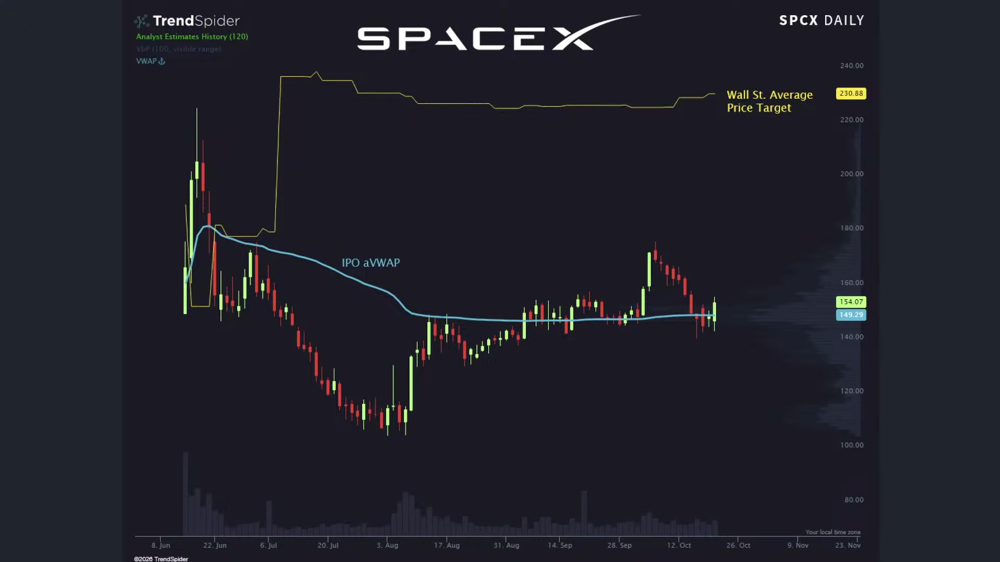

**逐字稿片段：** 我們看到韓國資料中心的新股 暴跌了32% Alice估值7.5億美元 結果週二在收入掛牌的時候 直接崩盤了 跌了三成二 讓大家很擔心 你都已經有資料中心了 韓國政府還支持你 你還拿到了政府的合約 你還有獲利的業務 結果市場給你賣三成 所以一系列的這種市場衝擊 原本造成十足的悲觀心態 不過靠SpaceX的財報 稍微挽回一點回來 但現在大家很清楚 明顯看到股價是沒怎麼跌 真正的焦點其實都在信用市場 都是在採取避險措施 所以股價沒有太多的波動 不過市場似乎也做好了十足的準備 對讀你股價隨時有波動 這是可以看到的氛圍 那就說明市場很明顯是半信半疑的 你看Core Wave之前開出五年期 15%值利率以後 那個CDS價格也是以非常驚人的速度快速上行 那現在總體全美 現在的信用違約交換的合約 在短短的過去幾個月 我那個上行速度交易量也非常之龐大 我們細節觀察

**話題推測：** 韓國資料中心新股Alice暴跌32%事件

---

## 00:08:47

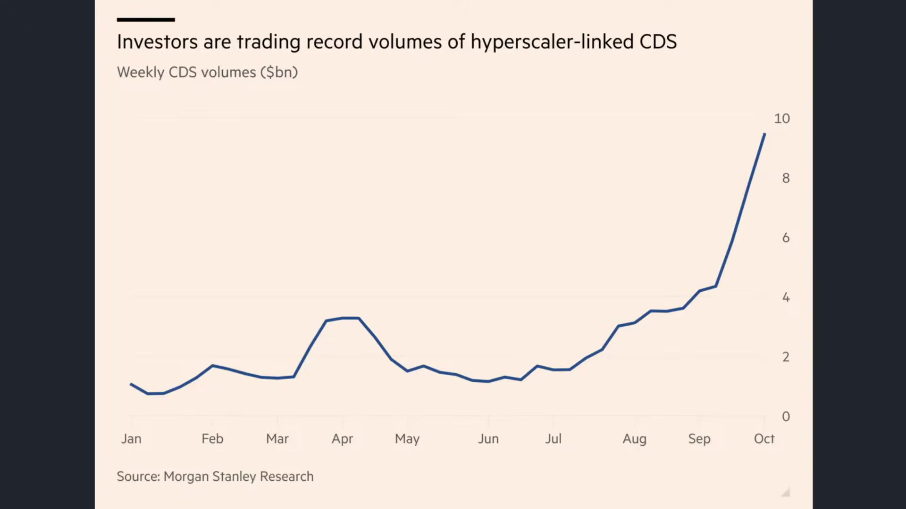

**逐字稿片段：** 這是摩根士丹利的資料 你把甲骨文 把SpaceX 把Alphabet 亞馬遜Meta 博通輝達 重量級企業的CDS交易量 7月每週大概成交量就20億美元 到9月底每週成交量是90億美元 成長至少超過3.5倍 10月還在創高 為什麼大家突然急著要去買 這些巨頭可能違約的保險呢 很明顯 即便股價沒有非常明顯什麼大漲 所以避險成本增加 並不是單純說股價漲高了 我多買一點保單 多買一點避險成本 其實更多反映的就是 市場上越來越懷疑 到底現在的現金流 能否支撐龐大的資本支出 和債務負擔 這就變成一種效果 就即便是財報開出來 真的非常好 好像也無法證明你的風險不在 或者風險消失了 因為重點是你借的錢 重點不是你現在的獲利 我知道獲利很不錯 但我怕你借了這麼多錢 有一個人跟你借錢 告訴你說明年你借100萬 明年就還你115萬 你不覺得它會被跑入嗎 Core Wave就是這樣子 那如果開20%的殖利率 開25% 你總覺得怪怪的 所以我們才講說 為什麼美國的CDS價格 交易量撞下新高 原因就來自於 市場上越來越懷疑 這些中小型企業或者新創AI 能否還得起 這麼龐大的利息支出 當然了這一次回調 尤其是費辦 因為標普沒怎麼跌 費辦有點壓力是真的 尤其你買在過去一個季度的 你告訴我說 你一股部位都沒有 那我猜你大概也沒參加今年行情 所以投資也一樣 本來在本人的回調當中 始終會受一點傷 你想要知道一個人對於股市 到底有多悲觀 你也不用聽他嘴巴怎麼講 你直接問他 他手上還剩下多少現金 多少比例的現金 一個人現在是滿手股票 嘴巴天天喊崩盤 那代表他是擔心 他是真的很擔憂 那反過來如果一個人 手上都是現金 然後遲遲不願意進場 那才是用真正的行動表達悲觀 今年正常人 你總要有持股 今年沒持股的人 那是很厲害的一件事情 所以不管怎麼說 你手上持有多少現金 往往其實就反映了 你對於未來保留多少的信心 如果你跟女生出去玩 有時候結束的時候 你就順便偷偷看 她手機電量剩多少 通常那個就是 她給你打的分數 如果她願意把最後的電量留給你 那就代表她願意繼續聊天 如果你發現已經沒什麼電量 那說明他早就懶得回你 早就在手機上跟其他男生聊天了 他也不在乎你了 所以這個時候你就可以瞭解說 現在你的手上的現金部位剩下多少 其實某種程度 就是你對於股票市場的悲觀程度 這給大家多多的思考 大多數人一定會參與本輪的行情 一定會有點痛 但是你正由於有點痛 你才能夠參與本輪的行情 廢盤疊那麼重 今年仍然是四大指數當中 表現最為漂亮的

**話題推測：** 摩根士丹利數據：科技巨頭CDS交易量暴增圖表

---

## 00:11:49

**逐字稿片段：** 好 那我們回過頭看臺股 臺股的賣壓就真的很重了 賣壓這麼重 居然還可以撐在這樣的位置 也很厲害 我們看到到昨天為止

**話題推測：** 轉向分析臺股市場，外資賣壓情況

---

## 00:11:58

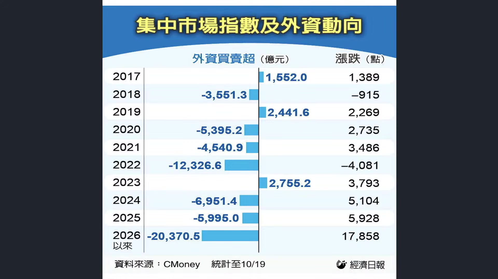

**逐字稿片段：** 外資累計賣超臺股是2.03兆 這一次是首次突破2兆臺幣的大關 2022年它也不過賣了1.2兆 2022年打了一整年的烏二戰事 當時市場的高通膨也賣了1.2兆 現在今年也沒發生什麼大事 你賣了2兆 這個外資真的是已經調節臺股習慣了 反正就漲高就調節漲高就調節 其中光是10月份就賣了6620億臺幣 我們看到大型科技股 目前是主要的提款對象 臺積電大概今年被提款就提款了1.9兆 所以大部分都是提臺積電 好那現在重點來自於 由於外資正在快速的撤離 雖然臺股的內資ETF買盤能夠跟上 可是也讓臺幣的匯率受到十分大的承壓

**話題推測：** 外資累計賣超臺股首次突破2兆臺幣數據

---

## 00:12:44

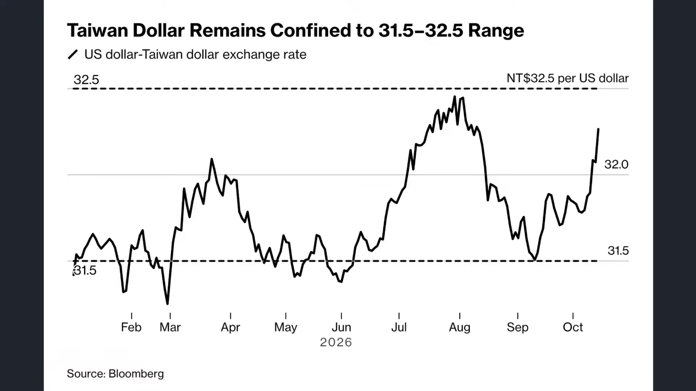

**逐字稿片段：** 我們看最近新臺幣 大概已經扁到32.6塊了 這真的蠻重的 我們清楚知道 外資針對整個亞洲股市都在做調節 可是好像最近新臺幣 有一點不扁的味道 一方面當然是因為 臺灣央行沒有升息 你沒有升息 韓國央行也升息了 日本央行也升息了 歐洲央行也升息了 美國聯儲會自己都升息了 那錢往哪裡走 水往低處流 錢往高利率的方向跑 所以臺灣央行的確 它沒有什麼能力留住資金 留在臺灣的銀行系統當中 對於外資來看 這是第一個角度 那第二個角度 當然是我們觀察到 當臺北股市表現的強度 比韓國股市相對而言 越來越漂亮以後 它就變成了主要的調節對象 你要調節 你要逢高獲利 那當然是挑有賺錢的 那韓國股市對外資來看 今年都已經不算是賺錢了 如果稍微買得慢一點 所以不管是臺幣還是韓元 其實都在下滑 尤其在韓國股市過程當中 韓國股市現在 因為本益比也低了 外資似乎也沒有太多 這個期貨操作的空間 那臺幣不一樣 臺股是本益比其實也算偏高 那臺幣可能有補貶空間 那市場上外資又覺得 這個臺灣市場好像 散戶買盤意願特別高 拋貨拋得特別順利 韓國股市這種已經 快要跌破底部的 那外資都不太敢拋了 怕一拋搞不好自己也被套牢

**話題推測：** 新臺幣匯率貶值至32.6塊關卡圖表

---

## 00:14:08

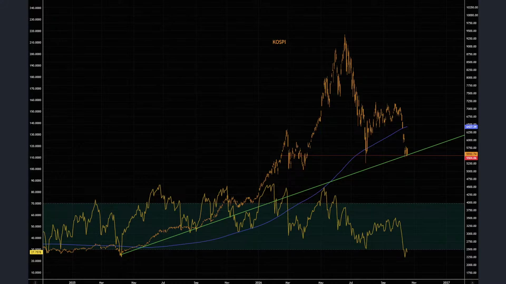

**逐字稿片段：** 我們看COSPI指數 現在因為從高點跌下來 已經跌超過兩成了 一年三度暴跌15% 本益比看起來已經來到歷史低點了 這個臺股本益比還有二十幾倍了 COSPI指數的12個月預估本益比才多少 8.4倍 這應該是歷史上除了08年以來最便宜的時刻 你說COSPI指數不對 它股價還是很高 怎麼會已經幾乎來到20年來的低位呢 最直觀的原因就是因為它獲利暴增 所以它的本益比下滑速度 一方面是股價本次的下跌 另外一方面當然是在獲利的拉伸底下 下滑速度來得更快 如果我們細節觀察

**話題推測：** 韓國COSPI指數跌幅與本益比創歷史新低圖表

---

## 00:14:47

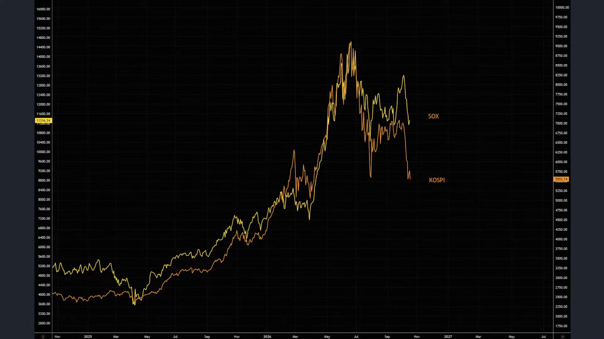

**逐字稿片段：** 現在韓國的企業獲利 還在上行 你不要覺得說股價崩了 它的企業獲利跟著一起鬆動 目前的獲利預估還在往上跳 不管是SK海力士等等 其實都看得出來 現在看起來有非常顯著的推升 如果是從剛才提到的 你不管是把海力士 把三星給剔除掉 還是保留他們 從平均前瞻本益比 那個都是08年以來的最低點了 這也給投資朋友多做一些思考 當然現在回過頭說 對於韓國股市來看 本身市場的買盤 相對於臺北股市還是疲憊一點 原因很簡單 那投資也一樣 上槓杆的人 那的確受了一次傷以後 那要恢復元氣 所需要的時間比較久 那上一次是臺北股市 本來要去借貸的人 硬是被金管會給按住了 發現怎麼那麼難借 投資也是一樣 尤其是使用融資槓桿的人 有時候明明確信股票會上漲 卻有可能因為利息維持率 追繳保證金 被迫在最低點賣出 沒有槓桿的人 那時間就是你的朋友了 過多槓桿的人 時間就變成你的敵人 投資最可怕的 不是說行情回不來了 是怕那個行情回來的那一天 你已經不在市場裡頭了 所以我們才講一定要活著 一定要活著 不要看對趨勢 死在波動 當兵不是最有名的一句順口溜嗎 叫當兵一年八個月 最怕女友陪人睡 別人再爽我再累 誰叫我什麼都不會 這投資最怕的就是 你不是看錯方向 是看對方向等不到結果 明明知道你要退伍了 你只能眼睜睜的 看著外面的世界繼續轉動 股價最後又創高了 但是你已經沒有資格 繼續參與遊戲了 被洗掉了 好那回過頭來說 現在大家更為關注的就是 好那你剛才所說的 這個臺幣的貶值 看起來可接受 韓國股市看起來 有特別單一個股問題 尤其是散戶的追捧意願 那我們要怎麼解釋 為什麼我現在還是很難借錢呢 到底臺灣基本面情況如何

**話題推測：** 韓國企業獲利預估仍持續上行的圖表

---

## 00:16:48

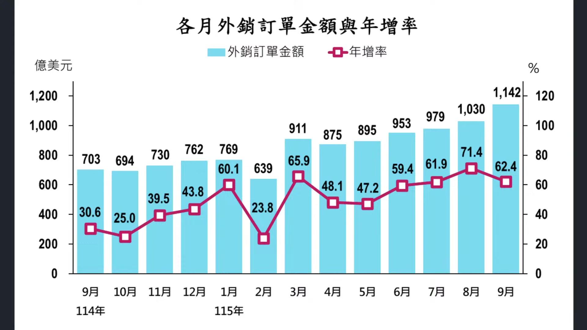

**逐字稿片段：** 其實最新所公佈的外銷訂單 現在是來到了1142億美元 整體而言又創下歷史新高了 月增幅10.9% 年增幅62% 已經連續20個月成長了 所以出口外匯進來的速度還是很快 從超額儲蓄來看 明年應該是有機會 直接挑戰11兆臺幣 相對於23年到24年的三到四兆 是直接翻了接近有三倍 連超額儲蓄率都在上升

**話題推測：** 臺灣最新外銷訂單數據，創歷史新高圖表

---

## 00:17:17

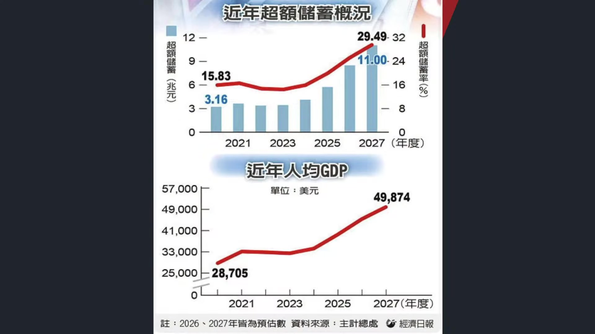

**逐字稿片段：** 明年我們預估 人均GDP直接要挑戰5萬美元 疫情剛開始的時候 我們才2萬8 現在5萬上升速度有夠快 所以從人均產出來看 我們不講說 你一定要達到這個數字 但你的薪資按照這個速度 那是不是差不多要翻倍了 就5年你的薪資要翻倍 要不然你就跟不上 人均GDP上升的速度了 我講的不是絕對提量 我講的是增量 這個就是臺灣市場 現在在很多工程師發生的事情 他們的確相對於五年前 工資差不多都已經翻倍了 當然現在市場上就形成另外一道問題 就是我們看到央行的統計

**話題推測：** 臺灣人均GDP預估將挑戰5萬美元圖表

---

## 00:17:52

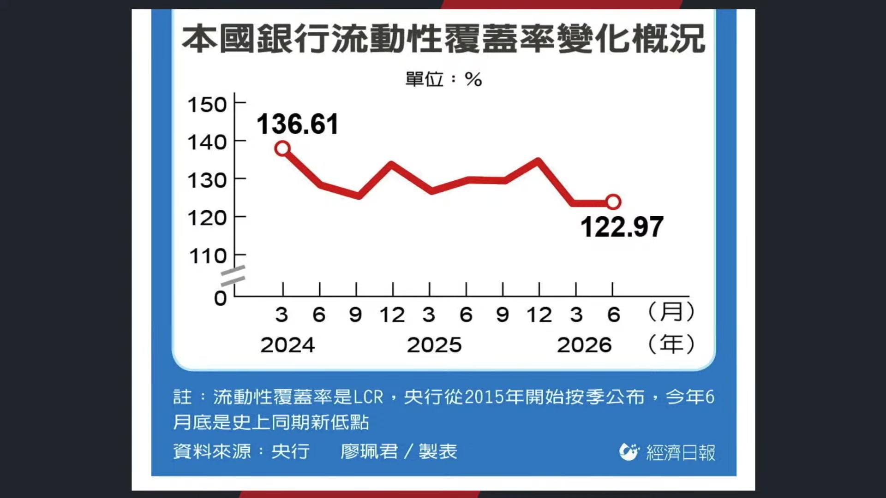

**逐字稿片段：** 在今年的銀行平均流動性覆蓋率 已經降到了122.9% 這個是2015年以來的最低紀錄 這個數據是什麼意思 它的概念其實就是 市場在銀行之間的流動性 尤其是高流動性的資產 能否支應未來30天 可能發生的資金淨流出 法定最低標準是100 那現在還有一段時間 可是有幾家銀行快碰到了 你像是土銀102 陽性銀行103 那合庫 兆豐 臺汽銀 新光銀 已經來到107到109 所以資金緊不緊張 其實硬要講 資金有點緊張 快要快要 不能講流動性風險 是因為銀行本來就會要求 一定程度的維持安全比例 你不能把你所有的錢 全部都放款出去 然後尤其又放款給高風險的企業 那資金變得緊俏以後 壓力就比較大了 所以從這樣的一個角度來做觀察 資金流出去 借出去的速度有點快了 所以為什麼金管會 或者說上頭才希望 銀行可以稍微謹慎一下 選擇你要放款的對象 不要把錢全部的放出去 好那這就要回過頭來說 你不是說油資過剩嗎 超額儲蓄創高 錢那麼多 外銷訂單這麼多 那怎麼會銀行沒錢呢 銀行不是沒錢 銀行的獲利也創高了 因為銀行的錢跟市場的需求比較起來 市場的需求似乎快要大於 目前錢進來的速度了 所以這是很有趣的一個現象 那錢進來的速度非常快 可是由於在銀行篩選客戶的過程當中 他可能優先選擇給這些企業 導致個人的值借 信貸感覺好像壓力就更大了 覺得借不到錢 這就是有趣的一個方向 因為企業把錢給借走了 我們如果細節觀察 今年前7個月

**話題推測：** 臺灣銀行平均流動性覆蓋率降至2015年以來新低圖表

---

## 00:19:40

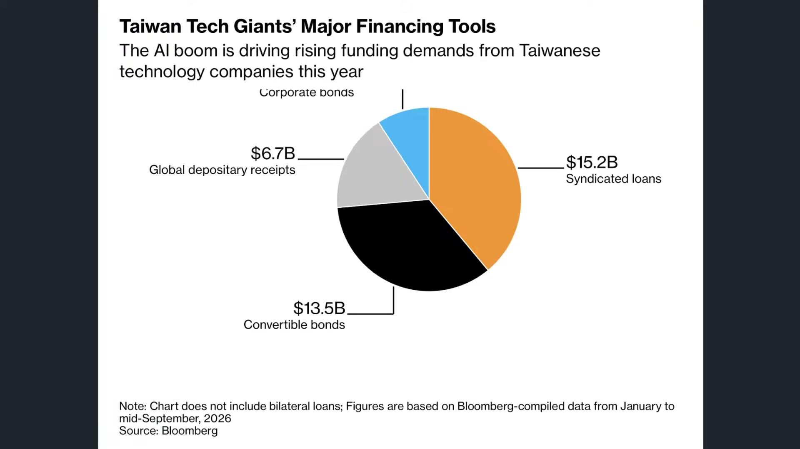

**逐字稿片段：** 臺灣的銀行新增的放款 已經來到4兆美元 大概是1260億美元 光是7月就增加了 接近有一兆 那8月9月都在激增 如果我們細節觀察 你其中看到的 接近有152億 是屬於我們看到的連帶 就是很多銀行 他可能要借給臺積電 借給聯發科 他也會怕 你就跟我一下去借 那我們兆豐或者永豐或者土銀 一系列銀行或者說公股銀行 一起合併起來 我們一起借給他 這叫連帶 那另外一種可轉債 這個就是跟股票的價格上漲有關 那另外一個就單純 從GDR的角度來向外籌詞 但很明顯數字出現在週轉金

**話題推測：** 臺灣銀行新增放款數據，企業借款暴增趨勢

---

## 00:20:25

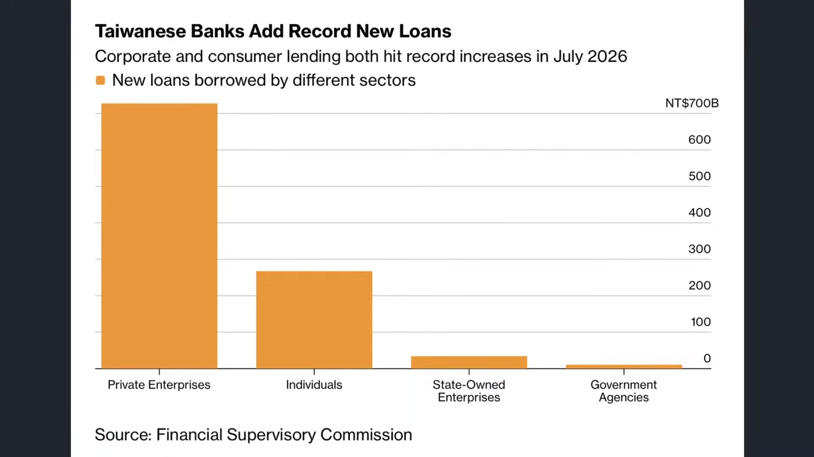

**逐字稿片段：** 我們把企業和個人的週轉金的 總體需求來做觀察 現在如果是看企業的話 那整體而言 大概是接近民眾或者說個人 接近三倍到四倍左右 也就是企業借錢的規模 大概是我們一般民眾去借信貸 去借職業的規模 接近有四倍左右 所以錢大量的被這些企業給借走以後 就變成了錢荒 所以對於企業來說 有沒有錢荒 企業其實大部分是拿到錢的 企業沒有錢荒 但是個人有錢荒 那油資充不充沛 油資其實也蠻充沛的 只是市場的需求來得更強 所以才會造成這種現象 叫做遊資過剩 這是沒錯的 因為錢不斷的進來 可是遊資過剩 反映在資產價格 我們感受到以後 我們卻覺得自己借錢很困難 也不是說借錢很困難 因為錢先被這些頂尖的企業 給借走了 他們獲得更好的貸款條件等等 那我們總覺得 開了國的利率特別高 好像貸款的總體金額 好像也沒有想象中來得多 這個就是我們觀察到的失職現象 錢荒跟遊資過剩同步存在 錢荒講的是個人 油資講的是整體 我們看央行的統計數據

**話題推測：** 企業與個人週轉金需求比例懸殊比較圖表

---

## 00:21:35

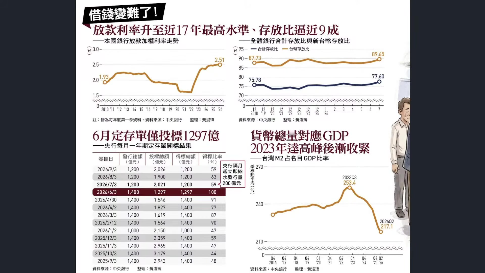

**逐字稿片段：** 本國銀行的放款加群平均利率 現在大概是2.5% 這是17年的新高 新臺幣的存放比是89.65% 整體銀行的存放比也來到77.6% 代表銀行吸收的存款當中 其實有非常高的比例 現在都是用於放款 所以總體來說 這主要就是來自於 現在市場上的借貸需求 快速的拉昇 那央行雖然現在是沒升息 不過你按照目前銀行目前的借貸利率 銀行自己都已經開始升息了 臺灣商業本票9個月的利率 大概從去年底的1.4% 已經上升到今年上半年1.9% 短短半年就上升0.5% 銀行放緩利率已經來到17年以來的高點 根本原因是什麼 我們看一下 這個圖表是金週刊所做的專題

**話題推測：** 臺灣銀行放款平均利率創17年新高圖表

---

## 00:22:22

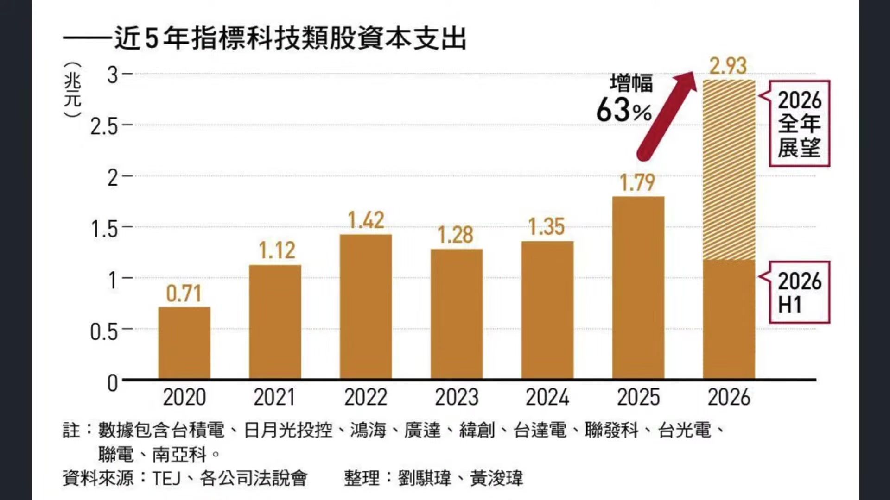

**逐字稿片段：** 是臺灣科技業的資本支出 這個也很龐大 我們把臺積電、鴻海、廣達、偉創、臺達電 10家指標的科技公司來做統計 2020年也不過是7000億臺幣 22年來到1.4兆 25年是1.7兆 到26年瞬間挑戰2.9兆 今年搞不好破3兆 成長63% 所以臺灣的廠商 正在瘋狂擴敞當中 需要錢 把銀行的錢全部給借走了 錢一回來就借走 所以AI資本支出 就帶動了科技業的借款暴增 我們看幾家企業

**話題推測：** 金週刊專題：臺灣科技業資本支出暴增至2.9兆圖表

---

## 00:22:56

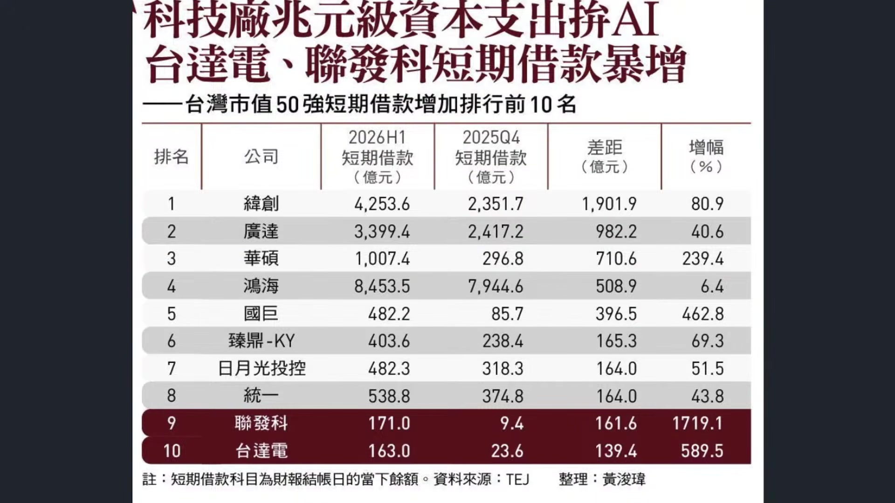

**逐字稿片段：** 你看整個上半年 偉創從銀行業借款從25年底借了2300億 還不到一年 現在10月而已 已經借到4250億 短短一年就借了2000億 這個是借款速度最快的 廣達的部分 短期借款大概增長了982億 現在大概是借了3400億左右 華碩借了710億 增幅239% 鴻海借了500億 短期借款已經來到8400億了 聯發科也借了9.4億 來到171億 臺達電借了23億 來到163億 大家都在瘋狂借錢 而且這個征服都是300% 400%來做起跳的 長屆發債的年征服 整體來看也非常誇張 現在大概已經突破了2600億 年征服有40% 就是臺灣的這幾家大型科技公司 還有分長期借款和公司債 兩者加起來大概是9200億 他們把現在油資過剩的情況 全部錢都給借走了 你說借了那麼多錢 那真的就只有投資在臺灣嗎 當然不止臺灣

**話題推測：** 偉創、廣達、華碩等科技公司借款金額與增幅列表

---

## 00:24:01

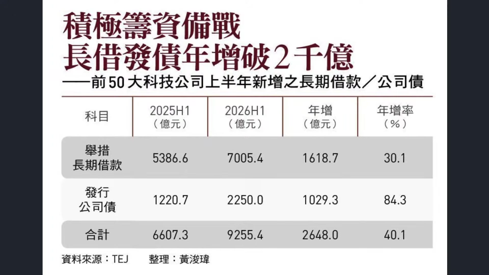

**逐字稿片段：** 現在臺商往海外來做投送 我們看在上禮拜最大的新聞 就是臺灣政府已經正式核定了

**話題推測：** 臺商往海外投資設廠新趨勢

---

## 00:24:08

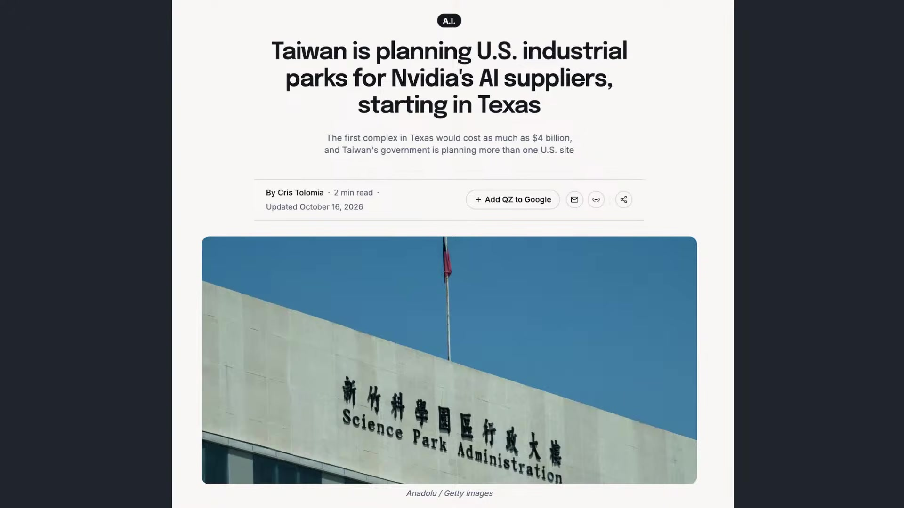

**逐字稿片段：** 臺灣政府會在美國建立多座的AI產業園區 首選站就是德州 單座的開發成本是21到40億美元 你以為誰出錢 當然就是這些企業主動出錢 所以他們要跟臺灣的銀行瘋狂借錢 借錢到德州去設廠 經濟部已經明顯表態了 目前已經協助臺積電 鴻海偉創等大型企業 以及中小型的供應商赴美設廠 涵蓋晶片的封裝基板 散熱模組 或者說伺服器的零組件等等 因為臺積電之前已經投了 2000到3000億美元 在亞利桑那擴建產能 那現在臺灣政府首選的第二站 就是德州 把整個德州的產業鏈繼續的擴大 所以我們看到 這個向外投資的需求暴增以後 可是這些臺商在海外的銀行 也許可能法規的問題 海外利率也比較高 那不好進 反正我們自己賺了那麼多錢 我們就把臺灣的銀行 錢都給捲走 到美國去設廠 那受害的是誰 就是我們 我們的利率 這個職業利率怎麼越來越高 為什麼職業的貸款額度 好像越來越小 那企業把錢給拿走了 所以錢荒跟油資過剩 同步的存在 那也不只是單純的電子零組件 或者我們看到的AI企業

**話題推測：** 臺灣政府核定在美國德州建立AI產業園區新聞畫面

---

## 00:25:22

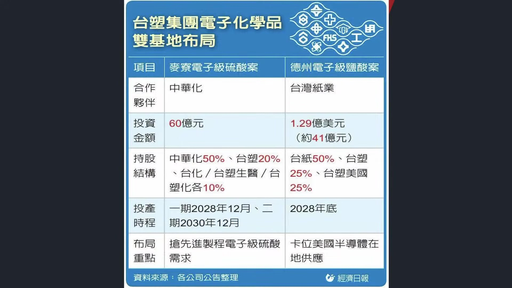

**逐字稿片段：** 包括過去我們提到的臺塑 現在也在往美國來做佈局 在臺灣台塑臺化 臺塑人一臺塑化和中華化 之前是合資成立的臺塑中華新晉化學 預估大概會投資68億臺幣 那新廠一部分是設置在麥裡 另一條暫行就直接到美國成立公司了 資本額3800萬美元 整體投資大概是1.29億美元 傳產也開始向海外來做佈局 那之前我們提到的房地產也是如此 房東市目前還是沒有大幅好轉的跡象 算是勉強止穩 可是建商這幾年賺了這麼多錢 那總要往下一步來做思考 我們看到亞新集團跑到馬六甲來做飯店案 大陸建設到吉隆坡做超高樓大案 我們看到松嶽建設到菲律賓做廠房做飯店 日本的部分清井林三地開發 現在在熊本來蓋出住宅 維格汽車旅館集團 這個我算是常客 投資了上億元 在熊本買了兩塊土地 預估要做飯店或者酒店式公寓 加上大陸建設或者全昆 現在在西雅圖 在舊金山都開始有複合式的開發住宅 這就是一個新的投資過程 也理解了為什麼 我們總感覺 那錢進來說都很快很驚人 但你總感覺好像錢沒這麼好借 這是解釋其中的原因 因為錢都被他們給借走了 好那最後回過頭來看 剛才給我看到的臺幣的貶值 它是一個外資對於次級市場的看法 但對於初級市場當中 臺灣在投資美國 美國也在投資臺灣 雙方的初級市場在廠房上的投資 規模是快速的膨脹的 看起來是比次級市場外資的態度 相對而言比較極端一點 或者差距比較大 那回過頭看 其實這一波大家也觀察到了

**話題推測：** 臺塑等傳統產業集團也向美國佈局新聞

---

## 00:27:11

**逐字稿片段：** 在人民幣的走強 它是一個非常特殊的現象 因為全球貨幣 的確在亞洲貨幣 都還是有補貶的味道 韓國韓元也是如此 可是人民幣今年是對於美元真的很強勢

**話題推測：** 人民幣走強的特殊現象，可能搭配人民幣匯率走勢圖

---

## 00:27:25

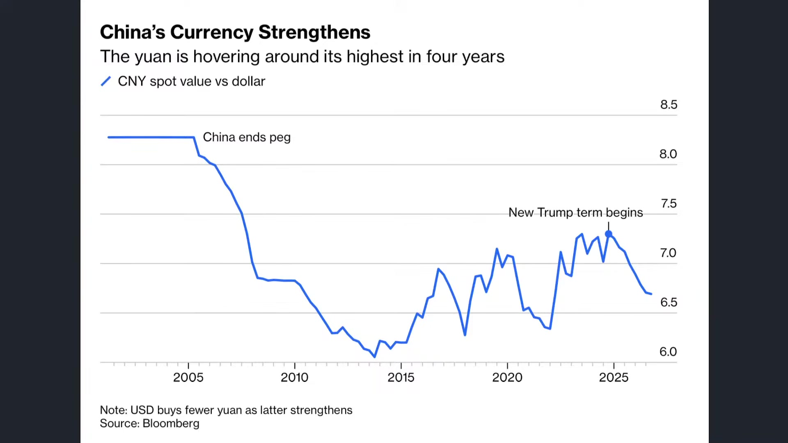

**逐字稿片段：** 相對於美元大概已經升了接近有4% 很多人在問說 浩哥你有沒有看人民幣對臺幣 現在是多少 4.8 4.9 那10年新高 人民幣什麼時候變那麼強 一個經濟成長率 10%的成長的經濟體 然後貨幣貶成這樣子 是臺幣 一個內需動能也沒有說到很強 那出口競爭力就維持穩定發展的一個大型經濟體 人民幣居然可以升值4% 這很神奇 他們的經濟成長率又沒有比臺灣來的高 那怎麼會貨幣升成這樣呢 這就很有趣的一個課題

**話題推測：** 人民幣對美元升值4%，對臺幣創10年新高圖表

---

## 00:28:00

**逐字稿片段：** 因為中國人行是特別強調 中國商品的國際競爭力 並非建立在低估的人民幣之上 匯率變動是由市場供需 由利率差異和經濟成長來決定 這跟楊總裁所說的話有點像 但其實我們都大概有一點清楚知道 應該是上面就是黨中央有放手聲的意思的味道開始出現了 包括我們最近所觀察到的 不只是中德或者中歐之間的新貿易的紛爭 我們看到很多歐洲人希望減少中國商品 和歐洲產業的競爭壓力 那雙方談判的持續 以及在過去美中貿易戰的敲定 我們似乎都有一種味道 越來越感覺到 再來講 你關稅戰打越深 我人民幣這個扁給你看 你克我越重 我就扁越重 那永遠我都可以逃過制裁 這是一個合理的設想 可是現在雙方開始和解以後 人民幣又開始在亞洲貨幣當中 高速的走深 那有一股味道你知道嗎 就是好了 我知道我的貨真的傷害你們的經濟 傷害很重 那我主動釋出一些善意 升值一點點 我讓我的貨幣競爭的能力 不要那麼強 至少在匯率上我不要取得優勢 感覺中歐雙方美中雙方 似乎取得了一定程度 人民幣升值的態度 所以我個人的看法是 人民幣現在的升值 背後一定有中共中央願意放手 讓人民幣走強的政策態度 要不然大家都在貶 就你升很神奇 中國人行當然每天都會設定 匯率的中間價 還能夠透過國有銀行來市場干預 如果北京真的不希望人民幣升值 他完全有能力去做抑制的

**話題推測：** 中國人行關於人民幣匯率的政策聲明

---
