# yutinghaofinance_uo6c3YNtEY8 — 關鍵畫面索引

- 來源逐字稿：[yutinghaofinance_uo6c3YNtEY8_GT.srt](yutinghaofinance_uo6c3YNtEY8_GT.srt)
- 影片：https://www.youtube.com/watch?v=uo6c3YNtEY8
- 截圖數：19

## 00:00:35

**逐字稿片段：** 昨天美國股市四大指數還是收黑 阿發貝財報 真的給它跌下去10% 而且跌到12% 那現在盤後居然還在跌 這一次自由現金流轉負 加上Marvell暴跌哦 13 %導致了整個 納斯達克指數和費半 雙雙都受到市場上顯著的承壓 不過呢我們也要回過頭說 現在呢隨著亞馬遜財報公佈之後 股價又遭受到市場賣壓 能不能在中期選舉之後 有一個好的否極泰來 要不然這一輪財報季的中斷呢 的確 開出來財報都不是特別好 明明營收表現還可以接受不過呢 光是一些小訊息就足以導致股價下跌 那更何況稍微如果 財報展望不如預期的像Intel 一天可以跌兩成 越跌越誇張 那首歌怎麼唱的 菸一支一支一支的點 股票一天一天一天的落 你知道一天一天就這樣跌下來了 有點恐怖哦 雖然對於指數而言 好像還未在高檔持續震盪 不過呢至少從短期角度來看 個股持有者 某些痛感應該是很強烈的

**話題推測：** 討論美國股市四大指數表現

---

## 00:01:41

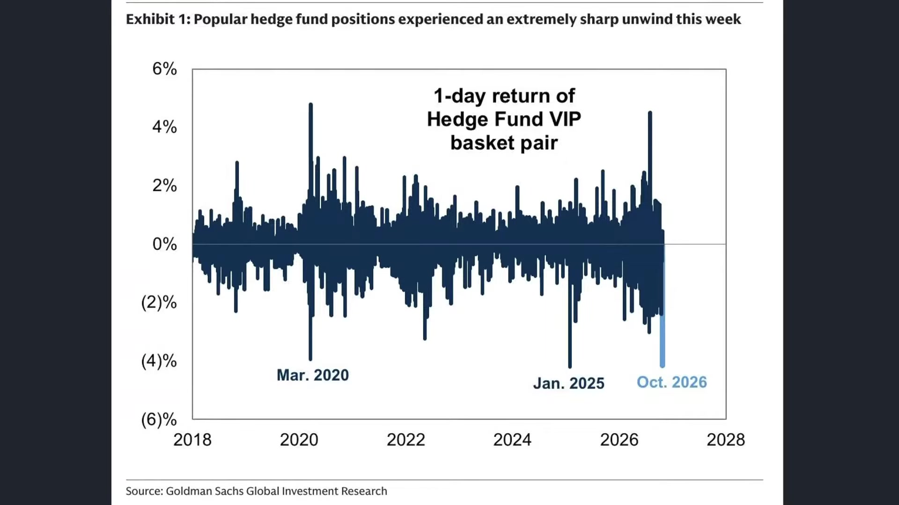

**逐字稿片段：** 我們以避險基金現在 最熱門的總體持股 整體來說 單日報酬大概一天都是 蒸發4%到5%左右 這個大概是2020年3月份疫情恐慌 以來的最劇烈的單日跌幅之一 我們可以把它簡單理解成 因為對沖基金有的部位也很大 大嘛可是他又不想要買SPY 不想要買QQQ 不想要買SOXX 所以他可能會針對這些ETF 裡頭的單只的大型巨頭 流動性不錯的股票來做單一購買 哦那有時候稍微買錯一隻哦一 天的痛感就很強了 好這大概是過去6年來 第一次看到單日蒸發來 幅度來得這麼快的 好所以對沖基金這一波 受傷也是非常深的 那七巨頭現在 必須承認了 哦默默地大家都開始跑輸給大盤了 有的還在正報酬 不過負報酬的巨頭好像越來越多了 七巨頭大概也只剩下蘋果還撐著 那現在有一種說法嘛 買鏟子的也掛了 賣鏟子的也掛了 只有賣水果的在創新高 再這樣下去 我也要去解讀水果了 好那不管怎麼說 現在美國股市 從指數來看還看不出那種重災區 但個股的痛感已經非常強烈了

**話題推測：** 討論避險基金的總體持股與單日報酬

---

## 00:02:55

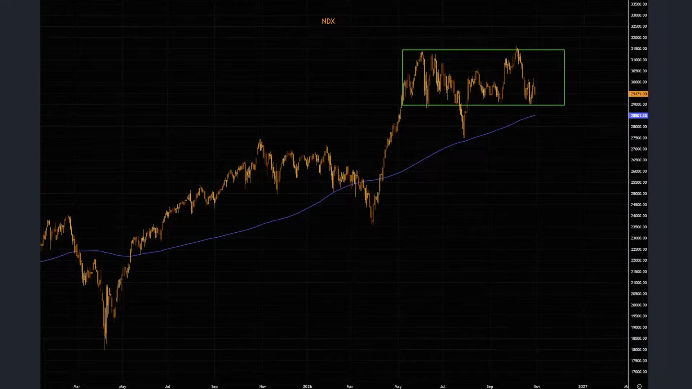

**逐字稿片段：** 我們看在最近 納斯達克指數從5月份以來 基本上還算是在固定的區域震盪 期貨指數大概29,000點是重要的支撐 不過呢 因為年線慢慢慢慢的就堆上來了 是否能夠在未來一個季度 形成適度的買盤來做拉升 值得多多一些觀察 可是好處是 最近小型股開始彈了 雖然大型股好像 動不動就給他跌10%跌20% 可是小型股羅素2,000 已經連續好幾天反彈 誒最近站穩了年線 那麼這種做法是不是意味著 我們雖然在高利率時代 當時對於樓數兩金形成重大承壓 可是過去兩周至少第一沒升息嘛 利率預期的回檔導致市場在 中小型股有喘口氣的空間 另外一方面 你把這些大股票賣了 那資金部分可能會流到 傳產或者防禦性的股票 部分流到債券市場 那是不是也有部分資金可以讓 羅素2,000有適度的空頭回補呢 這個值得多做一些觀察 畢竟呢你讓這些股票 隨隨便便跌10-20% 那你撥一些資金過來買中小型股 也可以漲幅不少哦 值得大家多做些留意

**話題推測：** 討論納斯達克指數的震盪區間和支撐點

---

## 00:04:07

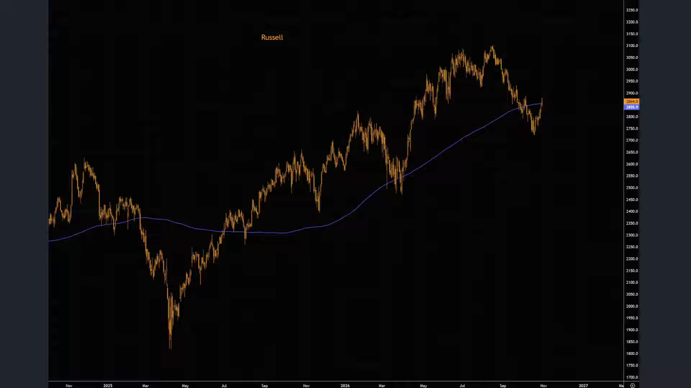

**逐字稿片段：** 那美國股市現在所面臨 的幾大關鍵考驗很明顯 一輪就是財報季過程當中 所面對的AI融資壓力 也就代表著你的現金流搭配你的營收 增長能不能持續玩下去這場遊戲 市場看起來是以非常 刁鑽的角度來衡量 明明Google整體財報表現也不算太差 但就因為在廣告主業務 收入似乎有一點鬆動 就剛開始害怕你現金流會不會不夠了 那第二呢 就是下禮拜就會解決 的美國期中選舉 不管怎麼說 至少下禮拜就結束了嘛 雖然民主黨可能會針對AI 採取進一步的監管 第三呢是我們看到市場的流動性預期 就是利率會不會就這樣子一路下來了 還是只是短期內的下滑呢 如果未來通膨數據開出來 會不會大家的升息預期又重新的歸來

**話題推測：** 歸納美國股市面臨的幾大關鍵考驗

---

## 00:04:54

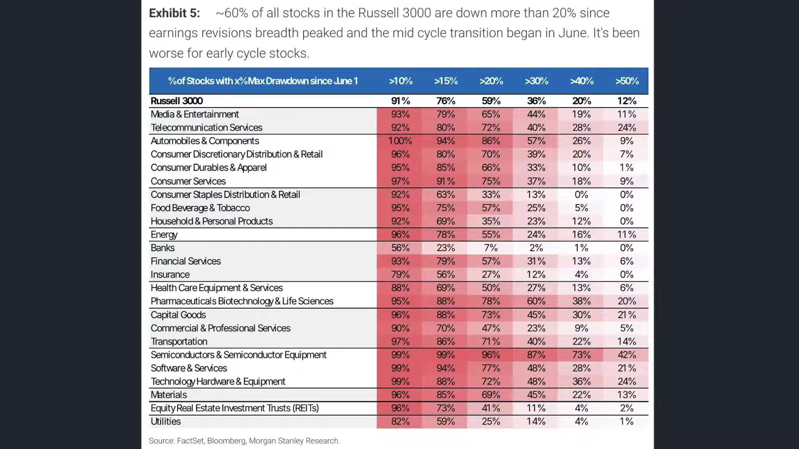

**逐字稿片段：** 那我們根據摩根士丹利所引用的資料 整個26年從6月到9月 這一波企業獲利預期上修的動能呢 的確可能會來到本坡的高峰 好但是畢竟現在成長接近30-50%了 已經成長蠻多的 接下來下滑不是說 進入到衰退 是年增幅的最高峰 也許已經看到了 從羅素3,000指數的成分股當中 現在比較大的問題就是有沒有 可能要反映這種年增遞緩的現象 不是衰退哦 以前是本季度是賺5成嘛那 下個季度如果年增幅是30% 有沒有必要做這麼大的跌幅 我們以羅素3,000指數的成分股當中 高達91%的股票從6月份以來的高點 現在大概已經回落10%了 59%的股票最大回撤幅度是20% 甚至有36%的股票曾經下跌到30% 其中現在看起來跌最重是半導體股 或者一些設備股 高達96%的股票回撤已經超過兩成了 73%曾經回撤超過來到4成 接近40% 甚至已經腰斬好 所以如果你是持有單純半導體個股的 現在 被套了個兩層也算正常 畢竟今年都是翻倍式成長嘛 所以稍微跌幅會稍微來的重一點 當然 這就代表著標普500指數的廣度指標 現在呢在下跌的過程當中就收斂了 之前是怎麼樣 大股票就撐在高位嘛 那很多中小型股已經跌很慘了嘛 所以廣度指標就顯著惡化 就內部極度分化 好像好正常好的那個說法 應該是小股票漲回來那個 廣度指標的惡化就開始收斂 現在不是 現在是大股票也跟著一起跌 所以這項指標呢 反而正在好轉當中 大家都在往同個方向走 往好處想 這搞不好是接近修正尾聲呢 這說明大家一起跌嘛 那往壞處想呢 那會不會形成流動性的踩踏 這個多值得一些留意 畢竟像ETF的買盤賣盤呢 統一的集體性行動 壓力也比較大 但這一次我們也知道 巨頭下跌 大多數也不是真的 本益比我們看到多高 受到估值的承壓 也不是說它的基本面有多差 基本就是針對短期融資 成本所產生的疑慮 因為財報其實表現還不錯

**話題推測：** 引用摩根士丹利資料討論企業獲利預期動能

---

## 00:07:11

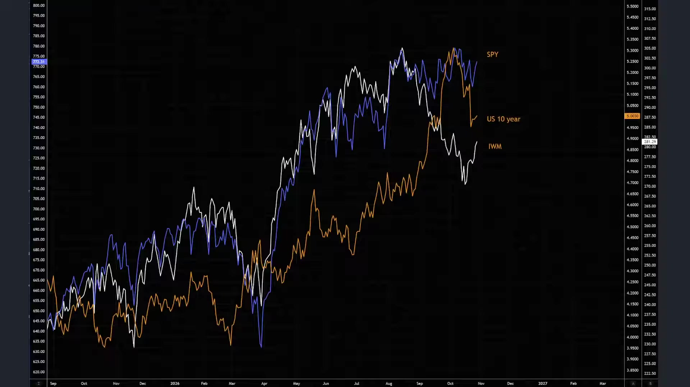

**逐字稿片段：** 雖然美債殖利率現在 還徘徊在5%左右 可是必須承認的事情是 標普500每股盈餘 至少是保底20% 如果加上一些股權上的投資 甚至可以來到30%到40%左右 另外一方面 融資成本雖然是有壓力的 可是是未來兩年的付款壓力 不是現在 所以沒有立即性的流動性風險 標普500的非金融企業有91%的 債務都採取固定利率 那前兩年都已經鎖定好了 前兩年他們已經借很多錢了 只是我們擔心的是他現在借更多 未來會不會還得出來 可是至少現在要還的錢 沒有立即性的還款壓力 所以在這樣的一個角度底下 市場上 反而更為重視的是 基本面是否長期在上行的 如果是的話 哦那就是尋找機會的時刻了 而並不是把本輪的下跌視為一場危機 誒股市都已經 個股都已經跌10%20%了 你才在開始擔心危機是不是發生了 正常你要反過來 股市在高估值的時候 你就要擔心危機了 那跌下來的時候 反而我覺得是不是要尋找機會呢

**話題推測：** 提及美債殖利率和企業融資成本

---

## 00:08:13

**逐字稿片段：** 我們從昨天美國最新 所公佈的第三季GDP 來到3.4% 好這個是遠遠超乎預期 比二季度的2.2%來得高非常多 那這一波當然主要是由 AI投資來做共同推動 其中民間固定投資成長有9.4% 好這個是2020年 疫情復甦以來的最大增幅 在疫情過後從來沒有 這麼史詩級的建廠投資 另外一方面 美國消費支出其實也不差 大概有3.8%的強勁增速 所以即便物價在上漲 然後之前有退稅帶來的刺激效果 也逐漸的消退 但民眾在醫療在食品住宿的 支出看起來還是蠻強勁的 那當然了 主要就是靠這些固定投資來做支撐的 背後呢 9月份的個人消費支出 月增幅還是有0.5% 這也是3月份以來的最大漲幅說明 實值可支配所得其實還是下滑的 只是呢現在AI往前帶頭衝 然後高資產人士其實也在花錢呢 所以把整個經濟撐 在這樣的一個區間了

**話題推測：** 公佈美國第三季GDP數據與超乎預期表現

---

## 00:09:15

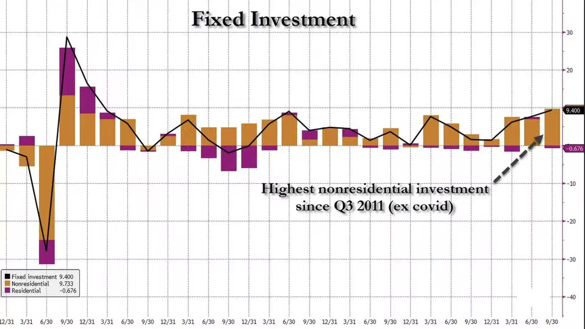

**逐字稿片段：** 另外一個比較值得大家留意的方向 主要還是來自於 因為2026年年底到了嘛 大家對於27年的展望 當然會擔憂這種過度依賴 股票市場的財富效應 就有可能出現劇烈反轉 什麼意思呢 就是之所以經濟這麼好 是因為股票漲了 這標準財富效應嘛 這股票跌了 經濟很快就沒這麼好了 本來這理論可能是經濟其實很不錯 所以股票下跌也沒什麼 做估值修正而已 基本面是好的 勇敢買進 這個大概是多方的想法 那空方的想法是什麼呢 沒有現在的經濟就是靠股票撐著 因為股票會產生財富效應

**話題推測：** 討論2027年經濟展望與過度依賴股票市場財富效應的擔憂

---

## 00:09:54

**逐字稿片段：** 我們根據高盛的估算 過去一年AI相關的股票上漲 透過家庭的資產增值 大概推升了美國實質消費支出 大概有0.4個百分點 相當於GDP的0.25% 那他預估 如果AI股平均下跌40% 其他股票跌不重 跌15個百分點就好 財富效果瞬間就會 拖累0.5個百分點的GDP 什麼意思呢 高盛已經意識到 目前由於大量的中產和資產階級 他的股票的增值速度 尤其在45歲到50歲以後的人 對於他的收入所得貢獻來的越來越大 就變成了他未來 辨認景氣好不好的 方式不一定是本業收入 就是他有沒有裁員 有沒有受到減薪 那個好像不是很重要 重點是他股票有沒有繼續漲 這個其實臺灣也很常見的 就是臺灣現在有很多工程師 對可能工作到快要接近退休年齡了 他本身現在已經不靠本業收入來 生活了 那這一點點 但他累計的財富其實非常龐大的 那這個財富上光是幾%的波動 就足以影響到 他明年要訂的機票 他的健身房要不要續約 換車計畫要不然再隔兩年吧 好所以這個是很多人擔憂的風險 就是誒如果現在的經濟掛鉤 基本面看起來是好的 是基本面好的背後 其實來自于對於財富效應的信心 但我當然了 我們現在所看到的GDP 其實還沒有真正完全 反映到AI的生產力 當時1987年諾貝爾經濟學獎得主 羅伯特索羅 這個索洛 他提出一個很經典的觀察嘛就 1987年其實已經可以看到 各地都有電腦的時代了 但是唯獨在生產力統計當中看不到 為什麼呢 從1980年末到1990年代 其實美國已經有大量 的企業採購電腦了 但是整體生產力 並沒有看到明顯的上升 它是一直到1990年代後期 資訊科技所帶來的效率才更加提升 然後在2,000年網路泡沫之後 提升速度更快 因為到時候當時社交媒體 Youtube相關串流媒體的發達 都導致了這個生產效率 是延了10-2十年才來到 那現在就有這樣的一個思維 就是AI哦 你說真的是對於GDP的貢獻沒有 GDP貢獻都是投資AI造成的貢獻 但是AI本身的生產力 沒有反映在GDP裡頭 不代表AI沒有價值哦 而是技術投資和生產力提升 之間可能存在部分的時間差 好所以 我們對於長期的前景 對於短期的GDP GDP拉升 還有民間財富的效應呢 還是要有一個比較公允的判斷 現在都還在初期 我們還沒有看到AI真正 生產力的全面爆發 我們主要是看好AI所造成的投資 造就了目前的經濟成長 所以呢在這樣的一個效果當中 大家就會有不同的思維 美國的AI投資熱潮 對於經濟成長 現在一季度左右 去年大概是0.4嘛 今年已經來到大概1% 第三季來到1.4%左右 第四季可能會來到1.5哦 這說明的其實我們對於 投資對於GDP的貢獻 其實幅度還是不小的 可是2027年預估年增幅就會慢慢的遞緩 或者說占比就慢慢的遞緩了 那就要看生產力能不能順勢的跟上來 這是給投資朋友做的更進一步思維

**話題推測：** 引用高盛估算AI股票上漲對實質消費支出的推升作用

---

## 00:13:07

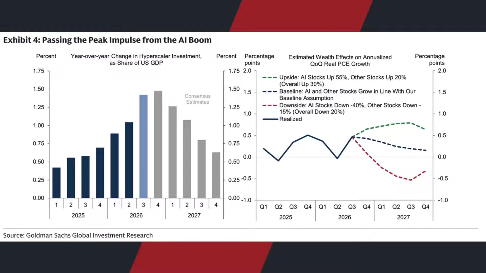

**逐字稿片段：** 另外一個市場上會 擔憂的相對性的利空 一個是擔憂財富效應嘛 就股市一跌 也許這波榮景就撐不住了 那第二波呢 是擔心下禮拜就期中選舉了 那選完之後呢 如果蓋不完 沒有足夠的算力 是不是也會導致部分數據 中心的建制企不如預期所造成 不管是可能部分違約 還是對於市場的需求產生極大的影響 到時候也許必須要有更進一步的 技術革命才撐得下去這一波的遊戲 畢竟可能有很多27年到28年的 資料中心無法準時的履約交付

**話題推測：** 探討中期選舉對AI建制進度的潛在影響

---

## 00:13:41

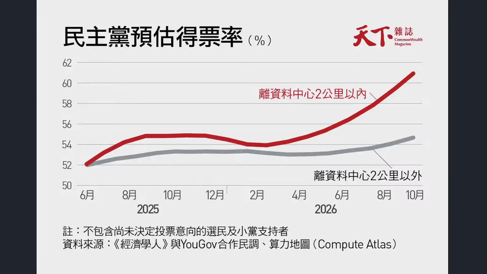

**逐字稿片段：** 我們若根據經濟學人的民調分析 現在居住在資料中心 周邊兩公里內的選民 支持民主黨候選人的比例 從5月份的54%上升到61% 增加了7個百分點呢 相對之下 全美民主黨的支持率 僅從53%提升到55% 增加兩個百分點而已 說明什麼事情呢就是 你距離資料中心越近的人 越容易投給民主黨 那這就很吊詭了 我那時候蓋資料中心就是為了要 獲得共和黨進一步的選票擴張 結果你告訴我 我在搖擺州所建設的這些 資料中心都會投給民主黨 說明著資料中心它是一個鄰避效應的 厭惡才 就是大家看到他 就想要投給他的反對黨 覺得這種東西很討厭 跟核電廠 跟樂色廠 跟焚化爐其實差不多的意思 那未來代表的民主黨 如果要反映資料中心選民的民意 會採取什麼樣的做法 當然是採取更進一步的監管 更進一步的聽證會 所以很多人會擔心期中選舉之後 民主黨全面獲勝 對於AI建制需求放緩的衝擊 需求是不會放緩的 但供給有可能會放緩 那供給放緩 它就造就算力價格 可能維持在某種區間好處是 這場遊戲就會玩的下去 因為建不完嘛 不會有算力過剩嘛 那壞處就是 我那有很多原本所設定的計畫 就要被迫重新調整 企業可能要付出更多的成本 才能夠玩下去這場遊戲 當然了有些人會覺得 哦這個趨勢已經很明顯了 川普一定會大敗 我也認為不一定哦 因為選舉最好玩的地方就是 不到最後一刻很難說了 那也許年輕人投票率只要稍微低一些 那洪博士一拿那股票 或者說市占率 投票率也許馬上就把 那個民調給拉回來了 臺灣選舉其實也是 你撇開台南高雄 雙北到底會選成什麼樣 那也很難說 安西教練說過一句話 選舉不到最後關頭 never give up never give up是什麼意思 中文就是 永不給上 不對 永不放棄 永不放棄 所以很難說了 但至少這是一個潛在的因素 好處是其中選舉完 不確定性就轉化為確定性 壞處就是這個確定性看起來 民主黨獲勝造就AI建制延後的可能性 壓力是稍微大一點的

**話題推測：** 引用經濟學人民調分析資料中心周邊選民的政黨傾向

---

## 00:16:01

**逐字稿片段：** 那我們看一下散戶的 態度是如何來做看待的呢 在這一波的下跌過程當中 剛才講到嘛 避險基金這一波其實摔蠻重的 因為他們都是從那些大型權資股 當中挑幾隻喜歡的來重壓 那美國散戶目前的投資熱度呢 其實第一沒有如同5月 6月7月來的這麼熱 26年初散戶的交易量一度占羅素3,000 指數成分股總交易量的15% 創下這幾年來的新高 但到10月份呢只剩下 8.8%好 這個是19年到20年前的水準 這說明著其實散戶的交易熱度 第一成交量在下滑第二 每日平均交易股數從高峰的14億股 現在只有到7.5億股 接近一半而已哦 其實實際的交易規模 都在一起縮水當中 所以大家沒有想像中來的樂觀了 那再來呢 是消費者信心是否有同步的轉弱 從整個25年來 散戶交易量占羅素3,000指數 成分交易量大概是15%左右 到今年10月呢 剩下8.8% 就變成了 散戶的買盤 它不只是絕對體量少了一半 它連比值也減少了 如果大家一起減少 比如大戶 對沖基金 還有散戶一起減少 那比例不變嘛 但是呢 現在看起來是散戶特別不想買股票 或者說對於股票的信心 對於股票的交易熱情很明顯 衰退幅度比這些大戶還要來得快 這件事情呢 其實默默地說明 好像行情就是在半信半疑中 慢慢的成長 我們一直跟投資朋友分享 那投資當中最重要的事情 你不要每天被我們的雜訊牽著鼻子走 我們分享市場動態 那是因為我們本身 算是一個新聞節目嘛 那你有更多的興趣和想法 到我們的會員系統 或者聽友會來看看我的說法 可是你如果每天因為這些雜訊 而決定你今天的投資策略 其實風險也是很大 最好還是要有一個 中心邏輯 你今天擔心AI泡沫 你明天又擔心川普政策 你後天你又擔心第三次世界大戰 永遠會有講不完的利空嘛 也會永遠會有人告訴你下 一場金融危機就要來了 可是你回過頭看過去10年 哪一年沒有風險 哪一年沒有讓投資人害怕的新聞呢 真正關注的也不是每天發生什麼 枝微末節的事情來影響你投資哦 你最後還是看的什麼 你投資的企業有沒有繼續在賺錢嘛 你的營收有沒有繼續在成長 獲利有沒有在改善 他投的錢是不是合理的 股價最終有基本面支撐的情況底下 你還是能夠在不確定性的 世界當中找到一些確定性的 根據這些確定性衍生 出自己的投資策略 這件事情呢 其實還是很重要的 不要每天盯著一些短線消息 來大幅度影響你的投資 那我們的策略很清晰的 這個投資朋友也知道 最近不是看一個年輕弟子問師父 師父我練功這麼多年 為什麼還是無法像您一樣厲害呢 師父很慈祥的看著他 徒弟你可曾觀察過螞蟻 日夜不停的搬運食物 有 師傅 你可曾關注過竹子 即便狂風來襲 也會彎曲 但是不會折斷 有 師父 你可曾在寧靜的夜晚 凝視水中明月的倒影 有 師父 師父沉思片刻 難怪你武功都沒進步 你整天看這有的沒的 你怎麼不去練功呢 對不對 觀眾朋友 不要每天看些有的沒的或者 每天根據這些雜訊影響到你的操作 你要有一個心中的思維 這些都是雜訊 我這些雜訊都是拿來考驗你的 OK好 那美股股市四大指數的變化 道鐘斯指數是下跌132點 0.25 % 收在52,342點 標普下跌23點 0.3 % 收在7,720點 薩克指數下跌三百六十五點1.38% 收在26,184點 費半下跌一百六十五點1.4% 收在11,518點 其實指數來看 都還好嘛 也沒有說跌到特別重 現在大家比較值得觀察的 角度還是從市場上最新所 公佈的財報來看一下內部的分化

**話題推測：** 討論美國散戶的投資熱度與交易量下滑情況

---

## 00:20:04

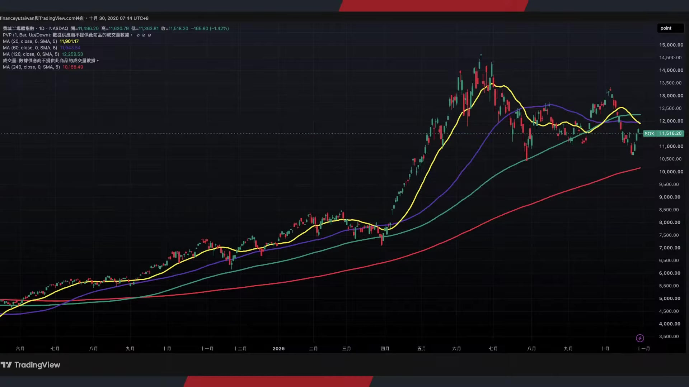

**逐字稿片段：** 我們看亞馬遜財報 亞馬遜這次第三季財報營收是2,019億 年增幅12% 哦但是比市場稍微預期的來低哦 市場預期是2,023億 每股盈餘1.89塊 也不如預期的1.96 所以盤後股價真的重挫了 而這沒辦法 亞馬遜的獲利能力 雖然已經改善了 但整體成長幅度還是 沒有想像中來得快 雲端業務營收459.8億 年增幅39% 這還算不錯了 這個是5年來的最高哦 但是似乎現在這些巨頭 都有透露出一些跡象那就是 Google真實 不如預期的 不是AI營收不如預期 Google是廣告主的業務下單量 好像沒有想像中來的多 那現在好像亞馬遜也是一樣 它的AI增長還是很快 39.3% 5年最快 誒可是你的電商收入 好像沒有想像中來得多 這個其實都透露出 這個非AI產業的疲憊已經開始 回過頭影響到AI投資的擴張 我們都總覺得沒關係 現在的景氣就靠AI來撐 誒這個思維應該是AI的生產力來撐 可是靠AI投資來撐 其實是有盲點的 什麼意思呢 他一直投資撐住了美國的經濟 可是投資背後是他的本業收入 而他的本業收入就是美國經濟 就是傳統的市場消費 所以這個是市場上 壓力比較大的部分呢 擔心這場遊戲會因為 本身實體需求的疲憊 拖累了AI投資的進度 而生產力又還沒有造成 領先或者做顯著的拉升 那像亞馬遜呢 整體AI的投資規模也很明顯 超越了現金流的創造能力 到今年第三季為止 過去12個月的營業現金流 雖然年增幅來到29% 來到1,683億哦 但是因為買的設備實在太多了 比去年同期增加了948億哦現在呢 轉為淨流出423億哦 前後惡化大概571億左右 好這說明看起來 大家花的錢還是非常多 七巨頭已經陸續自由現金流翻覆了

**話題推測：** 詳細解析亞馬遜第三季財報與各業務表現

---

## 00:22:06

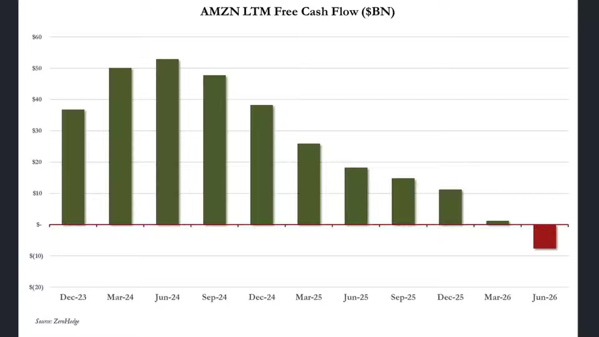

**逐字稿片段：** 另外一檔財報是Intel Intel這一波就真的很慘了 一次給它跌兩成 AI製造中心 明明它也是爆沖了78% 但是呢很明顯 每股盈餘雖然也高於預期 0.56塊比0.4塊來得高 可是有幾個利空消息哦 慢慢的影響當中 第一個是PC業務崩掉了 我們知道現在 內的價格的暴漲 很多PC廠現在也買不到記憶體了 導致整機的生產開始下滑 整體Intel在PC晶片訂單快速下滑 月減幅大概有接近20%以上 應該講季減幅了 有20%以上 那第二個是以色列工廠的停工 這個10納米的伺服器的晶片停產 大概造成了 3億美元左右的收入的損失哦 那再來是毛利率掉蠻多的 所以必須承認 因為晶片廠的成本大部分是固定的 工廠的折舊設備 人工開工率高的時候 固定成本會攤到更多的晶片上 那每片毛利率高 開工率低的時候 同樣的成本會攤到更少的晶片上 毛利率這個時候稍微就會掉一點了 那這就意味著哦 這個PC現在晶片訂單又往下掉了嘛 今年筆電真的賣很差 好之前那個推的RTX哦 我我看大概也是賣的很差 那意味著一部分的產線呢 開工不足 固定成本沒有地方攤嘛 好所以總結來說就是AI 大家都賺的蠻多的 可是PC崩了 手機也崩了 那也很神奇 在所有崩潰當中 蘋果的手機看起來賣的還不錯 所以從這件事情其實都意味著第一 融資成本遊戲 必須要找到更多便宜的錢 那第二呢 本業收入 要撐住 不然美國經濟如果持續疲憊下去 就沒有錢玩下去了 第三就是時間線的遊戲那就是 其實還是在燒市場的錢 然後燒了這個市場的錢 還沒有造成生產力提升 是最大的壓力 所以市場要求什麼 儘快給我更進一步的 AI的爆炸 爆炸式營收 這個爆炸式營收不能 是什麼算力出租 這個資料中心使用量的營收 而是往下游端 有沒有造成機器人 自駕車物理AI的提升 我們看Google這一次也採取了股票回購

**話題推測：** 詳細解析Intel財報與股價重挫原因

---

## 00:24:14

**逐字稿片段：** 398億美元呢 現在呢又開始發股借錢了 整體AI投資 因為上次我們聊到 已經把自由現金流燒光了 整個27年的資本支出大概 已經上升到3,500億左右了 那我們要知道嗎 你看他的Google cloud或者 network revenue還在成長 可是其他板塊呢 什麼Youtube Google搜尋業務 我們必須承認這個 AI爆發以後 到底對於Google搜尋引擎 業務是好事還是壞事 真的很難說 有些人說現在用Google 搜尋引擎更好使用了 因為你在Google搜尋 底下就會有AI的相關的搜尋結果 有另外一部分人說沒有 我都直接用AI 不比如說去GPT或者Gemini來做使用 那廣告的曝光效果 可能就會因此而減弱 所以我覺得Google最大的挑戰就是 到底是不是全球的 搜尋引擎業務真的放緩了 還是只是一個單季度的下滑而已 因為第三季搜尋收入的年 增幅現在已經來到12%哦 第一季有19 第二季16.8 第三季來到12 如果第四季還在往下掉 掉到個位數 那你幾乎就可以確認了 搞不好明年全球的廣告收入 至少傳統廣告 以前的搜尋引擎廣告見頂了 哦那這對於Google的影響就很大了 因為它大量的營收其實都 來自於搜尋引擎業務 那往好處想是什麼呢 往好處想 我個人認為 這幾檔股票的重挫 當然不同人有不同人的解讀 可是對於Google來看呢 我覺得相對於一場危機哦 它更多反映的是一場機會 為什麼呢 第一哦至少搜尋的業務引擎 它仍然擁有龐大的市占率哦 它可以用AI幫助自己優化 那第二種角度 來自于我們過去跟投資朋友提過 Google現在有一個極大的優勢第一 它的Gemini的 模型呢雖然有時候用起來笨笨的 可是仍然在模型的 輕型模型的前列當中哦

**話題推測：** 討論Google的股票回購、發債借錢及資本支出

---

## 00:26:08

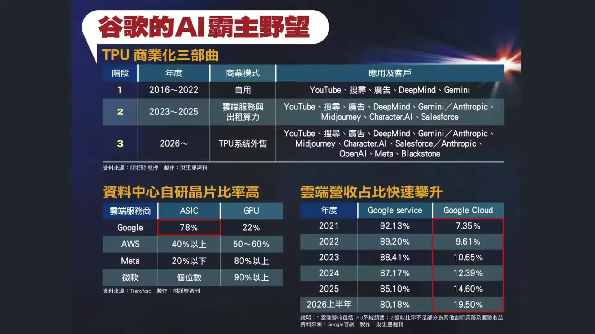

**逐字稿片段：** 那第二是它的自研晶片 我們知道Google之所以有能力 擴大TPU市場 就是因為自研晶片已經 累積相當成熟的技術和規模 我們根據市場統計 現在Google資料中心的AI加速器當中 ASIC大概78% GPU只有22%哦 所以他其實沒有必要買 這麼多輝達的產品 相對之下 微軟有90%還依賴GPU Meta的GPU占比也超過80% 代表Google不只是有在大 語言模型上的領先 它還有高度自主的運算架構 它不會受到輝達 到時候的售價大幅度的捆 榜這也讓TPU具備進一步 對外銷售的條件呢 所以現在輝達 我們講說Google不只是跟 我們講說chatgpt 或者antrohpic來做競爭呢 它其實有更大一部分呢 是在跟輝達來做直接性的競爭 那從這樣的一個效果來做思維 等於是軟硬體雙方都有壓住哦

**話題推測：** 分析Google在自研晶片（TPU）和運算架構上的優勢

---

## 00:27:01

**逐字稿片段：** 那這個時候Google的本意比 從前年我們看到大概 是接近30倍到40倍 現在本益比多少 這是跌 14倍 14倍那就真的很便宜了 我稍微看了一下 前瞻本益比14倍 那等同於過去 搞不好是除了08年09年 本世紀以來的最低哦 你看它股價其實還是很貴 就算跌10% 可是它居然已經迎來了過去 20年來的最便宜的水準了 還不買爆 當然了 不會那麼直接 每個人不同思維哦 也許它跟微軟一樣 給你打底打了大半年了 可是微軟最後也是否極泰來嘛 所以我個人認為 14倍的本益比哦 那比台積電便宜多了 也許市場上 還是有一股潛力持續在發酵 這給投資朋友多做一些觀察了 好所以大家都可以瞭解我們的態度 本身對於本輪的回檔 是保持非常樂觀 非常具有信心態度 我們當然知道有一些 本業收入的風險等等 好但這個本業收入跟其他 傳產股比較起來 風險其實沒這麼大 那第二它真的很便宜 真的很便宜 有時候買一張股票也 不是期待它能夠走多高了 它真的很便宜 你知道受不了了 很想買兩件來看看 好那當然了 最後的效果其實還是來自於 生產力是否能夠有效提升 生產力提升了 一切問題都陸可以陸續解決

**話題推測：** 比較Google目前的本益比與歷史水準

---

## 00:28:23

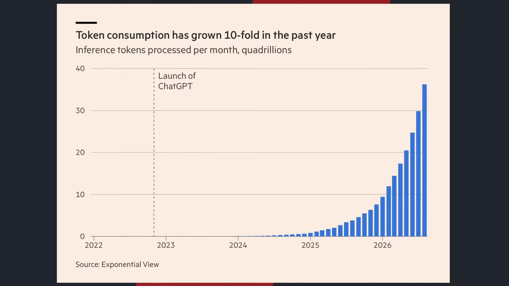

**逐字稿片段：** 我們都知道AI代理人 現在正在改變整個AI產業的成本 現在呢同樣執行一樣任務 你可能最高TOKEN的用量 如果是以AI agent來做觀察的話 使用量大概已經是過去傳統直接做 語言詢問的接近4倍到5倍左右了 今年1-9月份 人類直接操作AI的每週TOKEN使用量 大概是從3兆增加到了接近10兆左右 可是AI agent的TOKEN使用量是從兩兆 暴增到50兆 一個是成長3倍 一個是成長25倍 所以我們才講說 現在市場上很大壓力就是來自 於到底AI代理所消耗的TOKEN呢 你來自於快取輸入嘛 你到底創造了多少營收回饋 這個是給投資朋友做的一些思維 也是大家最為擔心的方向 就是害怕投資太多 但是沒有足夠的營收回饋 可是我又不同的想法 因為我們之前不是聊那個 大陸的AI的短劇嘛 現在越來越紅 我們很多人就擔心嘛 大部分的算力 都去拿去用 做一些這個短劇 或者一些好像對於 生產力沒有直接性的提升 可是人類 本來在AI的生產力初期 他就會面對這種 本來有出奇的浪費 因為你還不確定到底這 項工具到底有多偉大嘛 科技史本就是這樣子 每一次重大技術的革命 最早被大眾拿來使用的 都不是提高生產力 都是可能娛樂投機呀社交 甚至是一些看起來毫無意義的事情 我我們一開始做直播 對應該是做直播都是 謝謝哥哥的火箭 沒有一開始做直播 真的就是開著直播跟大家聊天 你是不期待覺得會有 多大的營收爆發的 但是呢後續就形成一整套的產業鏈 1990年代網路開始普及的時候 很多消費者一開始接觸網絡 難道是每天查維琪百科嗎 每天認真的研究電商系統沒有 那個都後期 一開始電腦普及 大家做什麼 看Ａ片 下載音樂嘛聊天嘛 玩遊戲嘛 那有很多大量的企業 的確建立了入口網站 一開始是沒賺錢的 可是時間拉長 大家總會找到相對的生態系 能夠成長的模式 一開始我們使用Foxy 難道是為了研究 臺灣經濟史的發展嘛 當然是看Foxy裡頭有沒有一些 值得學習的一些日本教程 能夠做觀察嘛 所以本來科技爆發的 初期都是這樣子 AI現在的爆發 好像大家都去生成那個短影音 但是呢 就其實就是初期當中的混亂 1970年到1980年的錄影機哦 其實最受歡迎的一個用途是什麼 有沒有看過那古惑仔系列 色情影片嘛 就是那個錄影機 電影的租賃或者家庭革命呢 它的確推動了設備的普及 很多人覺得浪費呀浪費呀 生產力有什麼革命 你只是原本去電影院看電影 現在變成在家看影看電影吧 你哪有什麼生產力革命呢 誒後來的商業化造成了爆發 1870年的電話革命也是如此覺得 電話沒有像電報那麼 適合正式商業通訊 大部分人都是簡單的 訊息或者私人交談 誒後來包括跨地區的協調 訂單的確認 生產力的提升 客戶成本的大幅降低 其實都是我們看到 一系列的拉伸 我們講就是科技革命 有一個有趣的現象 就是人類拿到新技術之後 第一件事情本來就 不是拿去提高生產力 先拿來玩一玩嘛 電話發明之後先來聊天 廣播發明之後來聽音樂 電腦發明之後來打電動 網路普及之後看Ａ片 現在AI也是一樣 科技巨頭花了 幾千億美元建設資料中心的 結果大家每天跳那個貓咪跳舞 或吉普利圖 有人質疑這麼多的算力有什麼用 回顧歷史來看 本來這就是科技歷史的週期 必然會發生的跡象 所以我覺得也是 不要找那麼多的藉口去懷疑AI 這個科技的爆發它是真的 我們擔心的其實是融資成本的問題 只要融資可控 基本上初期的混亂 我覺得是可以接受的 你也不要找那麼多理由 我們講說 你要找到的利空永遠都找得到 錢永遠是不夠的 活永遠是幹不完的 苦永遠是說不出的 愛永遠是操不完的 我是說心 心永遠是操不完的 你不要擔心一些 未來發生的事情呢 因為它在過去的歷史革命當中 其實都有逐步的展現 給投資朋友做一些思考

**話題推測：** 討論AI代理人對TOKEN使用量和成本的影響

---

## 00:32:51

**逐字稿片段：** 誒最後幾分鐘 臺北股市 好我們看臺指期下跌1,382點哎呦 回到4萬五了 好但不管怎麼說 至少從位階來看 臺北股市還是比 其他韓國股市表現來的強勁 我們就拭目以待 來看一下這一波有什麼機會吧 今天禮拜五 最後我們幾分鐘導讀一本書 每個禮拜五我們都會 推薦一本書給投資朋友 今天推薦這本書叫做為所有人 www支付看到的數位未來 哦這本書的作者就是全球 資訊網的發明人提姆伯納斯 那這本書是描述第一 他如何發明了全球資訊網 以及這位改變世界的科技先驅 現在開始擔憂網路和AI的發展 好這是從1989年要說起 那個時候他還在歐洲的核子研究 組織擔任城市設計師 然後呢使用不同的電腦系統 常常面臨無法溝通的困境 他就提到一個大膽的想法 既然電腦可以透過 網際網路來互相的通訊 為什麼不把 電腦裡面的檔連接起來呢 只要你點一個文字 就能夠跳到另外一份檔 這個就是全球資訊網最核心的概念 那個時候幾乎沒有人理解他的想法 實驗室也不是為了開發網路而設立 不過呢他不斷的向主管爭取資源 最後呢他就架構出了網路架構 市場上當時很多人不明白他在做什麼 結果呢 慢慢的就改變了數十億人的生活 現在AI其實就是如此哦當然呢 他聊到AI的時候 其實反映更多的是反思 他原本希望全球資訊網是一個

**話題推測：** 簡述臺北股市最新表現

---
